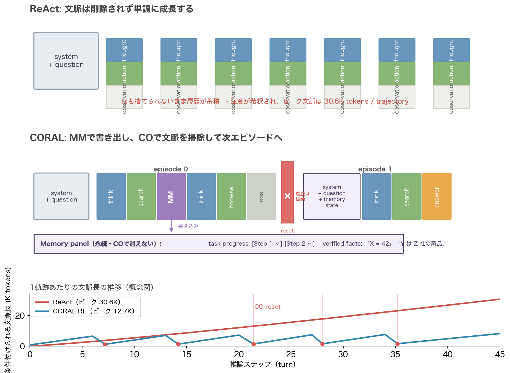
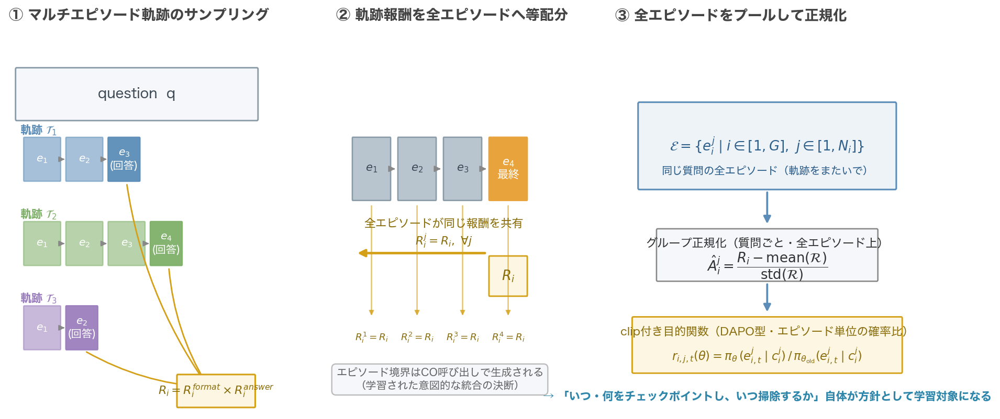
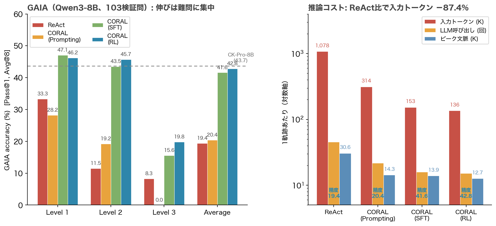
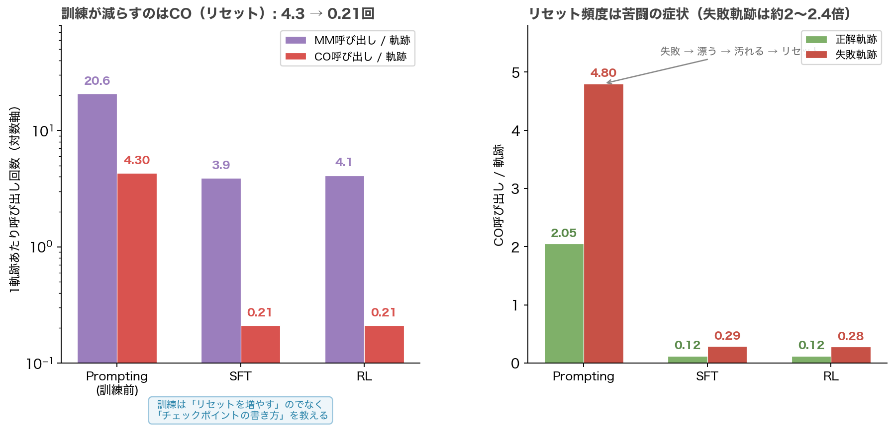

# 忘れるために書き出す──CORALが認知的オフロードで長期エージェントの文脈を自ら整理する仕組み

## TL;DR

ReAct型のLLMエージェントは、長期タスクで必ず同じ場所につまずく。thought–action–observationのループを回すたびに文脈が膨らみ、その大半は失敗した検索の残骸だ。人間ならメモを取って机を片付けるところを、エージェントは何も捨てられないまま全履歴を読み続ける。注意力は有限なのに、である。

CUHK・Tencent・HKUSTのZhuらがCOLM 2026で発表した「Don't Lose the Thread」が提案する**CORAL（Cognitive Resource Self-Allocation）**は、この片付けをエージェント自身の判断に委ねるフレームワークだ。認知心理学でいう**認知的オフロード（cognitive offloading）**──考える途中の状態を紙に書き出して頭の中を空ける──のエージェント版であり、具体的には2つのツールで構成される。

- **Memory Management（MM）**：タスクの進捗と検証済みの事実を永続パネルに書き込む。ADD / MODIFY / DELETEで更新
- **Context Optimization（CO）**：文脈が汚れたと判断したとき、履歴を全廃棄してMMの内容だけを持った新エピソードを開始する

さらに、このチェックポイント行動を強化学習で磨く**Multi-episode ARPO**を提案している。COで区切られたエピソードをまたいで軌跡レベルの報酬を伝播させ、「いつ・何を書き出し、いつ掃除するか」自体を学習対象にする。

結果の見どころは3つある。

- GAIAでQwen3-8Bが**42.8%**（ReAct比+23.4pt）。伸びは最難関のLevel 3に集中（8.3→19.8）
- 精度が2倍以上になるのに、**入力トークンはReActの約1/8**（1,078K→136K/軌跡、−87.4%）。文脈管理はコストではなく精度の源になる
- 訓練すると**リセットは減る**（CO呼び出し4.3→0.21回/軌跡）。学ぶのは「掃除の仕方」ではなく「汚さない書き方」だった

BrowseCompでは訓練なしのClaude Sonnet 4で+8.0pt（30.7 vs 22.7）。強いモデルほど恩恵が大きい。コードは公開されている。

## 背景：汚れるのは文脈、削られるのは注意力

長期タスクでのエージェントの失敗は、個々の推論ステップの失敗というより、文脈の劣化として現れる。論文はこの悪循環を明快に定式化している。計画が不完全 → 間の悪いツール呼び出し → 無関係な環境フィードバックが文脈に堆積 → 推論が劣化 → さらに計画が狂う。一度転び始めると、転んだ痕跡自体が次の転倒の原因になる。

これは認知心理学の古典と構造が同じだ。Kahnemanの注意資源理論、Baddeley and Hitchの作業記憶モデル、Swellerの認知負荷理論──いずれも「保持するものが容量を超えると、難しくないステップまで崩れる」という観察に立つ。人間の定番の対処法が認知的オフロード、つまり途中の状態を外に書き出して、頭の中身を今扱っている部分問題だけにすることだ（Risko and Gilbert 2016）。

既存のLLMエージェント向け文脈最適化は、この書き出しを外側の規則で行ってきた。固定間隔での圧縮（Mem1は関数呼び出しごと）、文脈窓の飽和を検知しての要約（ReSum）、外部モデルによる切り詰め。いずれも「いつ片付けるか」をシステム側のヒューリスティックが決めている。

CORALの立場は違う。**汚れの感じ方を一番よく知っているのは汚している当事者だ**、という立場だ。したがって書き出しも片付けも、エージェント自身がツールとして呼び出す。ルールでも外部コントローラでもなく、エージェント自身のタスク状態の判断から発火する。この一点が、後で見る「学習可能なチェックポイント方針」への扉を開ける。

## 提案手法：書き出すツールと、掃除するツール

### 作業記憶管理ツールセット

CORALは既存のReActループに2つのツールを足すだけだ。環境ツール（Web Search / Web Browse）と並べて、エージェントが呼べるようにする。

**Memory Management（MM）** はチェックポイント機構で、永続的な作業記憶パネルを2区分で管理する。1つは**task progress**（高レベルの計画と、どのサブゴールが終わったか）。もう1つは**verified facts**（推論の過程で確認できた中間結果や発見したエンティティ）。典型的な呼び出しタイミングは3つある。タスク開始時に計画を記録するとき、重要な情報を見つけて事実として保存するとき、サブタスクを完了して進捗を更新するとき。

**Context Optimization（CO）** はハードリセットだ。エージェントが「文脈が長すぎる/古い情報だらけだ」と判断したときに呼ぶと、会話履歴が消去され、現在のメモリ状態がobservationとして返ってくる。次のエピソードの初期文脈は `(s, q, o_t)`──システムプロンプト、元の質問、そしてメモリ状態だけ。堆積したツール出力と推論痕跡は捨てられる。

### マルチエピソード軌跡

COが単一の推論過程を複数の短いエピソードに分割するため、軌跡の定式化も拡張される。N個のエピソードからなる軌跡 $\mathcal{T}=(e_1,\dots,e_N)$ で、エピソード $e_i$ の初期文脈は1番目なら $(s,q)$、以降なら $(s,q,o_{i-1,M_{i-1}})$ ──前のエピソードの最後にMMが書いたメモリ状態を伴う。最終エピソードの最後のthoughtが答えを含んで終了する。

この構造の面白さは、**エピソード間の連続性が構造的に保証されている**ことだ。エピソード2の冒頭文脈は、エピソード1がCOの直前に書いたメモリ状態そのものだから、「どのサブタスクが終わって、どの事実が確定しているか」を正確に引き継いで再開できる。システムプロンプトには「COを呼ぶ前にtask progressを同期せよ」という前提条件が書かれており、古いメモリのままCOを発行すると後続エピソードが不整合になる事故を防いでいる。

### SFT：エピソードに切って教える

まずSFTでチェックポイントの基本動作を仕込む。学習データはWebShaperで難度制御して合成した質問に対し、Claude Sonnet 4にCORALツールセットを持たせて走らせた2,932本のweb軌跡（正解56%・失敗44%を両方保持）に、数学推論241本を足した3,173本。

ここで工夫が必要になる。マルチエピソード軌跡を1つの平らな会話として学習させると、モデルは推論時に絶対に見ない文脈で訓練されることになる。なぜならエピソードごとに初期文脈が違うからだ──1番目は $(s,q)$、2番目以降は $(s,q,\text{メモリ状態})$。そこで**COの境界で軌跡を切り、各エピソードを独立の学習会話にする**。結果、3,173軌跡から3,682会話になる（CO呼び出し509回ぶんだけ増える）。

この分割は単なる利便性ではなく正しさの要求だ、と論文は強調する。しかも分割によって、平らな軌跡では決して現れない2つの状況を監督できる。非終端エピソードは「メモリを保守しながら進み、サブタスクの塊が終わったら文脈を捨てる」こと（CO呼び出し自体が、外部規則ではなく学習されたリセットの決断になる）を教え、後続エピソードは「生の履歴ではなくコンパクトな進捗と事実から再開して、完了済みの仕事をやり直さず次のサブタスクを見つける」ことを教える。損失はobservationトークンをマスクした通常のagent SFTだ。

### Multi-episode ARPO：境界をまたぐ信用割当て

SFTだけでもGAIAの20.4%から41.6%まで跳ねるのだが、論文はさらにRL段を重ねる。DAPOなどの標準的なエージェントRLは単一エピソード軌跡を対象に設計されていて、COで区切られた軌跡にそのまま適用できない。そこで**Multi-episode ARPO**を導入する。

仕組みは素直だ。質問 $q$ にG本のマルチエピソード軌跡をサンプルする。報酬は最終エピソード（答えを含む）から計算し、**それを同じ軌跡の全エピソードに等しく伝播**する（$R_i^j = R_i,\ \forall j$）。そして同じ質問の全エピソード $\mathcal{E}$ をプールし、その上でグループ正規化してアドバンテージを求める。確率比とクリップはエピソード単位で計算するDAPO型で、clip比率は0.2/0.28。KL正則化なし、1プロンプトあたり8サンプル。

報酬設計も意図的に単純で、$R_i = R_i^{format} \times R_i^{answer}$。フォーマット報酬（全ツール呼び出しが有効なJSONか）と、LLM-as-a-Judgeによる正誤判定の積だ。中間ステップへの形状報酬は一切ない。「いつチェックポイントするか」自体を、最終結果だけから間接的に学ばせる。

結果として、エピソード境界をまたいだ信用割当てが可能になり、チェックポイント方針そのもの──何をverified factsに残すべきか、どの時点でリセットするべきか──が最適化対象になる。

## 実験結果

### GAIA：伸びは難問に集中

GAIA検証セット（103問、Level 1が39問・Level 2が52問・Level 3が12問）を1問8回サンプルしたPass@1（Avg@8）で評価する。

| 設定（Qwen3-8B） | L1 | L2 | L3 | 平均 |
|---|---|---|---|---|
| ReAct | 33.3 | 11.5 | 8.3 | 19.4 |
| + CORAL Prompting | 28.2 | 19.2 | 0.0 | 20.4 |
| + SFT | 47.1 | 43.5 | 15.6 | 41.6 |
| + SFT + RL | **46.2** | **45.7** | **19.8** | **42.8** |

プロンプトだけではほぼ効かない。8Bのベースモデルには4ツールのJSONを確実に出す力がなく、フォーマット違反や呼び出しミスが頻発するためだ。SFTが3,173軌跡という少ないデータでこれを解消し、RLがさらに上積みする。

同一8B帯の最強ベースラインCK-Pro-8B（43.7）とは平均で僅差だが、内訳が違う。CK-Proの優位は全部Level 1（56.4 vs 46.2）にあり、**Level 2とLevel 3ではCORALが逆転している**（45.7 vs 42.3、19.8 vs 8.3）。作業記憶の維持にはオーバーヘッドがあって、散らかされる前に終わる短い問題では損になる。平均だけ見ると過小評価される、というのがこの手法の性質だ。

RL段の見た目の利得は+1.2ptと地味だが、論文はこれが二重に過小評価されている指摘をする。第一に利得はLevel 2で+2.2、Level 3で+4.2と効く場所に集中している（Level 1はむしろ微減）。第二にRLは**エージェントを安定させる**。実行間の標準偏差が3.5%→1.9%に減り、8回の最悪実行が36.9%→39.8%に上がる。一方でPass@8とMaj@8はわずかに下がる（71.8→68.9、46.6→44.7）。つまりRLは「稀に当たる尖った成功」を「着実に届く成功」に質転換させる。配信を考えるとこれは大きな差だ。

強いモデルに適用しても効く。Claude Sonnet 4では訓練なしのPromptingだけで60.2→65.0（Level 3は25.0→33.3）で、OpenAI Deep Research（67.4）に肉薄する。バックボーン横断ではQwQ-32Bで+5.8、Claude Sonnet 4で+4.8と、能力のあるモデルほど得をし、JSONを出せないQwen2.5-7B-Instructは−3.9と逆に落ちる（SFTすれば34.4まで回復）。

### コスト：トークンは1/8、精度は2倍

824本の全評価軌跡を計測した内訳が秀逸だ。

| 設定 | 入力トークン | LLM呼び出し | ピーク文脈 | MM | CO | GAIA |
|---|---|---|---|---|---|---|
| ReAct | 1,078K | 45.3 | 30.6K | – | – | 19.4 |
| Prompting | 314K | 21.8 | 14.3K | 20.6 | 4.3 | 20.4 |
| SFT | 153K | 15.9 | 13.9K | 3.9 | 0.21 | 41.6 |
| RL | **136K** | **15.2** | **12.7K** | 4.1 | 0.21 | 42.8 |

コスト削減には2つの機構が重なっている。直接的にはCOリセットが文脈長の上限を縛り、ピークを30.6K→12.7Kに抑える。ReActループは毎ターン全履歴を読み直すのでコストがターン数の2次で増えるが、文脈に上限をかけるとその支配項を直接攻撃できる。もう一つはより強力で、**計画と検証済み事実を書き出したエージェントは、知っていることを再検索しなくなる**。ターン数自体が45.3→15.2と3分の1に減る。

### 訓練はリセットを減らす

ここが本論文で一番好きな分析的発見だ。COが仕組みの中核なら、なぜ訓練されたエージェントのCO呼び出しは0.21回/軌跡で、訓練前の4.3回の20分の1しかないのか。

答えは**訓練が教えるのはリセットの増やし方ではなく、チェックポイントの書き方だ**、ということ。MMの書き込みが的確なエージェントは、リセットを正当化するような散らかりをそもそも溜め込まない。MM呼び出しも20.6回から4回へ激減するが、これも同じ理由で、未訓練モデルはほぼ毎ステップ同じ内容を書き直していたのが、訓練後は少数のよく選ばれたチェックポイントだけを書くようになる。

さらに成否別に割ると、**失敗軌跡は正解軌跡の約2〜2.4倍リセットしている**（RLで0.28 vs 0.12）。因果の向きは難しさ→リセットであって、その逆ではない。うまくいっていない軌跡はさまよい、汚れを溜め、リセット条件を満たす。「リセット頻度は maximise するレバーではなく、苦闘の症状」という読みが正しいなら、訓練でCO使用が20分の1になり精度が20点以上上がる、という結果と整合する。

### 汎化：Knowledge QAとBrowseComp

GAIAと同じRLチェックポイント（web合成+数学だけで訓練）を、マルチホップQA5種にそのまま適用すると、NQ 71.0、HotpotQA 70.4、2Wiki 79.2、Musique 43.2、Bamboogle 79.2。Search-o1、R1-Searcher、DeepResearcher、SimpleDeepSearcherを一通り上回る（SimpleDeepSearcherの2Wiki 79.8のみ僅差で上）。チェックポイント技能は訓練分布に縛られず転移する。

ただし著者自身が認める通り、このスイートは「散らかりにくい」問題が多く、文脈管理の主張の検証としては弱い。そこで**BrowseComp**──多数ホップの探索なしには答えられない質問だけのベンチマーク──で最初の150問をClaude Sonnet 4（訓練なし）で評価する。検索・閲覧ツールを同一にして、MM/COの有無だけを変えた統制比較で、CORALが30.7% vs ReAct 22.7%と**+8.0pt**。全ベンチマーク中最大の利得が、訓練ゼロで出る。

付録のケーススタディが生々しい。ReActは序盤で間違ったエンティティに確定してしまい、42件の検索結果の下にその誤った前提を埋もれさせてもう見つけられない。CORALは検証のたびにエンティティをチェックポイントしていたので、間違いに気づいて回復する。

### 消融：不正解軌跡にも過程の価値がある

SFTデータの消融が丁寧だ。フル設定41.6%から数学241本を外すと39.9%（−1.7、Level 2に集中──検索では教わらない中間計算の移転）。不正解軌跡1,290本を外すと39.3%になるが、これはデータ量の減少と混在している。そこで**同量2,030会話のランダムサブサンプルを統制に置く**と36.5%。つまり1件ずつなら正解軌跡のほうが質が高いのに（39.3 vs 36.5）、全量にはさらに+2.3上乗せできる。

解釈は、観測マスク付きの行動クローンが監督するのは**結論ではなく過程**だ、というものだ。最後のホップでエンティティを見誤る前まで、計画を立て、せっせとチェックポイントしていた軌跡は、こちらが入れたい技能のほとんどを示している。

## 考察

### 履歴は相互検証チャネルである

付録D.2のメモリ破損実験が、CORALの設計に潜む緊張を露呈させる。成功軌跡の途中でメモリ項目を人為的に改変して、エージェントが気づくかを調べたのだが、結果が破損の時点できれいに分かれる。

- **計画直後の破損は黙って受け入れられる**。まだ証拠が集まっておらず、もっともらしい計画は本人が書いた計画と区別がつかない
- **軌跡途中の破損はしばしば検出される**。その事実を生んだ検索結果が会話履歴にまだ残っているから
- **リセット後の破損は原理的に検出不能**。裏付け証拠はCOで消えており、どれだけ後から推論しても矛盾を浮かび上げる材料がない

ここから導かれる設計原則が、MMとCOの**非対称性**だ。会話履歴はメモリパネルの冗長コピーではなく、相互検証のチャネルとして機能している。MMは履歴を残したまま焦点だけを研ぐので気軽に使え、COは自己監査能力を切り捨てる取引なので、本当に手に負えなくなった文脈のために取っておくべきものだ。訓練済みモデルの行動──MM 4回に対してCO 0.21回──は、まさにこの処方に一致する。この一致は明示的に最適化した結果ではなくデモンストレーションから学んだものだ、と著者は率直に書いている。

### 等配分の限界

Multi-episode ARPOの報酬伝播は、全エピソードへの等しい放送（broadcast）という最も単純な方式だ。著者自身が「自分たちの動機と緊張する」と認める部分で、生産的な基礎作業と失敗の回り道が混在する軌跡では、両者を同じ報酬で扱うことは区別を捨てることにあたる。

では長期RLの定番である割引を前のエピソードにかけたらいいかというと、それも安易すぎる、という議論が面白い。CORALのエピソード境界は恣意的な時点ではなく、**COという意図的で学習された統合の決断が作るもの**だからだ。前のエピソードは「間違えたかもしれない初期の試み」ではなく、タスク分解と事実発見と検証を行う構造化された準備段階であり、後のエピソードの成功を直接可能にしている。割引をかけると、CORALが入れようとしている行動そのものを妨害する。

本当の前進には、個々のエピソードの質──後のエピソードが実際に使った検証済み事実をどれだけ含むか──を評価する原理が必要で、それはエピソードレベルの報酬モデルか貢献度重視方式になるだろう、と今後の課題としている。

### 出処を携帯するメモリへ

もう一つの限界は、作業記憶が構成上**権威的**であることだ。チェックポイントされた事実を疑う仕組みがフレームワークに存在しない。この失敗モードの具体例が上の破損実験で、解決方向として著者が挙げるのが、各事実がその成立根拠へのポインタを運ぶ**provenance-aware memory**──リセット後に再取得・再検証できる出処つきメモリだ。低品質なソースからチェックポイントされた事実が、どこから来たかの記録なしに軌跡の残りを伝播する、という配信時の問題にも通じる。

## 関連研究

**文脈圧縮系**との違いが本質的だ。Mem1は関数呼び出しごとに圧縮をかける。長さの制御には効くが、硬いスケジュールで動くため有用な情報を捨てたり高レベルの計画を乱したりする。CORALは圧縮のタイミングをタスク状態からの判断に委ね、「やる価値があるときにだけ」圧縮が起きる。MemAgentは固定長の長い入力を漸進処理する系統で、エージェント的設定とは文脈の伸び方が違う（静的か動的か）。

本ブログで既読の系譜との関係で言うと、まず**Mosaic**（マルチセッション・エージェンティックRL）との対比が示唆的だ。Mosaicはcompactionやsubagent forkingが破壊する「単一セッション」前提を一般化するために、軌跡レベルとセッションレベルの階層的最適化を必要とした。CORALは逆方向から攻めていて、エージェント自身がCOでエピソードを区切ることで、区切り自体を学習可能な行動にしてしまう。セッションを分割する主体が外側か内側か、という違いがRLの設計をまるごと変える好例だ。

**StateTrack-Bench**が測ったのは、長期対話で制約を覚えていても守らない「状態整合性崩壊」だった。CORALのメモリパネルはまさにこの「覚えているものを明示的に保守する」装置だが、破損実験が示す通り、明示的ながら権威的すぎる記憶には新たな脆さがある。**PoS（明示的信念状態）**が状態を外部化して長期実行を支えたのと同型の利益を取りにいく一方で、**The Memory Trap**が指摘した「書いたものが独り歩きする」リスクと隣り合わせでもある。そして実務面では、**SpecCompact**が扱ったコンパクションの計算コスト問題を、CORALは「そもそも汚さない」方向から回避している。

## まとめ

CORALは、長期タスクのエージェントに認知的オフロードを教える。道具は2つで、進捗と検証済み事実を書き出すMMと、文脈を掃除してメモリだけ持って再開するCO。区切り（エピソード）をまたいで軌跡報酬を伝播するMulti-episode ARPOで、チェックポイント方針そのものをRLの対象にする。

数字の並びが物語っている。精度は2倍を超えて伸び、伸びは最難関に集中し、入力トークンは8分の1に減る。訓練するとリセットは20分の1に減る。つまり**注意力の管理は精度のために払う税ではなく、精度の供給源だ**、というのがこの研究の主張の核で、私はこれに同意する。

一方で、等しい報酬放送は最初の一歩にすぎず、エピソード品質の評価という難問が残る。そして破損実験が見せた「リセット後の記憶は原理的に検証不能」という性質は、MM/COの非対称な使い方で緩和はできるが解決ではない。出処を携帯するメモリが次に来るものだろう。忘れるために書き出す、の先には、書いたものを疑うための工夫が待っている。

## 参考

- Zhu, Z., Liang, X., Chen, X., Yu, B., Jia, J. "Don't Lose the Thread: Empowering Long-Horizon LLM Agents with Cognitive Resource Self-Allocation." COLM 2026. arXiv:2610.40350
- コード: https://github.com/JIA-Lab-research/CORAL
- Yao, S. et al. "ReAct: Synergizing Reasoning and Acting in Language Models." 2022.
- Zhou, Z. et al. "MEM1: Learning to Synergize Memory and Reasoning for Efficient Long-Horizon Agents." 2025.
- Yu, Q. et al. "DAPO: An Open-Source LLM Reinforcement Learning System at Scale." 2025.
- Tao, Z. et al. "WebShaper: Agentically Data Synthesizing via Information-Seeking Formalization." 2025.
- Wei, J. et al. "BrowseComp: A Simple Yet Challenging Benchmark for Browsing Agents." 2025.
- Risko, E. F., Gilbert, S. J. "Cognitive Offloading." Trends in Cognitive Sciences, 2016.
- Baddeley, A. D., Hitch, G. "Working Memory." Psychology of Learning and Motivation, 1974.
