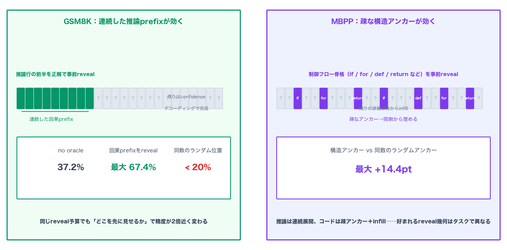
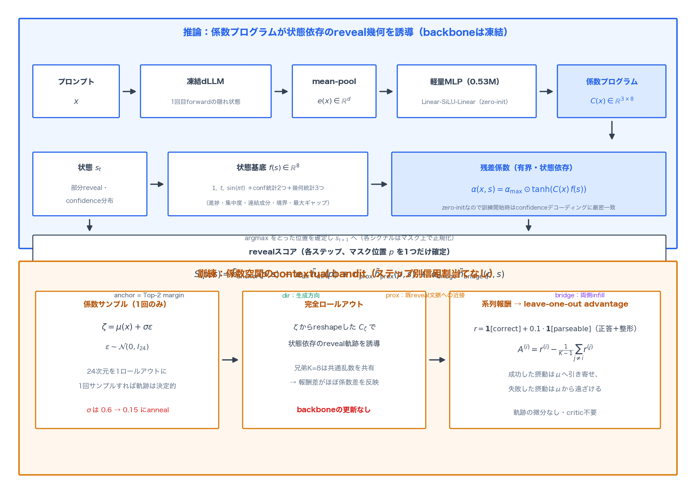
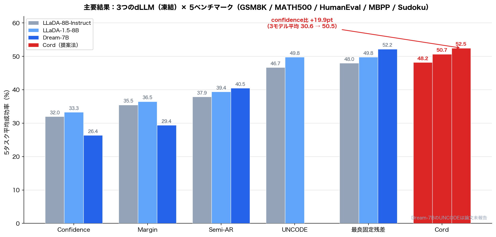
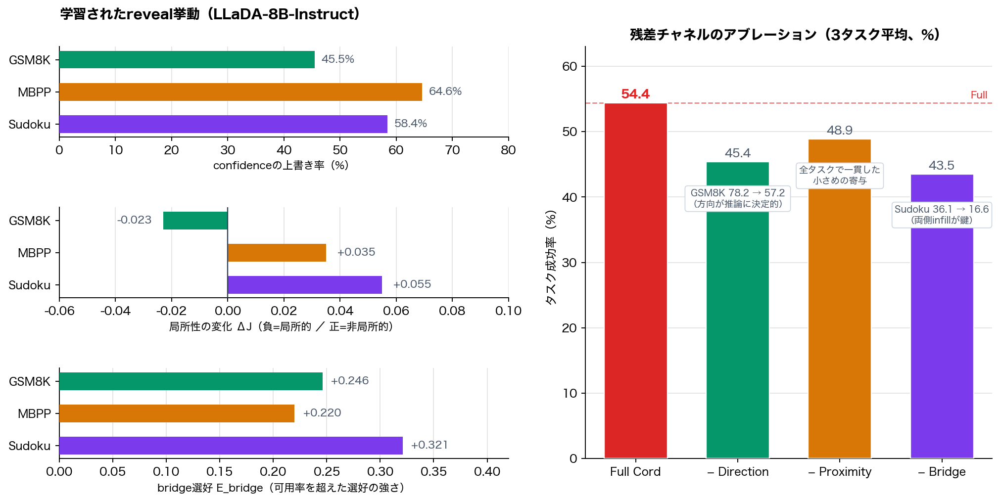

# 自信のある位置が有用な位置とは限らない──Cordがマスク拡散LMのreveal順序を幾何残差で学習する仕組み

## TL;DR

マスク拡散言語モデル（dLLM）は、マスクされた応答位置をどの順序で確定（reveal）していくかを自由に選べる。多くのデコーダが使うのはconfidence、つまり「今その位置の予測がどれだけ決まりきっているか」という統計量だ。しかしconfidenceは予測の決定性であって、その位置を先に確定することが後続のデコーディングにどれだけ役立つかとは別物である。本論文が提案する**Cord（Confidence-Anchored Order Residual Decoding）**は、confidence（Top-2 margin）を安定な基準として保持したまま、生成方向・既確定文脈への近接・両側infillという3つの幾何シグナルへの有界な残差を重ね、プロンプトとデコーディング状態に応じて「いつ・どの程度confidenceから逸脱するか」を学習する。探索を24次元の係数空間に置くことで系列報酬からのcontextual banditとして訓練でき、backboneは完全に凍結したまま、3つのdLLM・5ベンチマークで平均成功率30.6%→50.5%を達成。追加パラメータはわずか0.53M、推論レイテンシの増加も5.39%にとどまる。

- 論文: [Cord: Confidence-Anchored Order Residual Decoding for Masked Diffusion Language Models](https://arxiv.org/abs/2610.39372)（arXiv:2610.39372、2026年10月29日）
- 著者: Chengwei Zhou（Case Western Reserve）、Zhaoyan Jia（USC）、Massoud Pedram（USC）、Gourav Datta（Case Western Reserve）

## 背景：reveal順序は品質を左右する

ARモデルと違い、マスク拡散言語モデルは応答を厳密に左から右へ生成する必要がない。各ステップで「どのマスク位置を次に確定するか」を選べる。この自由度は一見どうでもよく見えるが、有限の事前学習済みモデルでは無視できない。Kim et al. (2025)の報告が象徴的だ。ランダムなunmaskingをtop-2確率マージンによる順序に変えるだけで、Sudokuの精度が7%未満から約90%へ跳ね上がる。一方、自然言語推論への効果はずっと小さい。

この差は何を意味するか。**reveal順序はデコーディング戦略の一部であり、最適な戦略はタスクに依存する**——これが本論文の出発点である。

一般に使われるconfidence系のスコア（最大確率、Top-2マージン、負エントロピー）には共通の限界がある。dLLMのforwardパスから追加コストなしで得られ、「いま確定しても迷いが少ない位置」を特定できる点では優れている。しかし、ある位置を先に確定することの価値は、その位置の現在の周辺分布の決定性では測れない。論文の付録Cはこの点を丁寧に扱っている。位置$p$を確定する下流への影響は、残りのマスク位置$q$の予測分布がどれだけ動くか——つまり$\mathrm{KL}(P_q(\cdot \mid s, Y_p) \| P_q(\cdot \mid s))$の総和——であって、confidence統計はこの量と直接は結びつかない。推論のような逐次的な依存が強いタスクでは推論連鎖を延長する方が効き、構造化生成では遠くの骨格を先に置いて後から埋める方が効くかもしれない。

## 予備診断：同じ予算でも「どこ」が効く

著者らはまず、学習を持ち出す前に、この直感を検証するoracle診断を行っている。backboneを凍結したLLaDAで、生成前に選んだ正解トークンをいくつか「先読み」として与え、残りを通常のconfidenceデコーディングで完成させる。比較対象は、同じトークン数をランダムな位置に与える統制条件だ。

結果は明快である。

- **GSM8K**では、推論行の前半（最終行と答えを除く）を正解で事前revealすると、精度が37.2%から最大67.4%まで上昇する。同じトークン数でもランダムな位置に置けば20%未満に留まる。
- **MBPP**では、`if`・`for`・`return`のような制御フロー骨格を事前revealすると、トークン数を合わせたランダムアンカーより最大14.4ポイント上回る。

同じreveal予算でも、情報を「どこ」に置くかで完成品質が大きく変わる。しかも好まれる置き方がタスクごとに異なる——推論は連続した因果prefix、コードは疎な構造アンカー。単一の固定的なreveal規則で全部を賄えるはずがない、という動機がここから導かれる。

既存の学習ベースのアプローチ（RLで系列報酬からreveal順序を直接学ぶもの、プランナーネットワークを追加するもの）は、位置レベルの逐次的意思決定を最終報酬のみから最適化するため、巨大な行動空間と長期的な信用割当て問題に直面する。プランナーはステップ毎に計算を上乗せするし、backboneを同時更新すれば訓練コストが膨らむ。Cordはこの対極を行く。

## 提案手法：Cord

### confidenceアンカーと3つの幾何シグナル

Cordのrevealスコアは次の形をとる。

$$
S(p, s) = \tilde{h}_{\mathrm{anchor}}(p, s) + \alpha_{\mathrm{dir}}\, \tilde{h}_{\mathrm{dir}}(p) + \alpha_{\mathrm{prox}}\, \tilde{h}_{\mathrm{prox}}(p, s) + \alpha_{\mathrm{bridge}}\, \tilde{h}_{\mathrm{bridge}}(p, s)
$$

各ステップで$S$が最大のマスク位置を1つだけ確定する。第一項のanchorは通常のconfidence（Top-2マージン、$\pi_p(v_1) - \pi_p(v_2)$）で、マスク位置上で正規化したものを使う。残る3項が幾何残差で、それぞれ解釈がはっきりしている。

- $\tilde{h}_{\mathrm{dir}}$：位置インデックスを$-1$〜$+1$に正規化したもの。係数が負なら左優先（AR的）、正なら右優先の順序に傾く。
- $\tilde{h}_{\mathrm{prox}}$：既に確定した応答位置への最小距離。負の係数は局所的な継続（既確定箇所の近くを埋める）を、正の係数は非局所なシーディング（遠くに目印を打つ）を好む。
- $\tilde{h}_{\mathrm{bridge}}$：両側が既に確定済みの位置を示す指示関数。正の係数は両側からのinfillを促す。

各シグナルは現在のマスク位置集合上で平均・分散により正規化され、分散がほぼ一定（$10^{-4}$未満）のシグナルは増幅されず0に抑制される。重要なのは、これらの残差が**ランキングを修正するだけで位置を除外しない**ことだ。ハードなルーティングではなく、confidenceという強い事前に対する摂動として設計されている。

### 24次元の係数プログラム

残差係数$\alpha_{\mathrm{dir}}, \alpha_{\mathrm{prox}}, \alpha_{\mathrm{bridge}}$を、プロンプト$x$とデコーディング状態$s$の両方に依存させて変化させたい。しかし每ステップで新しい政策行動をサンプルすると、また逐次的意思決定の問題に戻ってしまう。Cordの解決策は、**1つの低次元行列でロールアウト全体を誘導する**ことだ。

具体的には、8次元の状態基底

$$
f(s) = [\,1,\ t,\ \sin(\pi t),\ F_{\mathrm{mean}},\ F_{\mathrm{conc}},\ F_{\mathrm{comp}},\ F_{\mathrm{bound}},\ F_{\mathrm{gap}}\,]
$$

を用意する。$t$は応答の既確定割合。$F_{\mathrm{mean}}$と$F_{\mathrm{conc}}$はconfidence分布の水準と集中度（90%分位点と中央値の差）を要約し、残りの3つはreveal幾何——連続確定成分の数、両側確定済みマスクの割合、最大の連続マスク連長——を要約する。プロンプト側は、最初のbackbone forwardのプロンプト隠れ状態をmean-poolした$e(x)$から、2層MLP（隠れ128次元・SiLU）で係数行列$C(x) \in \mathbb{R}^{3 \times 8}$を予測する。残差係数は

$$
\alpha(x, s) = \alpha_{\max} \odot \tanh(C(x)\, f(s))
$$

として得られ、$\alpha_{\max}$が各補正の大きさの上限を縛る。つまり**プロンプトが「どの係数プログラムを使うか」を決め、状態が「そのプログラムをどう発現するか」を決める**。$3 \times 8 = 24$次元。MLPの最終層はゼロ初期化されるため、訓練開始時点でCordはconfidenceデコーディングに厳密に一致する。学習とは「既知の良い基準からの学習付きの逸脱」そのものだ。

### contextual banditとしての訓練

教師となる正解reveal順序は存在しない。戦略の良し悪しは、生成が完了して初めて分かる。Cordはここで、探索を係数空間に置く。プロンプトごとに24次元の摂動

$$
\zeta = \mu(x) + \sigma\epsilon, \quad \epsilon \sim \mathcal{N}(0, I_{24})
$$

を1回だけサンプルし、これをreshapeした$C_\zeta$でロールアウト全体を実行する。$\zeta$が決まれば以降のreveal判断はすべて決定的なので、文脈$x$に対して単一の行動$\zeta$を取り、系列報酬$r$を受け取る——教科書どおりのcontextual banditである。ステップレベルの信用割当ては不要になり、ポリシー勾配は離散reveal軌跡を一切通らない。

報酬は正答指示関数を主軸に、パース可能な出力との区別のための小さな整形項（$\lambda_{\mathrm{fmt}} = 0.1$）を足したもの。数学は答え抽出と記号的同値性、コードはサンドボックスでのテスト実行、Sudokuは手がかり保存と行・列・ブロック制約の検証で判定する。同じプロンプトから$K=8$個の兄弟ロールアウトを生成し、leave-one-outのグループ相対アドバンテージ$A^{(i)} = r^{(i)} - \frac{1}{K-1}\sum_{j \neq i} r^{(j)}$で比較する。兄弟間では係数以外の乱数を共有するため、報酬差がほぼ係数差を反映する（付録Bの命題6がこの分散削減をきちんと示している）。著者らはアドバンテージをグループ内標準偏差で正規化しない。バイナリ報酬では、全員一致に近いグループ内の単独の成功/失敗が$\sqrt{K}$オーダーに増幅されてしまうためだ。全兄弟が同点なら$A^{(i)} = 0$で、そのグループは勾配に寄与しない。

### なぜ係数空間なのか：区分定数な報酬地形

この定式化の理論的な裏付けが付録Bだ。top-1 revealは係数空間を「同じreveal軌跡を誘導する領域」に分割する。最高スコアと2位の間に厳密なギャップがある限り、その近傍では係数を動かしても軌跡・生成・報酬がすべて不変である（命題3）。したがって報酬は係数に関して区分定数となり、$\zeta$を$\mu$から微分でつなぐpathwise勾配は、領域内部では常にゼロ（系1）。さらに探索スケール$\sigma$を0に近づけると、すべてのサンプルが同じ領域に落ち、グループ報酬が一致して学習シグナルが消える（命題5）。実際の訓練でも$\sigma$は0.6から0.15へannealするが、0にはしない。「区分定数地形の上では、領域間を跳ぶ確率を保つ探索が学習の前提条件になる」という、シンプルだが本質的な観察である。

## 実験結果

### 主要結果：3つのbackboneで一貫した改善

評価はLLaDA-8B-Instruct、LLaDA-1.5-8B、Dream-7Bの3つのdLLM（いずれも凍結）× GSM8K・MATH500・HumanEval・MBPP・Sudokuの5ベンチマークで行われた。依存構造が質的に異なる3領域——逐次的推論、構造と局所完成の混在、稠密な非局所制約——を意図的に選んでの中核仮説（単一のrevealバイアスはどこでも最適ではない）への検証である。

| Backbone | Confidence | Margin | Semi-AR | UNCODE | 最良固定残差 | Cord |
|---|---|---|---|---|---|---|
| LLaDA-8B-Instruct | 32.0 | 35.5 | 37.9 | 46.7 | 48.0 | **48.2** |
| LLaDA-1.5-8B | 33.3 | 36.5 | 39.4 | 49.8 | 49.8 | **50.7** |
| Dream-7B | 26.4 | 29.4 | 40.5 | — | 52.2 | **52.5** |

3モデルの平均で、confidenceデコーディングの30.6%からCordの50.5%へ、+19.9ポイント。Dream-7Bでの伸びが特に大きい（26.4%→52.5%）。興味深いのはDream-7Bではentropyデコーディングが異常に強い（45.8%）ことだが、Cordはそれをも上回る。Semi-AR（半自己回帰的なブロック生成）がSudokuでほぼ全滅する（0.0〜0.3%）のに対し、Cordは柔軟な順序を保ちながら全領域で戦える。

注目すべき対照として「最良固定残差」がある。これはCordと同じ幾何シグナルを使うが、係数をプロンプト・状態に適応させず、ドメインごとに最良の固定値を選ぶ統制条件だ。Cordはこれを平均50.0%から50.5%へ上回る。差自体は0.5ポイントと控えめだが、**同じシグナルを使いながら適応によってなお上乗せが可能**であることを3backboneで一貫して示している。幾何シグナルの導入が利得の大部分、プロンプト・状態適応がその上の追加分、という誠実な分解と言える。

### 適応の分解

アブレーションでは、適応の成分を切り分けている。固定残差（プロンプトなし）46.1%、プロンプトのみの静的残差46.0%、時間基底のみ46.9%、状態特徴のみ42.2%に対し、フルのCordは50.5%。時間進行と状態フィードバックの**両方**が揃って初めて最大効果が出る。状態のみ（42.2%）が固定残差（46.1%）を下回るあたり、中途半端な適応はむしろ有害になり得ることも示唆される。

### 学習されたreveal幾何はタスク依存

訓練後のCordが実際にどんな順序でrevealしているか、行動監査で調べた結果が面白い。

同一状態で比較して、Cordはconfidenceだけの選択と異なる位置をGSM8Kで45.5%、MBPPで64.6%、Sudokuで58.4%のステップで選んでいる。つまり学習された残差は実質的に順序を書き換えている。その結果の幾何はタスクで分かれる。GSM8Kはわずかに局所的（$\Delta J = -0.023$）、MBPPとSudokuは非局所的（$+0.035$、$+0.055$）へ傾く。そして全タスクでbridge選好が正（$+0.246$〜$+0.321$）——両側確定済みの位置を、可用率が予測する以上に積極的に選んでいる。推論では局所的な連鎖の延長、コードと制約充足では非局所なアンカー＋infillという、oracle診断が予言したパターンそのものが、系列報酬だけから**創発**している。

残差チャネルのアブレーションもこの物語と整合する。3チャネルの平均（GSM8K・MBPP・Sudoku）は、フル54.4%に対して方向を除くと45.4%（GSM8Kが78.2%→57.2%へ落ちる）、bridgeを除くと43.5%（Sudokuが36.1%→16.6%へ落ちる）。方向は推論に、bridgeは制約充足に決定的で、近接は全タスクで一貫した小さめの寄与をする。3つは相補的であり、どれか1つで代替できるものではない。

### 効率とremasking系との対比

H200 1枚・256トークン生成での計測では、confidenceデコーディングの6.31秒に対してCordは6.65秒、オーバーヘッド5.39%。追加のbackbone forwardはゼロで、係数予測は応答ごとに1回、幾何スコアは各ステップでマスクから安価に計算できる。訓練時の係数パラメータは527,512個（0.53M）。

付録での比較も示唆的だ。一度確定したトークンを再マスクして修正するremasking系（CORE、SCOPE+D3IM、RemeDi）に対し、Cordは**厳密に単調**——一度revealしたトークンは決して書き換えない——で、backboneも更新しない。それでもCOREを4ベンチマークすべてで大きく上回り、backboneを修正可能に訓練したSCOPE+D3IMをも上回る（RemeDiのRemask-SFT 86.3%には及ばないが、これはremask向けにbackbone自体を事後訓練した強力な設定だ）。「後から修理する」経路と「確定の質を上げる」経路は相補的で、Cordは後者のみで相当量を回復できる、というのが著者らの読みである。

## 考察

この論文の肩書きは「reveal順序の学習」だが、方法論として印象的なのは設計思想の階層性だ。第一層は「confidenceを捨てない」。Sudokuで7%→90%を達成したTop-2マージンをanchorとして保持し、残差は有界で、ゼロ初期化で出発する。第二層は「探索を24次元に閉じ込める」。ロールアウト全体を1つの係数プログラムで決定的に誘導することで、長期的信用割当ての問題をcontextual banditに帰着させる。第三層は「理論で裏打ちする」。区分定常数地形の議論は、なぜ$\sigma$を0にできないか、なぜpathwise勾配ではなくscore-function推定量なのかを明確に答える。付録Bの命題群は装飾ではなく、設計選択の必然性の説明になっている。

一方で率直に見れば、「最良固定残差」にほぼ並ばれている点は留保として記録されるべきだろう。ドメイン毎に固定係数を探索するだけで平均50.0%に達し、適応の上乗せは+0.5ポイントだ。実運用でドメインが既知なら固定残差で十分な場面も多い。それでも、(1)係数が1つの表現に収まる領域横断の単一モデルで済む、(2)同一ドメイン内でも入力ごとの好みが変わる状況に対応できる、(3)backboneごとに再訓練せざるを得ない固定値探索と違い、政策は軽量で済む、という実用上の差は残る。夢の適応revealよりも、幾何シグナル3種の汎用性の発見の方が、この論文の長く残る貢献かもしれない。

限界も挙げておく。まず、扱うのはreveal順序のみでトークン予測自体は不変。remasking系やsampler-matched訓練（RemeDi、SCOPE）との組み合わせは未探索のまま残されている。次に、評価はLLaDA系とDream-7Bに限られ、マスク拡散系のより新しい大型モデルでの検証は今後の課題だ。第三に、top-1 reveal（1ステップ1位置）の設定に固定されており、ブロック並列revealとの組み合わせ（Fast-dLLM系の加速との直交性）は明示的に検討されていない。efficiency系の文脈では、Cordは品質を上げる側の手法であって、速度を上げる側ではない。

それでも、「どこを先に確定するか」がこれほど効くというoracle診断の結果（GSM8Kでランダム比3倍超）は、dLLMの推論研究にとって忘れてはいけない測定点になるはずだ。

## 関連研究

- **Confidence系デコーディング**: MaskGIT (Chang et al., 2022) 以来の流れ。最大確率・Top-2マージン・負エントロピー、ブロック単位のスケジュール（Fast-dLLM、DSB、EB-Samplerなど）。境界トークン・自明トークンへのバイアス（UNCODE）、高エントロピー接続詞の先送りが推論軌道を変える問題（Ni et al., 2026）など、confidence中心主義の限界を指摘する研究は増えている。
- **学習ベースのreveal順序**: プランナーネットワーク（Peng et al., Think-while-you-generate）、oracle順序の蒸留（Asano et al.）、系列報酬RL（dLaDiff、DiffPo、Dultra、Scheduling Thoughts）。いずれも位置・ステップレベルの意思決定を扱い、信用割当てと計算コストの問題を抱える。Cordは「係数空間のbandit」という3番目の道を示した。
- **Remasking系**: 確定済みトークンの再マスクと修正（CORE、SCOPE+D3IM、RemeDi）。「確定を良くする」Cordと「後から直す」この系統は相補的。
- **本ブログの既報とも近い**: Masked Diffusion LMの自己蒸留効率化（Pivot-SD、2026-10-05公開）やARモデルの無損失高速化（Uno、2026-09-09公開）と同じく、dLLMの「順序の自由度」を資源として活かす系譜に属する。

## まとめ

Cordは、マスク拡散言語モデルのreveal順序学習を「confidenceアンカー＋有界な幾何残差＋係数空間のcontextual bandit」という3つの工夫で軽量に解いた。backboneを一切更新せず、0.53Mパラメータと5.39%のレイテンシで、3つのdLLM・5ベンチマーク平均の成功率を30.6%から50.5%へ引き上げた。行動監査により、推論では局所継続、コードと制約充足では非局所アンカー＋両側infillという、タスク依存のreveal幾何が系列報酬のみから獲得されることも確認された。

「モデルが自信を持つ場所」と「先に確定する価値のある場所」は別物である。この乖離を、置き換えではなく摂動として埋める——その実装がいかに軽量になり得るかを示した点で、dLLMデコーディングの設計に残る一つの規範になる論文だと感じた。

## 参考

- Zhou, C., Jia, Z., Pedram, M., & Datta, G. (2026). Cord: Confidence-Anchored Order Residual Decoding for Masked Diffusion Language Models. [arXiv:2610.39372](https://arxiv.org/abs/2610.39372)
- Kim, J., Shah, K., Kontonis, V., Kakade, S., & Chen, S. (2025). Train for the Worst, Plan for the Best: Understanding Token Ordering in Masked Diffusions. [arXiv:2502.06768](https://arxiv.org/abs/2502.06768)
- Nie, S. et al. (2025). Large Language Diffusion Models. NeurIPS 2025.（LLaDA）
- Ye, J. et al. (2025). Dream 7B: Diffusion Large Language Models. [arXiv:2508.15487](https://arxiv.org/abs/2508.15487)
- Chang, H. et al. (2022). MaskGIT: Masked Generative Image Transformer. CVPR 2022.
