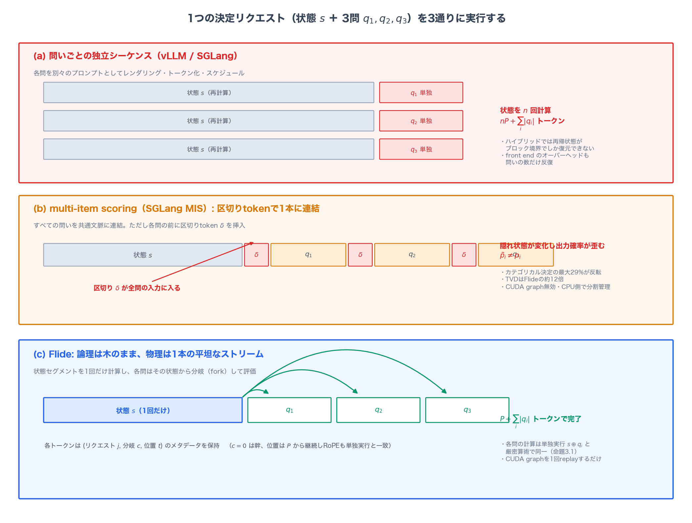
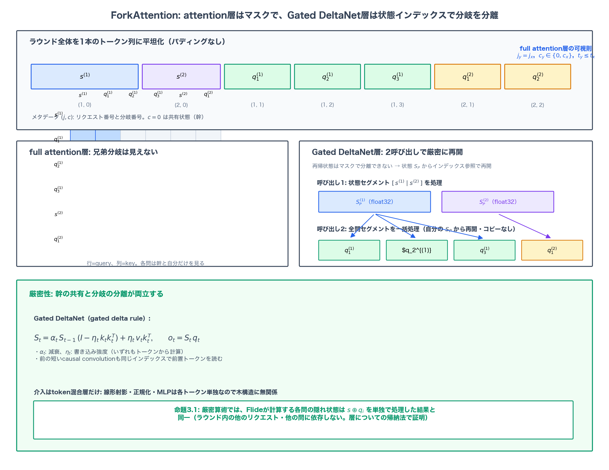
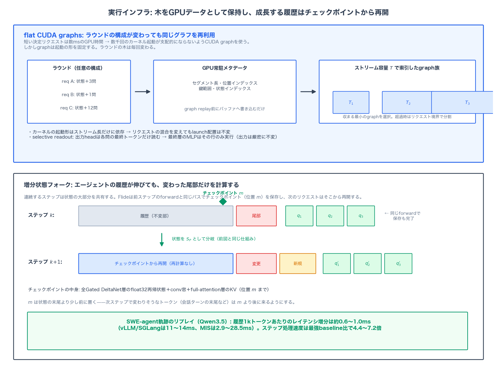
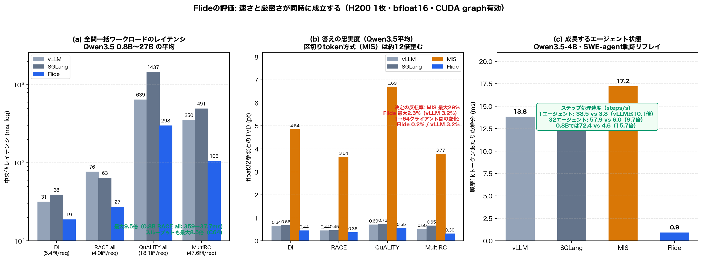

# 速くすると答えが変わる──Flideが決定モデルの推論を厳密な状態フォークで9.5倍速くする仕組み

## TL;DR

LLMエージェントシステムでは、リクエストのルーティング、応答の評価、次の行動の選択といった「カテゴリカルな決定」が大量に発生する。Jevのような決定モデル（decision model）は、長い文脈を読んで選択肢ごとの確率分布だけを返すことで、この種の仕事を軽量にこなす。ところが、既存の推論エンジンはこの仕事量をうまく扱えない。問いごとに独立シーケンスとして走らせれば共有文脈の再計算で遅くなり、問いを1本に連結すれば区切りtokenが隠れ状態を変えて確率を歪ませ、動的バッチングは浮動小数点の加算順序を変えて同一リクエストの答えを揺るがす。本論文が提案する**Flide**は、決定リクエストの論理的な木構造（幹＝共有状態、枝＝各問）と物理的な実行（1本の平坦なトークン列）を分離する推論エンジンだ。ForkAttentionはGPU常駐のインデックスでattention層とGated DeltaNet層の両方に分岐を実装し、厳密算術のもとで各問が単独実行と同一の計算を行うことを保証する。結果として、vLLM/SGLang比で最大9.5倍のレイテンシ短縮と8.5倍のスループットを達成しながら、float32参照との全変動距離は全エンジン中で最小。エージェントの成長する履歴に対しては1kトークンあたり約1msの増分でステップ処理速度4.4〜7.2倍を示す。

- 論文: [Flide: Accelerating Decision Inference with Exact State Forking](https://arxiv.org/abs/2610.42148)（arXiv:2610.42148、2026年10月30日）
- 著者: Bobo Li、Jiajia Song（NUS）、Hao Fei（Oxford）、Wynne Hsu、Mong Li Lee（NUS）
- プロジェクトページ: [flide.org](https://flide.org)／[ソースコード](https://github.com/OmniJev/flide)

## 背景：決定モデルという新しい仕事量

LLMの用途はテキスト生成だけではない。システムの核として、リクエストをどのモデルへ流すか（ルーティング）、応答を受理するか（評価）、エージェントの次の手は何か（行動選択）を決める「決定装置」としての使われ方が広がっている。これらの仕事でテキストを生成するのは無駄だ。必要なのは選択肢上の確率分布であって、そのためだけに数百トークンの文章を吐き、パースし、失敗を救済するコードを書くのは計算資源とレイテンシの両方を浪費する。

この発想で登場したのがJev（TypeSafe AI）やOpen-Jev、StartLuxといった決定モデルである。長い文脈——会話履歴やエージェントの軌跡——を一度読み、その上で複数の問いに答え、離散的な選択肢ごとの確率分布を出力する。「System One」的な、速くて軽いカテゴリカル推論を担うモデル群だ。運用では、この種のモデルがルーティングされる全リクエストとエージェントの全行動に対して呼ばれ、出力確率に閾値が適用される。つまり**速さと数値の正確さが同時に要求される**。閾値0.5の近傍で確率がわずかに揺れれば、決定は反転する。

問題は、この仕事量を支える推論エンジンが存在しなかったことだ。vLLMもSGLangもテキスト生成向けに設計されており、仕事の基本単位は「1本の線形なシーケンス」である。決定リクエストの構造はそうではない。

## 既存エンジンの3つの失敗

同じ文脈$s$について3つの問い$q_1, q_2, q_3$に答える、という1つのリクエストを考えよう。論文的には、これを3通りの方法で実行したときに何が起きるかが図1にまとめられている。

**失敗1: 問いごとの独立シーケンス（vLLM / SGLang）。** 各問を独立のプロンプトとして扱うため、レンダリング・トークン化・スケジューリングが問いの数だけ繰り返される。最新のvLLMは共通文脈を事前に1回計算するが、それでも各問はprefix cacheから再開する独立シーケンスとして走る。さらに厄介なのはハイブリッドアーキテクチャだ。Qwen3.5のように大半の層をGated DeltaNetが占めるモデルでは、prefix cacheが再帰状態を復元できるのはブロック境界だけであり、境界より後のトークンは**各問・各エージェントステップで毎回再計算される**。

**失敗2: multi-item scoring（SGLang MIS）。** すべての問いを1つの文脈に連結し、各問の前に区切りtokenを挿入する。状態の共有は実現するが、区切りtokenが全問の入力に入り込む。隠れ状態が変わり、出力確率は単独で問うた場合と一致しなくなる。後述するが、この歪みはカテゴリカル決定の最大29%を反転させる。さらにこの経路ではCUDA graphが無効化され、Gated DeltaNetの分岐メタデータがCPU側で構築されるため、速度面でも割に合わない。

**失敗3: 動的バッチングの非決定性。** バッチの構成が変わると浮動小数点の総和順序が変わり、同一のリクエストがサーバーの負荷状態によって異なる答えを返しうる。確率に閾値を適用する決定ワークロードでは、これは再現性の崩壊を意味する。

著者らの診断は明快だ。根本原因は**決定リクエストの論理構造と、エンジンがそれを実行する物理構造の不一致**にある。論理的には、リクエストの問いは「幹＝共有状態」から生える別々の枝であり、各枝は幹と自分自身だけを見るべきだ。物理的には、枝は1つの幹のコピーの上で一緒に走るのが効率的で、幹を1回だけ計算し、短い枝を多数並べてGPUを1パスで満たす。生成エンジンはこの2つを結びつけてしまっている。独立シーケンス方式は物理を論理に合わせて遅くなり、multi-item scoringは論理を物理に押し込んで答えが変わる。

## 提案手法：Flide

Flide（Flat-Graph Inference for Decision Models）は、この不一致を解消するために「木のまま保持した論理構造」と「1本に平坦化した物理実行」を分離する。

### 定式化：幹と枝

決定リクエスト$r = (s, q_1, \dots, q_n)$を、状態$s$（$P$トークン）と$n$個の問いとして定式化する。ここで$s$は「各問を単独でプロンプト化したときに全問が共有する最長の先頭列」として定義され、連結$s \oplus q_i$は単独プロンプトとトークン単位で一致する。各問には選択肢集合$O_i$が伴い、出力headの行$w_o$を使って

$$
p_i(o) = \frac{\exp(w_o^{\top} h_i)}{\sum_{o' \in O_i} \exp(w_{o'}^{\top} h_i)}
$$

と計算される。$h_i$は$s \oplus q_i$の最終トークンの隠れ状態で、ラベルtoken（chatモデル）か訓練済みスロット（決定モデル）に対応する。

コストの見通しは単純だ。各問を別々のシーケンスとして処理すれば$nP + \sum_i |q_i|$トークンの計算が要り、状態を$n$回評価する。状態と各問を正確に1回ずつ計算すれば$P + \sum_i |q_i|$で足りる。Flideは後者を単一のforwardパスで実現する。

### ForkAttention：マスクと状態インデックスの使い分け

Flideはラウンド（1回のバッチ）に含まれる全リクエストを、パディングなしの1本の連続トークン列に平坦化する。

$$
[\,s^{(1)} \mid s^{(2)} \mid \cdots \mid q^{(1)}_1 \mid \cdots \mid q^{(1)}_{n_1} \mid q^{(2)}_1 \mid \cdots\,]
$$

状態セグメントが先に並び、続いて各リクエストの問いセグメントが続く。各トークンは自分のリクエスト番号$j$、分岐番号$c$（$c=0$が幹）、通し位置$t$をメタデータとして持つ。問いトークンのRoPE位置は$P$から継続するため、回転の値も単独シーケンスと一致する。

分岐の分離は、層の種類によって手段が異なる。線形射影・正規化・MLPといったpointwise演算は各トークンを孤立に処理するので、木構造に無関係である。介入が必要なのはtoken混合層だけだ。

**full attention層**では、query $x$がkey $y$を参照できる条件を

$$
j_y = j_x, \qquad c_y \in \{0, c_x\}, \qquad t_y \leq t_x
$$

と定める。同じリクエストに属し、幹か自分の枝のどちらかにいて、より前に出現する。各問は幹と自分だけを見る——投機デコードのtree attentionが候補tokenに適用するのと同種の遮断だ。sliding window層（Gemma 4）でも、位置が単独実行と一致するため同じ鍵集合が選ばれる。

**Gated DeltaNet層**が本質的な難所だ。この層は過去の全トークンを単一の行列値再帰状態に折り込む。

$$
S_t = \alpha_t\, S_{t-1}\,(I - \eta_t\, k_t k_t^{\top}) + \eta_t\, v_t k_t^{\top}, \qquad o_t = S_t\, q_t
$$

$S_t$はすでに全ての先行トークンを含んでいるので、マスクで2つの問いを分離することはできない。そこでFlideは各層を**2呼び出し**で走らせる。第1呼び出しは全リクエストの状態セグメントを処理し、各リクエストの状態末端での再帰状態$S_P$とconv窓を出力する。第2呼び出しは全リクエストの問いセグメントを一括処理し、各問は**自分のリクエストの$S_P$からインデックス経由で再開する**——状態のコピーは発生しない。前置される短いcausal convolutionも同じインデックスで前置トークンを読むため、問いの先頭トークンは自分の状態の末尾トークンを見られる。

これらを合わせた厳密性が命題3.1だ。**厳密算術では、Flideが計算する各問の任意のトークンにおける隠れ状態は、$s \oplus q_i$を単独で処理した場合の隠れ状態と同一である。ラウンド内の他のリクエストや他の問いに依存しない。**証明は層についての帰納法で、各層で「等しい入力は等しい出力を与える」ことを確認するだけの素朴なものだが、これが「速さと正確さのトレードオフは必然ではない」ことの証明になっている。

### flat-graph実行：木をデータとして保持する

短い決定リクエストのGPU時間は数ミリ秒にすぎず、カーネル起動を数千回逐次発行すればそれが全体を支配する。CUDA graphは起動を排除するが、graphは起動の形を固定する。ラウンドごとに変わる木構造とは相性が悪い。

Flideの解決策は、リクエストの木を**GPUデータとしてだけ**保持することだ。セグメント長・位置インデックス・鍵範囲・状態インデックスといったラウンド構成で決まる変数はすべてコンパクトなデバイスバッファに置かれ、graph replay前に書き込まれる。カーネルの起動形はストリーム長だけに依存するため、サーバー初期化時にストリーム容量$T$で索引したgraph族を用意しておけば、任意のリクエスト混合が同じgraphを共有できる。ラウンドごとに収まる最小のgraphを選び、最大容量を超える場合はリクエスト境界で分割する。

もう1つの細部が効く。出力headは各問の**最終トークンだけ**を読む。そこで最終層では、全トークンが鍵と値の提供には寄与しつつ、MLPを含む残りの計算は読み出し行のみで実行する（selective readout）。出力は厳密に不変のまま、最終層の仕事の大部分が消える。

### 増分状態フォーク：エージェントの履歴が伸びても

エージェントの連続ステップは、状態の大部分を共有する。Flideは前ステップの答えを計算するのと同じforwardの中で、状態の内部位置$m$にチェックポイントを保存する。中身は全Gated DeltaNet層のfloat32再帰状態とconv窓、full attention層の$KV$だ。次のリクエストは、位置$m$までのトークンが一致する限りそこから再開し、変わりうる短い尾部と追加分だけを計算して、新しい問いを完成した状態からフォークする。$m$は状態の末尾より少し前に置かれる——会話ターンの末尾など、次ステップで変わりそうなトークンが$m$より後に来るようにする。

さらに、float32の還元順序を固定するオプショナルな**bitwise決定性モード**を備える。どの行列積も行数によらず固定順序で総和を取り、各問は自分専用のattentionタイルとGDNチャンクから還元を開始する。このモードのコストは64クライアント時のスループット最大10%に対して、SGLangのbatch-invariant kernelはQwen3-8Bで34%遅くなり、vLLMの同種モードはGated DeltaNet層を実行できない。

## 実験結果

評価はH200 1枚、bfloat16、CUDA graph有効。モデルはQwen3.5（0.8B〜27B、ハイブリッド）、Gemma 4（E2B〜31B、full attention）、そしてOpen-Jev-2B/9B。ワークロードはRACE、QuALITY、Decision Index（679リクエスト・3,635問、平均5.4問/リクエスト）、MultiRC（平均47.6問/リクエスト）から、1問/状態と全問一括の6種類だ。

**速度。** 1問/状態の設定でも、Flideは最小モデルで単独リクエストのレイテンシを最大3.2倍削減する。ラウンドごとにflat-graphを1回replayするだけで済むのに対し、生成エンジンのフロントエンドとスケジューラが重いためだ。本領は全問一括で、**全モデルサイズ・全並行性でリードし、最大9.5倍のレイテンシ短縮と8.5倍のスループット**を達成する（0.8BのRACE allで359ms→37.7ms、C64スループット4.6→39.1 req/s）。状態あたりの問いが最も多いQuALITYとMultiRCで利得が最大になる。full attentionのみのGemma 4でも、共通状態を1回計算するvLLMのprefix cache相手に1.1〜2.9倍のレイテンシ短縮であり、単一forward実行の価値はキャッシュの恩恵とは別物だと分かる。状態1つに問いが64個乗る設定ではvLLM比12.7倍。

**答えの忠実度。** float32参照と比較して、Flideのtop answer一致率は全ワークロードで最も高い。精度はvLLMと全セルで1.2ポイント以内、つまり速度を利得の源にしつつ精度を保っている。バッチングによる答えの変化はFlideで最大0.2%に対し、vLLMは最大3.2%、SGLangは最大1.7%。そしてmulti-item scoringの全変動距離は**Flideの約12倍**で、区切りtokenがカテゴリカル決定を最大29%反転させるのに対し、Flideの反転は最大2.3%にとどまる。bitwise決定性モードでは、全モデル・全ワークロードで負荷によらずビット同一の答えが返る。

**ablation（Qwen3.5-4B）。** 状態フォークを外すと、全問一括のQuALITYでレイテンシが135.6ms→1,868.5ms（13.8倍悪化）。CUDA graphを外すとDI（Decision Index）で8.8ms→76.1ms。flat graphを外すと短いリクエストのラウンドでスループットが3分の1以上低下。selective readoutも全ワークロードで追加の利得をもたらす。各部品がそれぞれ別の費用——状態の反復計算、カーネル起動、graph replay、最終層の仕事——を取り除いている。

**専用決定モデルとエージェント。** Open-Jevに対して、その専用エンジン（vllm-jev＋RadixFlow）相手に短入力で約3倍、長プロンプトでも最大1.7倍速い。汎用エンジンが特化システムを上回る点が示唆的だ。SWE-agent軌跡のリプレイでは、履歴1kトークンあたりのレイテンシ増分が約0.6〜1.0ms（vLLM/SGLangは11〜14ms）で、ステップ処理速度は最強baseline比4.4〜7.2倍。画像を状態に含むGQA（1画像平均11問）でも5.0〜7.5倍速い。

## 考察

**論理と物理の分離は、データベースの発想の移植だ。**論文自身がmultiple-query optimization（Sellis, 1988）を引き合いに出す。複数の問い合わせが共通の部分式を共有するとき、それぞれを独立に実行せず、共有部分を1回だけ評価する——クエリ最適化の古典的知見を、トークン列の実行グラフに対して適用したのがFlideと言える。「木をデータとして保持し、実行は平坦に」という設計は、servingの文脈で一般化できる原理に見える。

**投機デコードのtree attentionとの対比も見えてくる。**候補トークンの木を1パスで検証するtree attention（SpecInfer、Medusa）は、本記事の読者には馴染みのある機構だろう。ただし既存の機構はすべて「共有prefixが実行を完了してバッファに載った後で、下流のqueryがそれを消費する」という時間的分離を要求する。Flideはこの分離をなくし、共通状態と全分岐を単一forwardで評価する。さらに再帰層では「状態からのフォーク」をインデックス参照として実装した点が新しく、これによりハイブリッドモデルのブロック境界制約（MarconiやRadixFlowが扱った問題）を任意位置の分岐へ一般化している。

**決定の再現性はエージェントのデバッグ可能性そのものである。**確率に閾値を適用して行動を選ぶエージェントでは、確率が負荷で揺れれば行動も揺れる。再現できない失敗はデバッグできない。Flideの厳密性保証と10%コストのbitwiseモードは、この実務的な要件への回答だ。「速くすると答えが変わる」は、実装の選択の結果であって自然法則ではなかった。

**限界も正直に書いておく。**評価は決定ワークロードのみで、生成との混合スケジューリングは扱っていない。単一GPU・単一フロントエンドの評価であり、分散設定は今後の課題だ。アクセスパターンも「長い共有状態＋短い問い」という決定モデル特有の形に最適化されている。汎用のservingエンジンとしてvLLM/SGLangを置き換えるものではなく、決定という仕事量のための専用基盤を主張する論文と読むのが正確だろう。

## 関連研究

- **vLLM / SGLang**: PagedAttention（Kwon et al., 2023）とradix cache（Zheng et al., 2024）はprefix共有の標準枠組み。ただしシーケンスを実行単位とする前提は変えない。ハイブリッドモデル向けにはMarconi（Pan et al., 2025）やRadixFlow（Jing et al., 2026）がブロック境界での状態キャッシュを扱う。
- **投機デコード**: SpecInfer（Miao et al., 2024）やMedusa（Cai et al., 2024）のtree attention、STree（Wu et al., 2025）やLumoTree（Ma, 2026）のハイブリッド向け分岐状態伝播。本ブログで扱ったOsprey（ドラフター事前学習、arXiv:2609.09338）やSpecAgent（軌跡単位の投機実行、arXiv:2610.21463）と補完関係にある——SpecAgentがエージェントの行動先読りで帯域を削減するのに対し、Flideは問いのフォークで決定そのものを速くする。
- **決定モデルサービング**: PrefillOnly（Du et al., 2025）、Verdict（Chouhan & Perry, 2026）、FastJEV（Ma et al., 2026）など、単一tokenワークロード向けの変種は出揃いつつあるが、単一パス実行・入力の無改変・任意位置のハイブリッド状態分岐・graph replay・bitwise不変を同時に満たすのはFlideのみとされる（論文のTable 1）。
- **実行の決定性**: He & Thinking Machines Lab (2025) がLLM推論の非決定性を分析し、batch-invariant kernelの方向を示した。Flideの決定性モードは、そのハイブリッドモデル版と言える。
- **Gated DeltaNet**: Yang et al. (2025)。delta ruleによる gated再帰層で、Qwen3.5などのハイブリッド構成の中核。

## まとめ

決定モデルという新しい仕事量は、生成向けに育てられた推論エンジンの前提——仕事の単位は1本の線形シーケンスである——と衝突していた。衝突の現れは「遅い」（状態の反復計算）と「答えが変わる」（区切りtokenによる入力の改変、浮動小数点の順序依存）の両方だった。Flideは、リクエストの論理的な木をGPU常駐メタデータとして保持し、物理的には全ラウンドを1本の平坦なトークン列で走らせることで、この衝突を解消した。attention層には可視則、Gated DeltaNet層には状態インデックスによる2呼び出しと、層の種類に応じた適切な分岐機構を割り当て、各問が単独実行と厳密に同一の計算を行うことを保証する。CUDA graphの形制約はストリーム長で索引したgraph族で回避し、エージェントの成長する履歴はチェックポイントから再開する。最大9.5倍の速度と、float32参照への最小の距離。速さと正確さがトレードオフに見えていたのは、論理構造を物理実行に押し込めていたからだ、というのがこの論文の主張である。

## 参考

- Bobo Li, Jiajia Song, Hao Fei, Wynne Hsu, Mong Li Lee. *Flide: Accelerating Decision Inference with Exact State Forking.* arXiv:2610.42148, 2026.
- [プロジェクトページ（flide.org）](https://flide.org)／[GitHub（OmniJev/flide）](https://github.com/OmniJev/flide)
- Kwon et al. *Efficient Memory Management for Large Language Model Serving with PagedAttention.* SOSP 2023.
- Zheng et al. *SGLang: Efficient Execution of Structured Language Model Programs.* NeurIPS 2024.
- Yang et al. *Gated Delta Networks: Improving Mamba2 with Delta Rule.* ICLR 2025.
- He & Thinking Machines Lab. *Defeating Nondeterminism in LLM Inference.* 2025.
- Sellis. *Multiple-Query Optimization.* ACM TODS, 1988.
