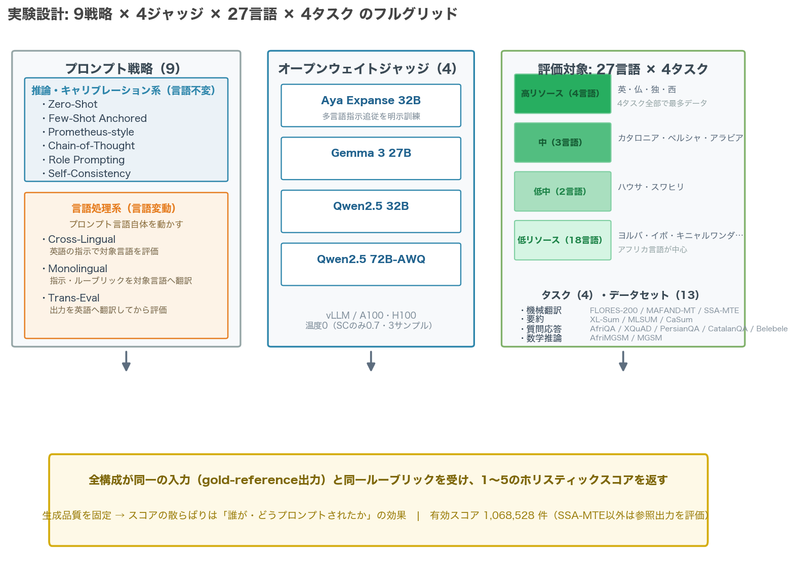
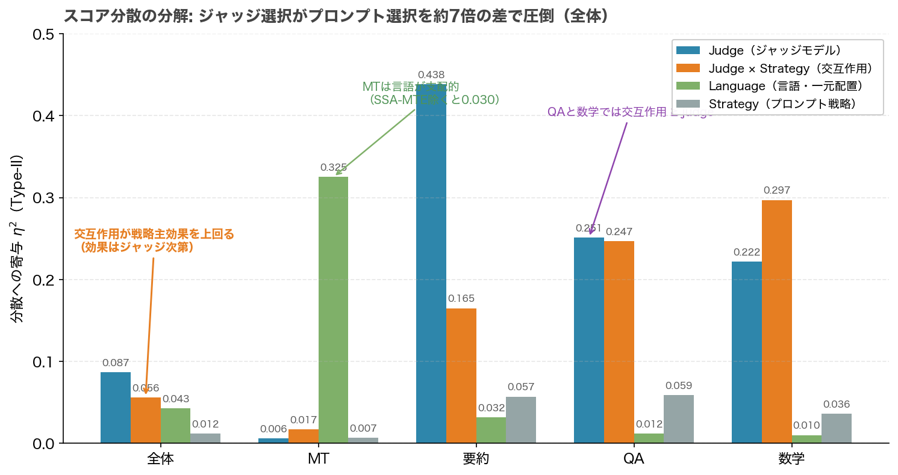
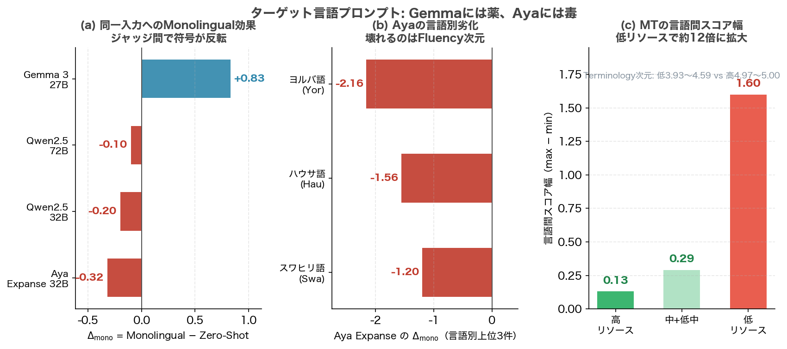
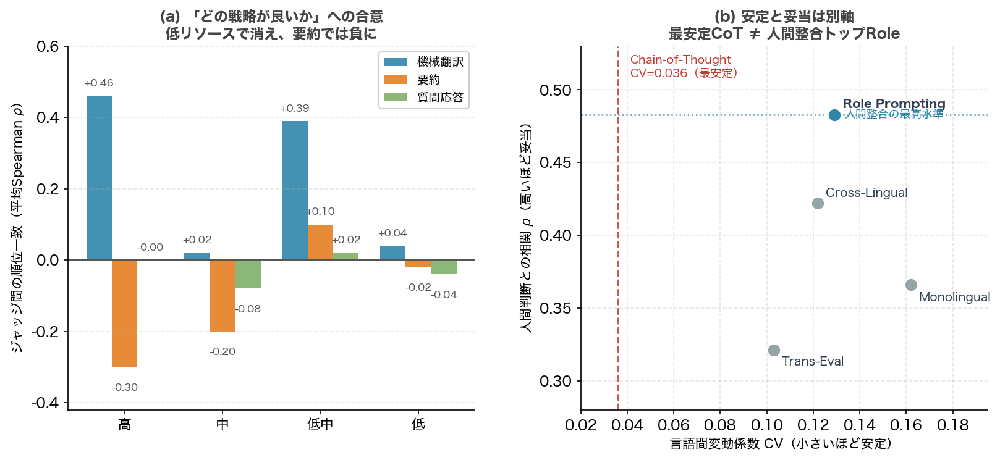

# 効くプロンプトは審査員次第──多言語LLM-as-a-Judgeで戦略効果がモデル間で反転する仕組み

## TL;DR

LLM-as-a-Judgeで評価を組むとき、私たちは「Chain-of-Thoughtで理由付けを書かせる」「評価者の役割を与える」といった定番のプロンプト技法をなんとなく拾ってくる。その推奨のほとんどは英語ベンチマークで確立されたもので、別のジャッジモデルや別の言語にそのまま移植できるかは、実は誰も体系的に測っていなかった。

アムステルダム大学とCWI（オランダ数理情報科学研究所）のMehrabi、Aliannejadi、Siroが公開した「Prompting Strategy Effects Depend on the Judge」は、**9つのプロンプト戦略 × 4つのオープンウェイトジャッジ × 27言語 × 4タスク（13データセット）**という格子を実行し、**107万件超のpointwiseスコア**を集めた大規模な堅牢性研究だ。評価対象を人手書きのgold-reference出力に固定しているため、スコアの散らばりは「何を評価されたか」ではなく「誰が・どうプロンプトされて評価したか」の効果として純粋に読める。

結果はこうだ。

- **ジャッジの選択がプロンプトの選択を圧倒する**：スコア分散への寄与はjudge η²=0.087に対し戦略η²=0.012（約7倍）。しかもジャッジ×戦略の交互作用（η²=0.056）が戦略の主効果を上回る
- **効果の符号が反転する**：ターゲット言語プロンプト（評価対象と同じ言語で指示を書く）はGemma 3の平均スコアを+0.83押し上げる一方、Aya Expanseでは−0.32下げる。Ayaのヨルバ語では−2.16に達する
- **低リソース言語で合意が消える**：MTでのジャッジ間の戦略ランキング一致は高リソースρ=0.46から低リソースρ=0.04へ。言語間のスコア幅も0.13から1.60へ拡大
- **安定≠妥当**：言語間で最も安定するCoT（CV=0.036）と、最も人間判断と相関するRole Prompting（ρ=0.483）は別の戦略だった

実務への含意は明快だ。「どのプロンプト戦略が良いか」は単独では意味をなさない。**ジャッジ・タスク・言語の組み合わせごとに検証してから使う**。そして研究間でジャッジの評価結果を比較するときは、ジャッジモデルとプロンプト構成の両方を報告しないと比較にならない。1.07Mスコアと全プロンプトテンプレートが公開されている。

## 背景：推奨プロンプトの由来を辿ると英語に行き着く

多言語で生成テキストを評価したいとき、選択肢は狭い。BLEUやROUGEのような参照ベースの指標は、評価対象の言語で人手アノテーションされた参照を必要とするが、そんなものはほとんどの言語にない。BLEURTやCOMETのような学習型指標も事情は同じだ。そこで近年広がったのがLLM-as-a-Judge──ルーブリックを与えたLLMに直接採点させる方式で、参照が不要なぶん、アノテーション整備から取り残された言語へ評価を広げる数少ない現実解となっている。

前提として、まともな多言語ジャッジに課されるべき性質は**言語不変性**だ。スコアは出力の品質を反映すべきであって、出力がたまたま何語で書かれているかを反映してはいけない。ところがFu and Liu (2025) が25言語の並行データで調べたところ、ジャッジ間のFleiss' κは平均0.3程度、低リソース言語ではさらに悪化する。しかも多言語向けの事前学習を積んだモデルでも、スケールを上げても、この一貫性は改善しないという。

では、設定できるノブはどこか。LLM-as-a-Judgeのパイプラインで人間が制御できるのは2つだけだ。**どのジャッジモデルを使うか**と、**どうプロンプトするか**。

後者について、私たちは「定番」を過信していないだろうか。Chain-of-Thought（Wei et al. 2022）、few-shot例の添付、self-consistency（Wang et al. 2023）、役割条件付け（Salewski et al. 2023）──いずれも元々はタスク解決のために開発され、後からジャッジングへ流用された技法で、効果検証の土台は英語ベンチマークだ。プロンプト感度の研究も、1つのテンプレートの言い換えやフォーマット摂動を英語で調べたものが中心だった（Sclar et al. 2024; Bellibatlu et al. 2026）。一方、多言語に目を向けたジャッジ研究──MM-Evalのメタ評価ベンチマークやM-Prometheusの多言語ジャッジ訓練──は、プロンプトテンプレートを固定してしまう。**戦略×ジャッジ×言語を同時に動かして測った研究は存在しなかった**。

著者らのリサーチクエスチョンは明快だ。**プロンプト戦略の効果は、それを適用するジャッジモデルと、評価対象の言語のリソース水準に依存するのか？**

## 実験設計：107万スコアの格子

### 9つのプロンプト戦略

検証した9戦略は2つのグループに分かれる。

**推論・キャリブレーション系（プロンプト言語を英語で固定する、言語不変の戦略）**

- **Zero-Shot**：指示・ルーブリック・スコア定義だけを与える
- **Few-Shot Anchored**：高品質と低品質のキャリブレーション例を添えて目盛りを合わせる
- **Prometheus-style**：総合スコアの前に基準別の評価を書かせる
- **Chain-of-Thought**：段階的な評価過程を明示的に書かせてから採点させる
- **Role Prompting**：タスクと言語に応じた評価者役割を与える
- **Self-Consistency**：CoT評価を3回サンプリングし、ホリスティックスコアの最頻値を取る

**言語処理系（プロンプト言語自体を動かす、言語変動の戦略）**

- **Cross-Lingual**：英語の指示でターゲット言語の出力を評価する
- **Monolingual**：指示・ルーブリック・スコア定義を評価対象の言語へ翻訳する
- **Trans-Eval**：出力をまず英語へ翻訳してから評価する

すべての戦略でタスク固有ルーブリックと5段階スコアは共通で、変更されるのは「どう指示するか」だけ。タスク適用可能性は一部限定され（CoTはMT非適用、Self-ConsistencyはQAと数学のみ、など）、その分マトリクスは賢く設計されている。

### 4ジャッジ × 27言語 × 4タスク

ジャッジは4つのオープンウェイトモデル：**Aya Expanse 32B**（多言語指示追従を明示的に訓練）、**Gemma 3 27B**、**Qwen2.5 32B**、**Qwen2.5 72B-AWQ**。クローズドモデルを外したのは再現性確保で、探索的に一部検証はしている。

言語は27言語を4つのリソース階層に分ける。高リソース（英語・フランス語・ドイツ語・スペイン語）、中（カタロニア語・ペルシャ語・アラビア語）、低中（ハウサ語・スワヒリ語）、そして低リソース18言語（ヨルバ語、イボ語、キニャルワンダ語、コサ語、ズールー語、ナイジェリア・ピジン、トウィ語、ベンバ語、フォン語、アムハラ語、ソト語、ティグリニャ語、エウェ語、ルガンダ語、リンガラ語、オロモ語、ソマリ語、ウォロフ語）。アフリカ言語の比重が意図的に厚い。

タスクは4種・13データセット：機械翻訳（FLORES-200、MAFAND-MT、SSA-MTE）、要約（XL-Sum、MLSUM、CaSum）、質問応答（AfriQA、XQuAD、PersianQA、CatalanQA、Belebele）、数学推論（AfriMGSM、MGSM）。各データセット×言語スプリットから最大200インスタンスをseed 42でサンプルする。

### 評価対象をgold-referenceに固定する意味

この実験設計の肝は、**採点対象を人手書きのgold-reference出力に固定した**（SSA-MTEを除く）ことにある。生成モデルの出力を評価すると、スコアの散らばりに「出力自体の品質差」が混入してしまう。参照出力なら品質はほぼ一定だから、スコアが散らばれば、それは「誰が・どうプロンプトされて評価したか」の効果として読める。全ジャッジ×戦略構成が同じ入力・同じルーブリックを受け取り、1〜5のホリスティックスコアを返す仕組みだ。

実行はvLLMでA100/H100 GPU上のバッチ推論。温度0（Self-Consistencyのみ0.7で3サンプル、全異なる場合は算術平均）。最終的に**1,068,528件**の有効スコアが揃った。

統計分析はこうだ。タスクごとに二元配置ANOVA（judge + strategy + 交互作用）を回し、Type-II η²で分散を分解する。言語とリソース階層は一元配置ANOVAで別途推定。言語間のばらつきは変動係数CV（言語別平均のσ/μ）、ジャッジ間の順位一致はSpearman ρ。人間判断との整合は、SSA-MTE（12,565件の多言語システム翻訳）、SummEval（1,600件の英語要約）、WMT MQM（500件）に対するインスタンスレベルのSpearman相関で検証する。

## 結果1：分散の主役はプロンプトではなくジャッジ

全スコアを通じた分散分解の結果はこうなる。

| 因子 | η²（全体） |
|---|---|
| **Judge（ジャッジモデル）** | **0.087** |
| Judge × Strategy（交互作用） | 0.056 |
| Language（言語） | 0.043 |
| **Strategy（プロンプト戦略）** | **0.012** |

ジャッジの選択がスコア分散に説明する量は、プロンプト戦略の約**7倍**。さらに重要なのは、**ジャッジ×戦略の交互作用（0.056）が戦略の主効果（0.012）を大きく上回る**ことだ。これは「戦略には平均的な効果がある」のではなく、「どのジャッジに投げるかで効果の中身が変わる」ことを意味する。プロンプト戦略の効果はプロンプト自体の内在的性質ではなく、ジャッジとの組み合わせに対して条件付けられた性質だ。

タスク別に見ると、構図はさらに具体的になる。

- **要約**：judge η²=0.438と突出。どのジャッジが採点するかでスコアが激しく動く
- **QA**：交互作用0.247 ≈ judge 0.251。ほぼ同額
- **数学**：交互作用0.297 > judge 0.222。**交互作用がジャッジ主効果を超える**
- **MT**：言語η²=0.325が支配的（SSA-MTEを除くと0.030に低下し、judge 0.048・交互作用0.114が浮上する）

なお、gold-reference評価の副作用として天井効果がある。QAと参照ベースMTでは平均スコアが4.5を超え、戦略間の差が物理的に圧縮される。著者らはAfroBenchの実システム出力で追試し、散らばりが広がることを確認済みだ。またGemma 3 27BはZero-Shotでのみ顕著に低いスコア（QA 2.29・要約3.15・数学2.90）を出し、他の戦略では範囲内に回復する──この癖の強さが交互作用を押し上げている一因でもある。勝ち戦略がジャッジごとに違う、というより「勝ち戦略」という概念自体が崩れている。

## 結果2：同じ戦略がジャッジ間で反転する

交互作用の中身を見ると、単なる効き目の強弱ではなく**符号の反転**が起きている。

### ターゲット言語プロンプトの反転

Monolingual（評価対象と同じ言語で指示を書く）のZero-Shotに対する効果Δ_monoをジャッジ別に見ると、同一の入力・同一の言語に対して：

- **Gemma 3：+0.83**（平均スコアを押し上げる）
- 2つのQwen2.5：−0.20 / −0.10（小幅に下げる）
- **Aya Expanse：−0.32**（明確に下げる）

Ayaでは言語別の劣化が深刻で、ヨルバ語−2.16、ハウサ語−1.56、スワヒリ語−1.20。ルーブリック次元で見ると下がるのは主に**Fluency**（全リソース階層で3.35〜3.67まで落ちる）で、Adequacyの差は最大0.5ポイントに留まる。「内容の理解」ではなく「表面の流暢さの見方」が壊れている。

この反転の解釈として著者らが挙げる仮説は興味深い。Aya Expanseは多言語指示追従を明示的に訓練されたモデルで、多言語処理の仕組みがすでに頭の中に出来上がっている。ターゲット言語プロンプトはその処理をむしろ**乱す**のかもしれない。一方Gemmaはプロンプト言語への依存が強く、対象言語で指示されることで評価が安定する。人間整合の側面もこれを支持する：SSA-MTEでのMonolingualの相関は、Gemmaでは列最高のρ=0.455、Ayaでは列最低のρ=0.219。**同じ戦略が、ジャッジによって最高と最低の両方を作る**。

### ジャッジ間の順位一致は低リソースで崩壊する

「どの戦略が良いか」についてジャッジどうしがどれだけ同意するかを、戦略ランキングのSpearman ρ（6ジャッジペアの平均）で測ると：

- MT高リソース：ρ=0.46（そこそこ合意）
- **MT低リソース：ρ=0.04（合意なし）**
- 要約：4階層中3つで**負の相関**（−0.30〜−0.02）

つまり低リソース言語では、ジャッジAが「良い」と判断したプロンプト戦略はジャッジBにとって無関係か、しばしば悪い。Fu and Liu (2025) やChung and Freienthal (2026) が報告した多言語ジャッジの不安定さが、絶対スコアだけでなく**戦略ランキングそのもの**に及ぶことが示された。

言語間のばらつきもリソースが下がると拡大する。MTでの言語間スコア幅（言語別平均のmax−min）は、高リソース階層で0.13、低リソース階層で**1.60**。10倍超の開きだ。ルーブリック次元では**Terminology**が特に脆く、低リソース言語で3.93〜4.59に対し高リソース言語では4.97〜5.00。用語の正しさの判定が、言語によってほぼ全か無かになる。AdequacyとFluencyの階層間差は最大0.5で、落ちる場所に偏りがある。

## 結果3：安定な戦略と妥当な戦略は別物

実務で気になるのは、結局どの戦略を使えばいいのか、だ。

人間判断との整合（SSA-MTE・SummEval・WMT MQMを横断したインスタンスレベルSpearman相関の平均）で最も良いのは**Role Promptingのρ=0.483**。最も悪いのはTrans-Evalの0.321。全ジャッジ×戦略ペアでρ=0.22〜0.46（すべてp<0.001）だった。

ところが、言語間で最も安定するのはRole Promptingではない。変動係数CV（MT+要約、言語別平均のσ/μ）の低い順に並べると、**CoTが0.036で断トツに安定**で、以下Trans-Eval 0.103、Cross-Lingual 0.122、Role Prompting 0.129、Few-Shot 0.133、Zero-Shot 0.135と続く。**最も安定的な戦略（CoT）と最も人間に近い戦略（Role Prompting）が一致しない**。スコアの一貫性と評価の妥当性は別の軸で、著者らも「一致は品質を保証しない」と明言する。構造化推論が中間ステップを明示して分散を抑えるというCoTの性質は知られていたが、それが人間整合の高さとは直結しない。

英語バイアスの観点も加えたい。英語平均と低リソース平均の差は、Cross-Lingualが−0.130と最もバランスが取れる一方、CoTは+0.206で、数学に限れば**+0.542**と最大の英語バイアスを持つ。Monolingualは全体では+0.009とほぼゼロだが、これはGemmaの+0.83とAyaの−0.32が打ち消し合った**見かけのゼロ**で、言語別には大きな正負のバイアスを抱えている。集計値の安定は、内側の不安定を隠す。

## 考察：何を学ぶべきか

### プロンプトはジャッジ構成の一部として扱う

この論文の実務的な結論は、「良いプロンプト戦略」という普遍的なものは存在しない、という否定形で述べられる。効果はジャッジ・タスク・言語の3条件に条件付けられており、あるジャッジ用に最適化したプロンプトは別のアーキテクチャに転移しない。したがって、**使うジャッジ・タスク・言語の組み合わせに対して、実際に検証された戦略を選ぶ**べきだ。論文間でジャッジの評価結果を比較する際も、ジャッジモデルとプロンプト構成の両方を明記しない比較は無意味になる。ベンチマークスコアの再現が合わない理由の一部は、ここに埋まっているかもしれない。

### なぜAyaとGemmaで逆になるのか

確定的な原因は特定されていないが、示唆的な間接証拠が揃っている。Aya Expanseは多言語指示追従を明示的に訓練したモデルで、多言語処理がある種の内蔵状態にある。ターゲット言語プロンプトがこの処理を攪乱するという説明は、Fluency次元だけが選択的に崩れAdequacyは保たれるという観察とも整合する。「judge分散が大きい」という結果自体、評価挙動が事前学習と指示チューニングで獲得された性質に由来する（Dang et al. 2024; Gemma Team 2025）という説明と無矛盾だ。ただし著者らも認める通り、この設計ではトークナイザや学習データ構成といったモデル間の他の差異を分離できていない。

### 天井効果という制約

gold-reference評価は「ジャッジの挙動を純粋に観察する」という設計上の利点と引き換えに、QAと参照ベースMTで平均4.5超という天井を作った。両タスクでは戦略間の差が物理的に圧縮されているため、η²の比較は保守的な見積もりと読むべきだ。著者らはAfroBenchの実システム出力で散らばりが広がることを確認しているが、ジャッジ・タスク・戦略のサブセットに限られる。さらにFleiss' κは、スコア分布が歪むと偶然補正が過剰に働き、生の一致率が高いのにκがほぼゼロになる「アーティファクト」を起こす。κの低さを鵜呑みにした多言語ジャッジ評価の一部は、この罠にかかっている可能性がある。

### 多言語評価の公平性

戦略選択は、平均スコアからは見えない公平性の問題を抱える。Cross-Lingualは最もバランスが取れるが、CoTは数学で顕著な英語優位を作る。そして低リソース言語では、ジャッジ間の合意そのものが消える。著者らは倫理的考察で「この結果は低リソース言語をLLM-as-a-Judgeパイプラインから除外する根拠にはならない。むしろ、評価結果がモデル選択やコンテンツモデレーションに波及する場面では、言語ごとの検証を経てから展開せよ」と明言している。1.07Mスコア、ルーブリック次元別スコア、プロンプトテンプレート一式が公開されており、再実行なしに検証できる点も実務的だ。

## 関連研究

- **LLM-as-a-Judgeの確立**：Zheng et al. (2023) がMT-BenchとChatbot Arenaで「有能なLLMジャッジは人間アノテータ間の一致に匹敵する」ことを示し、パラダイムを正正当化した。以降の研究は、タスク複雑性・参照品質・プロンプト設計が信頼性を左右するという失敗モードの特徴づけに移った（Gu et al. 2024）。候補の提示順序に敏感なposition bias（Shi et al. 2024）も有名な失敗モードだ
- **多言語ジャッジの信頼性**：Fu and Liu (2025) は25言語でFleiss' κ≈0.3を報告し、多言語事前学習でもスケールでも改善しないことを示した。MM-Eval（Son et al. 2024）は多言語メタ評価ベンチマークを、M-Prometheus（Pombal et al. 2025）は多言語ジャッジの訓練を提供したが、いずれもプロンプト戦略を固定していた。Chang et al. (2025) はリソースが下がるほど人間整合が落ちることを示した。Chung and Freienthal (2026) はフィン・ウゴル諸語の統制生成で、表面次元（文法・流暢さ）は言語間で安定するが高次の判断（一貫性）は安定しない──一部の不安定さが評価過程側に由来することを示した
- **プロンプト感度**：Sclar et al. (2024) はフォーマット摂動がタスク性能を大きく動かすことを示した。Bellibatlu et al. (2026) のJudge Sensitivity Scoreは、意味等価な言い換えで判断が変わる頻度を13ジャッジ×4タスクで測り、モデルスケールは安定性を予測しないことを見出したが、やはり英語のみ。本論文はこの「言い換えへの感度」の視点を「戦略全体のジャッジ間非転移」へ拡張した形になる
- **本ブログの関連記事**：LLMジャッジを測定器として扱う可靠性の問題意識は、共有エンドポイント上でジャッジの再現性が破れることを実証した[「工学が完璧でも測定は崩れる──LLMジャッジの信頼性が共有エンドポイントで破れる仕組み」](https://zenn.dev/zhuanz/articles/clean-engineering-unstable-measurement)（arXiv:2609.04198）から続いている。あちらは「同じジャッジ・同じプロンプトでも環境で崩れる」、本論文は「同じプロンプトでもジャッジで反転する」と、LLM評価の信頼性を異なる軸から削っている

## まとめ

9つのプロンプト戦略 × 4ジャッジ × 27言語 × 4タスク × 13データセット、107万スコアという格子で、多言語LLM-as-a-Judgeのプロンプト戦略の転移性を検証した研究を読んだ。

- ジャッジモデルの選択がプロンプト戦略の選択を7倍の差で圧倒し、ジャッジ×戦略の交互作用が戦略の主効果を上回る。QAや数学では交互作用がジャッジ主効果に匹敵・超越する
- ターゲット言語プロンプトはGemmaで+0.83、Ayaで−0.32（ヨルバ語では−2.16）と符号が反転。壊れるのはFluencyでAdequacyは保たれる
- 低リソース言語ではジャッジ間の戦略ランキング合意が消え（ρ 0.46→0.04）、言語間スコア幅が0.13→1.60へ拡大。落ちる場所はTerminologyに偏る
- 最も安定的なCoT（CV=0.036）と最も人間に近いRole Prompting（ρ=0.483）は別物。安定は妥当性を保証しない
- Monolingualの全体ギャップ+0.009は正負の打ち消し合いの産物。集計報告は内側の反転を隠す

LLM-as-a-Judgeは「参照のない言語への評価の拡張」として重宝される一方、その挙動はジャッジとプロンプトと言語の3体問題になっている。プロンプト戦略は独立したベストプラクティスではなく、ジャッジ構成の一部として、対象の設定で検証して初めて意味を持つ。評価パイプラインの設計書に「プロンプト: CoT推奨（英語で実証済み）」と書く前に、自分のジャッジと自分の言語で効くかを確認する──それがこの論文の最も安価な教訓だろう。

## 参考

- Mehrabi, A., Aliannejadi, M., Siro, C. *Prompting Strategy Effects Depend on the Judge: A Multilingual Study of LLM-as-a-Judge Robustness*. arXiv:2610.31172
- Zheng, L. et al. *Judging LLM-as-a-judge with MT-bench and Chatbot Arena*. NeurIPS 2023
- Fu, X., Liu, W. *How reliable is multilingual LLM-as-a-judge?* Findings of EMNLP 2025
- Son, G. et al. *MM-Eval: A Multilingual Meta-Evaluation Benchmark for LLM-as-a-Judge and Reward Models*. 2024
- Pombal, J. et al. *M-Prometheus: A Suite of Open Multilingual LLM Judges*. COLM 2025
- Sclar, M. et al. *Quantifying Language Models' Sensitivity to Spurious Features in Prompt Design*. ICLR 2024
- Bellibatlu, R. R. et al. *JudgeSense: A Benchmark for Prompt Sensitivity in LLM-as-a-Judge Systems*. 2026
- Chung, I., Freienthal, L. *Cross-lingual Stability of LLM Judges under Controlled Generation*. 2026
- Salewski, L. et al. *In-Context Impersonation Reveals Large Language Models' Strengths and Biases*. NeurIPS 2023
- Wei, J. et al. *Chain-of-Thought Prompting Elicits Reasoning in Language Models*. NeurIPS 2022
