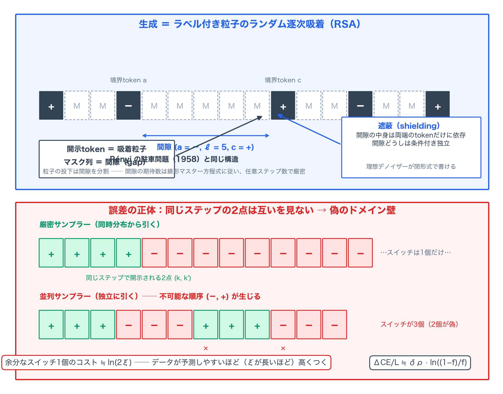
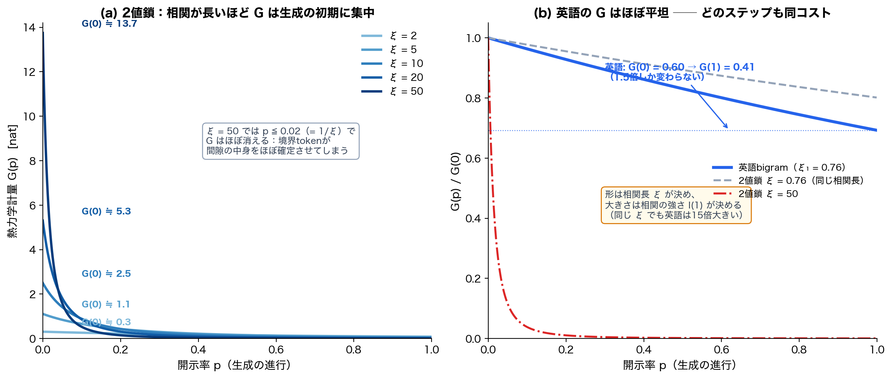
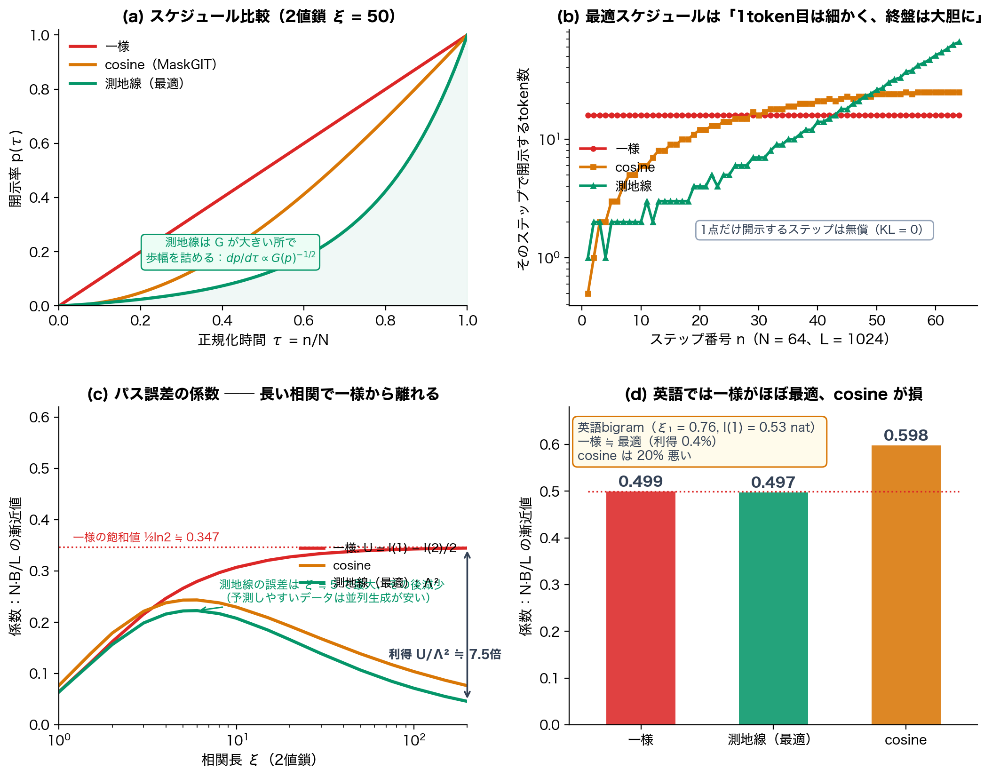
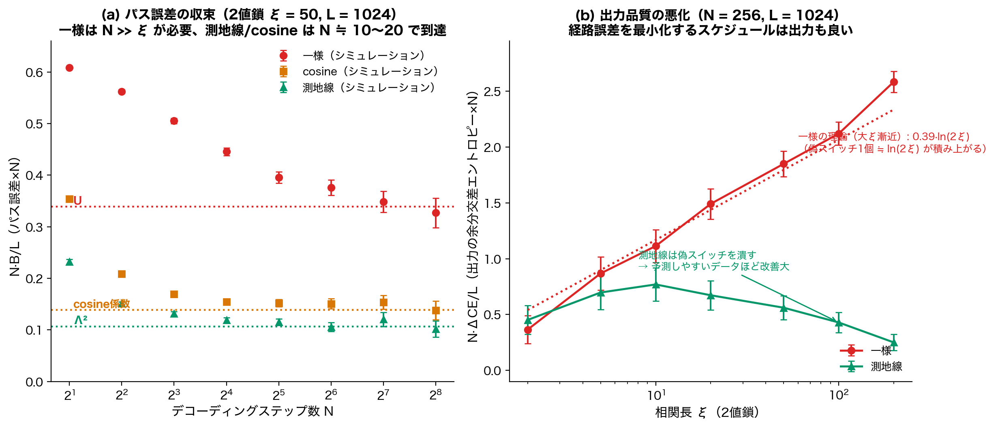

# 速く書く代償は始まりに集中する──マスク拡散の並列デコーディングを駐車問題として厳密に解く仕組み

## TL;DR

マスク拡散モデル（MDM）は、マスクされた各位置の条件付き分布を一度のネットワーク評価で全部返してくる。だから多数のtokenを並列に開示でき、長さ $L$ の系列が $N \ll L$ ステップで書ける。代償はよく知られている。同じステップで開示されるtokenは互いを見ずに独立に引かれるので、データ内の相関が壊れる。

本論文は、この「速さと正しさのトレードオフ」を統計物理の言語で**最後まで解いてしまう**。Queen Mary University of LondonのAdrian Bauleによる単著論文で、結果は三つに要約できる。

1. **誤差＝エントロピー生成**。任意のデータについて、並列サンプラーと厳密サンプラーの相対エントロピー $B$ は、生成過程のエントロピー生成そのものとして書ける。各ステップの寄与は「同時に開示されるtokenどうしの条件付き相互情報」に分解される
2. **生成＝駐車**。Markovデータ（bigram言語モデル）では、生成は「ラベル付き間隙」を持つランダム逐次吸着（RSA）過程に写る。開示tokenは駐車した車であり、間隙統計は閉じた線形マスター方程式に従う。任意のステップ数・スケジュールで、経路誤差と出力統計の**両方**が厳密に計算できる
3. **大N極限＝熱力学**。ステップ数を増やすと、誤差は「ゆっくり駆動された系の散逸」に帰着する。スケジュールは駆動プロトコル、$N$ はその持続時間、誤差はtoken間相互情報から閉形式で得られる熱力学計量 $G(p)$ で決まり、最適スケジュールはこの計量の**測地線**になる

この厳密解が見せてくれる描像は実務的だ。

- 相関が長いデータほど、誤差は**生成の最初に集中する**
- 最初に小さなステップを踏むスケジュールは、経路誤差でもperplexityでも得をするうえ、漸近挙動への到達も早い（測地線は $N \approx 10$ ステップで理論値に届くが、一様は $N \gg \xi$ が要る）
- 一様スケジュールの経路誤差は $NB/L \to \frac{1}{2}\ln 2$ で飽和するのに、出力のperplexity悪化は $N\Delta\mathrm{CE}/L \approx 0.39\ln(2\xi)$ で**伸び続ける**。失敗の数はtokenあたりほぼ変わらないのに、予測しやすいデータほど各失敗が高くつくのだ
- 逆に英語のような短距離相関では一様スケジュールがほぼ最適（測地線との差0.4%）で、MaskGITのcosineスケジュールは20%損をする

- 論文: [Masked diffusion as random sequential adsorption: an exactly solvable model for parallel decoding](https://arxiv.org/abs/2611.07845)（arXiv:2611.07845、cond-mat.stat-mech、2026年11月5日）
- 著者: Adrian Baule（Queen Mary University of London）

## 背景：並列誤差はこれまで「上から」見積もられてきた

並列デコーディングの誤差に関する理論は、ここ数年で急速に整備された。単一ステップの誤差は同時に開示されるtokenの条件付き全相関であること（Kang et al.、ParallelBench）、蓄積誤差はtoken間相互情報で上から抑えられること（Li & Cai）、任意のスケジュールの期待相対エントロピーがデータの情報プロファイルから書け、そこから準最適スケジュールが導けること（Lavenant & Zanella、Chen et al.）、そしてステップ数を大きくした極限で最適誤差が「複雑度密度の平方根の積分の二乗」という、熱力学長（Salamon & Berry、Crooks）と同型の構造を持つこと（Wainwright）まで分かっている。スケジュールをKL上界の数値最小化で設計する流れもある（Park et al.）。

扱えるデータモデルも用意されてきた。n-gramや隠れMarkov言語（Feng et al.）、グラフ上のランダムウォーク（Bansal et al.）、連続拡散の速度と精度の関係を非平衡熱力学から導くもの（Ikeda et al.）。

足りなかったのは一つ、**誤差と出力品質の両方が任意の $N$ で厳密に計算できるモデル**だ。上界や漸近論だけでは、大$N$理論が実際にいつから成り立つのかを検証しようがない。本論文はその実例を供給する。Markovデータでは間隙統計が閉形式で解け、有限$N$の誤差もperplexityも、モンテカルロなしで厳密に求まる。

## 前提の整理：並列誤差とは何か

設定を整理しよう。長さ $L$ のtoken列を、開示率のスケジュール $1 = p_N > p_{n} > \cdots > p_0 = 0$ に沿って生成する。マスク過程を真に逆時間で巻き戻す**厳密サンプラー**は、ステップ $n$ で開示される位置集合 $U_n$ のtokenを、既開示の $S_n$ を条件とする同時分布 $p_{\rm data}(\mathbf{x}_{U_n}|\mathbf{x}_{S_n})$ から引く。これはchain ruleで1tokenずつ引く必要があり、結局1評価ごとに1tokenしか書けない。

**並列サンプラー**はこの同時分布を周辺分布の積で置き換える。

$$
p_{\rm data}(\mathbf{x}_{U_n}|\mathbf{x}_{S_n}) \;\approx\; \prod_{i \in U_n} p_{\rm data}(x_i|\mathbf{x}_{S_n})
$$

各ステップは平均場近似一回分に相当し、これが積み重なったものが並列デコーディングの誤差になる。経路 $(\mathbf{x}, \bm\sigma)$ を通じて二つのサンプラーの相対エントロピーをとると、

$$
B = \sum_{n=0}^{N-1}\left\langle \ln\frac{p_{\rm data}(\mathbf{X}_{U_n}|\mathbf{X}_{S_n})}{\prod_{i\in U_n}p_{\rm data}(X_i|\mathbf{X}_{S_n})}\right\rangle
$$

となる。期待値は**厳密過程** $P$ の下でとる。ここが本論文の最初の観測点で、$P(\mathbf{x},\bm\sigma)$ は順過程（マスキング）の経路確率でもあるので、$B$ は確率熱力学の意味での**エントロピー生成**そのものだ。生成がマスキングの真の逆であれば $B=0$、並列化の分だけ正に漏れる。

chain ruleで同時分布を分解すると、各ステップの寄与は条件付き相互情報の和に落ちる。左から順に $i_1, \dots, i_m$ と番号をつければ、

$$
\ln\frac{p_{\rm data}(\mathbf{x}_{U_n}|\mathbf{x}_{S_n})}{\prod_{j}p_{\rm data}(x_{i_j}|\mathbf{x}_{S_n})}
= \sum_{j=2}^{m} I_{S_n}\bigl(i_j;\{i_1,\dots,i_{j-1}\}\bigr)
$$

並列サンプラーは「自分より先に開示される仲間」の情報を捨てて引く。$j$ 番目の項は、その捨てられた情報量そのものだ。順序は帳簿の都合で、和としては順序によらない。

## Markovデータと遮蔽：間隙は両端しか見ない

一般のデータではこの期待値を計算する術がない。ここでデータを定常Markov鎖、すなわちbigram言語モデルに限る。転移行列 $T$（語彙サイズ $V$）と定常分布 $\pi$ で系列確率は $\pi_{x_1}T_{x_1x_2}\cdots T_{x_{L-1}x_L}$ と書け、$k$ ステップ先へは行列べき $(T^k)_{bd}$ で届く。相関は固有値 $\mu_j$ を通じて $e^{-k/\xi_j}$ で減衰し、最大の相関長 $\xi = \xi_1$ が相関の範囲を決める。

Markov性が効くのはここからだ。系列確率が最近接要素の積なので、**開示されたtokenは列を独立な断片に切り分ける**。マスクされた極大連続領域を「間隙」と呼び、両端の開示tokenで $(a, \ell, c)$ とラベルづける（列の端では $a$ や $c$ は空）。すると間隙の中身は**両端のtokenだけ**に依存する。これが遮蔽（shielding）で、理想デノイザー──学習誤差を分離するための完全な条件付き分布──が閉形式で書けてしまう。

$$
m^{(a,\ell,c)}_{k}(v) = \frac{(T^{k})_{av}\,(T^{\ell+1-k})_{vc}}{(T^{\ell+1})_{ac}}
$$

位置 $k$ のtokenは、左端から $k$ 歩・右端から $\ell+1-k$ 歩でつなぐ経路の重みを規格化したものだ。$k \gg \xi$ なら境界の記憶が消えて $m \to \pi$ に戻る。

遮蔽は相互情報の分解も単純にする。$U_n$ を左から並べれば、各tokenにとって意味があるのは**同じステップで開示される直前の隣人**だけ。それ以外の左側の情報は条件づけで消える。したがって各ステップの誤差は、同じ間隙内の隣接共開示ペアの相互情報 $I_{S_n}(i_j; i_{j-1})$ の和に帰着する。間に既開示の位置が挟まるペア──別々の間隙に属すペア──の寄与はゼロになる。

## 生成は駐車である：RSAとマスター方程式

ここで統計物理の古典が出てくる。**ランダム逐次吸着（RSA）**、通称駐車問題だ。Rényiが1958年に問うたのはこうだ。長さ1の車が単位区間に重ならないよう無作為に駐車していったとき、どの隙間にも入らなくなって詰まるジャミング密度はいくらか。本論文の対応はこうなる。

- 開示されたtoken ＝ 駐車した車
- マスクされた間隙 ＝ 空きスペース
- 各ステップの開示 ＝ 吸着の試行

従来のRSAと違う点が二つある。第一に、間隙がラベル $(a,\ell,c)$ を持つ。第二に、吸着確率（開示確率 $q_n = \Delta p_n/(1-p_n)$）がスケジュールで時間変化する。この「ラベル付き間隙」過程に対して、著者は期待カウント $\mathcal{N}_n(a,\ell,c)$ の閉じた線形マスター方程式を導く。一ステップで間隙 $(a,\ell,c)$ から子間隙が生まれる経路は四つ──生存、左端を開示してできる子、右端を開示してできる子、内部に二点開示されてできる二つの子──で、$q_n$ の冪は高々2まで（間隙には端が二つしかない）。

このマスター方程式には単純な厳密解がある。

$$
\mathcal{N}_{n}(a,\ell,c) = (L-\ell-1)\,p_{n}^{2}\,(1-p_{n})^{\ell}\,\pi_{a}(T^{\ell+1})_{ac}
$$

つまり厳密サンプラーの下では、どのステップでも間隙統計はデータ分布そのものから読み取れる。並列サンプラーのずれは、この方程式を並列過程のカウントで置き換えて測る。著者は検証として、短い系列の全列挙（$L=8$、$N\le 4$ の2値鎖、3状態鎖 $L=6$、$N \le 3$）でマスター方程式と $2\times10^{-14}$、経路誤差と相対 $2\times10^{-15}$ で一致すること、$L=1024$ の直接シミュレーション（$10^4$ サンプル）が標準誤差2以内で一致することを確認している。

出力品質も同じ枠で厳密に計算できる。並列サンプラーの出力 $\mathbf{X}$ のデータモデル下での交差エントロピー $\mathrm{CE}_Q = -\langle \ln p_{\rm data}(\mathbf{X})\rangle_Q$、その指数 per token が生成perplexityだ。厳密サンプラーとの差は

$$
\Delta\mathrm{CE} = \sum_{b,d}\bigl[(L-1)\pi_b T_{bd} - \mathcal{P}_{bd}\bigr]\ln T_{bd} + \sum_d (\pi_d - \phi_d)\ln \pi_d
$$

となり、これは**出力に現れたありそうにない隣接ペアの超過分を $-\ln T_{bd}$ で重みづけたもの**だ。隣接ペアのカウント $\mathcal{P}_{bd}$ はマスター方程式から出る。

## 大N極限：熱力学計量と測地線

ステップ数を大きくすると、構造が一段変わる。「同じステップで開示されるペアの間に第三者が開示される」確率（遮蔽因子）を無視できる近似を施すと、経路誤差は

$$
\frac{B}{L} \;\simeq\; \frac{1}{N}\int_0^1 \dot{p}^2\, G(p)\, d\tau
$$

の形になる。$G(p)$ は**熱力学計量**で、「開示率 $p$ のとき、同じ間隙に残るマスク位置のペアが共有する情報の期待総量」を表す。一般データに対する情報プロファイル理論（Lavenant & Zanella）の計量が、Markovデータでは相互情報 $I(m)$ のラグ和として閉形式で書ける。2値鎖では距離 $m$ の2点の相互情報が

$$
I(m) = \tfrac12\Bigl[(1+\lambda^m)\ln(1+\lambda^m) + (1-\lambda^m)\ln(1-\lambda^m)\Bigr], \qquad \lambda = e^{-1/\xi}
$$

と綺麗に決まる。

この積分を最小化するスケジュールは、変分法（コーシー・シュワルツの不等式）から直ちに測地線だと分かる。最適条件は $\dot{p}^* \propto G(p^*)^{-1/2}$、つまり**$G$ が大きいところでは歩幅を詰める**。累積長 $F(p) = \int_0^p \sqrt{G(p')}\,dp'$ を定義すれば、最適スケジュールは $p^*(\tau) = F^{-1}(\Lambda\tau)$（$\Lambda = \int_0^1 \sqrt{G}\,dp$ は熱力学長）と陽に書け、そのときの最小誤差は

$$
\frac{B}{L} \;\simeq\; \frac{\Lambda^2}{N}
$$

になる。スケジュール最適化が熱力学長の測地線問題に帰着するのは、Salamon & BerryやCrooksが見つけた「ゆっくり駆動された系の散逸は計量の測地線長で決まる」という構造の、マスク拡散版だ。

近似の適用条件も具体的に評価できる。一様スケジュールの初手は $\Delta p_0 = 1/N$ なので、初動が $1/\xi$ のスケールを踏み越えないように $N \gg \xi$ が要る。cosine（$p(\tau) = 1-\cos(\pi\tau/2)$）の初手は $\pi^2/8N^2$ なので $N \gg \sqrt{\xi}$ で済む。測地線は計量に応じて自ら初手を調整して $N \gg \xi\Lambda/\sqrt{G(0)}$、2値鎖では $\xi=5$ で2.2、$\xi=200$ で5.7と緩く済む。

そして一様スケジュールの係数には驚くべき恒等式が成り立つ。

$$
U = \int_0^1 G(p)\,dp = I(1) - \tfrac12 I(2)
$$

$G(p)$ 自身はすべてのラグ $m \ge 1$ の相互情報を含むのに、$p$ で積分すると**3番目以降のラグが完全に打ち消し合う**。一様スケジュールの誤差は、最近接とその隣の相関だけで決まるのだ。

## 実験結果

以下、本記事の図は論文の理論式に基づいて独自に再計算・作成した。理論曲線の数値は論文の報告値（$U$、$\Lambda^2$、cosine係数、適用条件など）と一致を確認した。fig4のモンテカルロシミュレーションも、論文と同じ開示規則──各ステップでまだマスクされた各位置が独立に確率 $q_n = \Delta p_n/(1-p_n)$ で開示される──に従って独自に実行したものである。

### 2値鎖：相関が長いと最初が肝心

主例はスピン $\pm 1$ が確率 $f$ で反転する2値鎖（磁場なしのIsing鎖）。相関は $e^{-|i-j|/\xi}$ で減衰し、スイッチ（ドメイン壁）は密度 $f \simeq 1/2\xi$ で独立に現れる。

まず誤差の中身が物理的に見える。長い間隙の両端が食い違っているとき、その間隙にはスイッチが一つ、位置は不確定に入っている。ここで2点を独立に引くと、両者がスイッチの「来るべき側」を外れる──データでは起こりえない順序が実現し、偽のドメイン壁が生まれる。偽スイッチ1個のコストは $\ln\frac{1-f}{f} \simeq \ln(2\xi)$、すなわちドメイン壁のエネルギー $2J$ だ。出力の余分交差エントロピーは

$$
\frac{\Delta\mathrm{CE}}{L} = \frac{L-1}{L}\,\delta\rho\,\ln\frac{1-f}{f}
$$

と書けて、$\delta\rho$ は出力におけるスイッチ密度の超過である。

計量 $G(p)$ の形がすべてを語る。相関が短いと $G$ は $p$ についてほぼ平坦だが、$\xi$ が伸びるにつれ $G$ は**小さい $p$ に集中**する。生成の初期は間隙が長く、マスクされた位置は距離 $\sim\xi$ 内のすべての位置と情報を共有する。後半は間隙が $\xi$ より短くなり、境界tokenが中身をほぼ確定させてしまう。情報を運ぶのは、境界どうしが食い違う稀な間隙だけだ。誤差は生成の最初に宿る──冒頭の標題はこのことだ。

係数の振る舞いは三者三様だ。一様の $NB/L$ は $\xi$ とともに増えて $\frac12\ln 2 \approx 0.347$ に飽和する（$\xi \to \infty$ で $I(1), I(2) \to \ln 2$ となるため）。測地線の誤差は $\xi \approx 5$–$6$ で最大になったのち**減少**に転じる。予測しやすいデータほど、初速を抑える限り並列生成はむしろ安くなる。一様に対する利得は $\xi = 200$ で約7倍。cosineは $\xi \lesssim 20$ まで測地線に張り付くが、それを超えると落ちこぼれる。

収束の速さの差は劇的だ。一様は初手の条件 $N \gg \xi$ のせいで、$\xi = 50$ では $NB/L$ が $N=2$ の0.61からゆっくり降りてきて、$N = 256$ でようやく理論係数0.339の近くまで届く。cosineと測地線は $N \approx 10$–$20$ で既に漸近値に乗る。初手が小さいことが、漸近挙動そのものへのパスになる。

上図のシミュレーション（$L=1024$、800〜5000試行）は、有限$N$の経路誤差が漸近係数へ収束する様子（左）と、出力品質の悪化（右）を捉える。右図が本論文の最も実用的な帰結だ。一様スケジュールでは偽スイッチの超過密度が $N\delta\rho \to 0.39$（大$\xi$極限）に収束する──シミュレーションでも$N\delta\rho$は0.37〜0.43の範囲でこれを裏付ける──ため、$N\Delta\mathrm{CE}/L \approx 0.39\ln(2\xi)$ は$\xi$とともに**伸び続ける**。一方で経路誤差のほうは $\frac12\ln 2$ で飽和している。つまり、失敗の数はtokenあたりほぼ一定のまま、データが予測しやすくなるほど**各失敗が高くつく**ようになる。perplexityは「間違いの数」と「間違いの目立ち方」の積なのだ。

測地線は偽スイッチを初動の小さなステップで潰す。$\xi \approx 10$ を超えると $N\Delta\mathrm{CE}/L$ は減少に転じ、$\xi=200$ では一様に対して約10倍の改善になる（論文の厳密計算では約9倍）。経路誤差の最小化のためだけに設計したスケジュールが、**目的に入っていなかった出力品質まで良くする**。

### 英語bigram：平坦なGと一様の勝利

実言語での検証は、Tiny Shakespeare（106万字、小文字化・正規化して $V=27$、add-$\alpha$平滑化 $\alpha=0.01$）に文字レベルbigramを当てはめたものだ。結果は2値鎖と好対照をなす。

最大の相関長は $\xi_1 = 0.76$ 文字と短い。だが相関は強い──隣接文字は $I(1) = 0.53$ natを共有する。「q」の次は「u」だ。計量は $G(0) = 0.60$ から $G(1) = 0.41$ へ、1.5倍しか変わらない。同じ相関長の2値鎖と比べると形状は似ているが、大きさは**15倍**大きい。**相関の範囲（$\xi$）は $G$ の形を決め、相関の強さ（$I(1)$）は大きさを決める**。この二軸が分かれているのが本理論の見通しの良さだ。

どのステップもほぼ同コストなので、不等間隔のステップは損になる。一様の係数 $U = 0.499$ に対し測地線は $\Lambda^2 = 0.498$、利得はわずか0.4%。cosineは係数0.598で20%悪い。しかも情報のほとんどは隣接ペアに載っている（$I(1) = 0.53$ に対し $I(2) = 0.06$）ので、隣接ペアの遮蔽因子は厳密に1、$G$ は平坦──小ステップ近似の前提が大きなステップでも成り立つ。三つのスケジュールとも $N \approx 10$ で漸近係数に達する。

英語の文字レベルでは、**一様がほぼ最適**であり、「最初を慎重に」の常識は適用されない。

## 考察

この論文の価値は、単一のモデル内で「並列化の代償」の**全数表**を渡してくれたことにある。これまで上界と漸近論で語られてきた量が、任意の $N$・スケジュールで厳密に、しかも誤差（経路）と品質（出力）の両面で計算できる。おかげで、大$N$理論がいつから成り立つか（一様は $N \gg \xi$、cosineは $N \gg \sqrt{\xi}$）を直接検証できた。理論が自分の適用範囲を自分で明かせるのは、厳密に解けるモデルの特権だ。

二つの結果は実務にそのまま刺さる。第一に、**スケジュールの設計指針はデータの相関構造に依存する**。長い相関（反復性の高いコード、定型文、長文脈の依存）を持つ対象では初動を細かく始める価値が大きく、測地線がその最適解を与える。短距離相関の英語文字レベルでは一様で十分で、むしろcosineのような不等間隔が20%の損をする。第二に、**perplexityの悪化は経路誤差からは予測できない**。$NB/L$ が飽和しても $N\Delta\mathrm{CE}/L$ は伸び続ける。生成品質の評価には、経路の指標だけでなく出力の統計を別途測る必要がある。

測地線がperplexityも改善する機構も納得できる。初動のステップが小さければ、間隙が長い時期に各ステップで開示される点はまばらで、スイッチを跨ぐ独立ペアがそもそも生まれにくい。経路誤差の最小化が、副産物として偽スイッチの抑制を含むのだ。

限界も明確だ。**Markov性が前提**で、遮蔽が成り立たないデータには厳密解が適用できない。自然言語はべき法則の相関と階層構造を持ち、開示tokenは遠方の文脈とも情報を共有する。ただし実測の相互情報は短距離では指数的に減衰し、長距離でべき則にクロスオーバーするため、本論文の短距離の描像は現実の第一近似として妥当なところがある。なお著者自身が指摘するように、このRSA枠組は「どの位置を開示するか」の規則──選択確率が最近接の開示tokenのみに依存する任意の規則──に拡張でき、これは相互作用するRSA（interacting RSA）のacceptance functionに相当する。MaskGIT系の実用サンプラーはこの条件下で解析可能だ。

## 関連研究

- **誤差の理論的上界**: 単一ステップ誤差＝条件付き全相関（Kang et al.、ParallelBench）、蓄積誤差の相互情報上界（Li & Cai）。本論文はこれらの「上から」の見積もりに対し、下から厳密値を供給した格好だ。
- **情報プロファイルとスケジュール最適化**: Lavenant & Zanella、Chen et al.（COLT 2026）は一般データの期待相対エントロピーを情報プロファイルで表現し準最適スケジュールを導いた。Wainwrightは大$N$最適誤差が複雑度密度の平方根積分の二乗となることを示し、熱力学長との構造的類似を指摘した。本論文の計量 $G$ はこの一般理論のMarkov実装であり、適用条件を初めて直接検証した。
- **熱力学長**: Salamon & Berry（1983）、Crooks（2007）。ゆっくり駆動された系の散逸が計量の測地線長で決まるという構造を、マスク拡散のスケジュール最適化に持ち込んだ点が本論文の眼目の一つ。
- **RSA**: Rényiの駐車問題（1958）、Evansのレビュー（1993）、相互作用するRSA。著者自身が非球形粒子のRSAの普遍クラス（2017）や相互作用する粒子の最適沈着（2019）を解析してきた。「どの位置を開示するか」の規則の解析に道を開く。
- **速度と精度の熱力学**: 連続拡散モデルの速度と精度の関係を非平衡熱力学から導くIkeda et al.（PRX 2025）と、離散（マスク）拡散での本論文は対をなす。
- **本ブログのdLLM系譜**: ARモデルの無損失高速化（Uno、2026-09-09公開）、自己蒸留による並列化効率化（Pivot-SD、2026-10-05公開）、reveal順序の学習（Cord、2026-11-02公開）、commit ruleの認証対象（PACT、2026-11-05公開）と同じく、dLLMの「順序と並列性の自由度」を資源として扱う系譜だ。本論文はこの系譜の下流に流れる理論的土台──並列化の代償がどこに・いくら溜まるか──を供給し、しかもreveal規則（CordやPACTが扱ったもの）への拡張の見通しまで示している。

## まとめ

マスク拡散モデルの並列デコーディングを、Markovデータのもとでランダム逐次吸着に写像し、経路誤差と出力統計を任意のステップ数で厳密に解いた。大$N$では誤差は相互情報から閉形式で構成される熱力学計量の汎関数となり、最適スケジュールはその測地線、最小誤差は $\Lambda^2/N$ になる。

実りの大きい教訓は三つだ。相関が長いデータほど誤差は生成の最初に集中し、初速を抑えたスケジュールが経路誤差・perplexity・収束の三点で有利であること。一様スケジュールでは経路誤差が飽和してもperplexity悪化は $\ln(2\xi)$ で伸び続け、間違いの「目立ち方」が別の軸であること。そして英語の文字レベルのような短距離相関では一様がほぼ最適で、スケジュール設計はデータの相関構造に応じて変えるべきであること。

「どの位置を開示するか」の規則（reveal順序・commit rule）への拡張と、Markovを超えたデータへの拡張が次の課題として残る。前者は本ブログで見てきたCordやPACTの実践に理論の言葉を与え、後者はべき法則相関を持つ自然言語への挑戦だ。駐車問題から始まった数理が、拡散言語モデルの設計図に組み込まれていく。

## 参考

- Baule, A. (2026). Masked diffusion as random sequential adsorption: an exactly solvable model for parallel decoding. [arXiv:2611.07845](https://arxiv.org/abs/2611.07845)
- Lavenant, H. & Zanella, G. (2025). Error bounds and optimal schedules for masked diffusions with factorized approximations. [arXiv:2510.25544](https://arxiv.org/abs/2510.25544)
- Chen, S., Cong, K. & Li, J. (2026). Optimal inference schedules for masked diffusion models. COLT 2026, PMLR 336, 1279–1311. [arXiv:2511.04647](https://arxiv.org/abs/2511.04647)
- Wainwright, M. J. (2026). The data geometry of masking diffusion: Certified-optimal schedules via unmasking growth complexity. [arXiv:2608.13520](https://arxiv.org/abs/2608.13520)
- Rényi, A. (1958). On a one-dimensional problem concerning random space filling. Publ. Math. Inst. Hung. Acad. Sci. 3, 109–127
- Evans, J. W. (1993). Random and cooperative sequential adsorption. Rev. Mod. Phys. 65, 1281–1329
- Baule, A. (2017). Shape universality classes in the random sequential adsorption of nonspherical particles. Phys. Rev. Lett. 119, 028003
- Baule, A. (2019). Optimal random deposition of interacting particles. Phys. Rev. Lett. 122, 130602
- Salamon, P. & Berry, R. S. (1983). Thermodynamic length and dissipated availability. Phys. Rev. Lett. 51, 1127–1130
- Crooks, G. E. (2007). Measuring thermodynamic length. Phys. Rev. Lett. 99, 100602
- Chang, H. et al. (2022). MaskGIT: Masked Generative Image Transformer. CVPR 2022（cosineスケジュールの由来）
- Ikeda, K. et al. (2025). Speed-accuracy relations for diffusion models: Wisdom from nonequilibrium thermodynamics and optimal transport. Phys. Rev. X 15, 031031
- 本ブログ既報・dLLM系列: Uno（2026-09-09）、Pivot-SD（2026-10-05）、Cord（2026-11-02）、PACT（2026-11-05）
