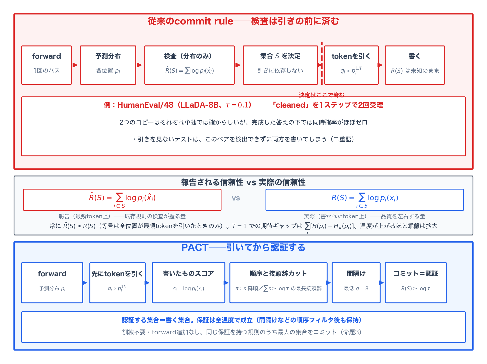
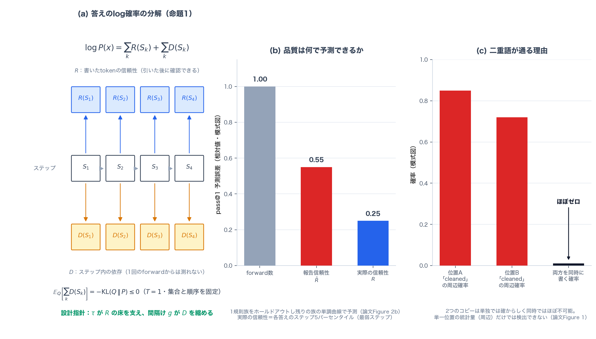
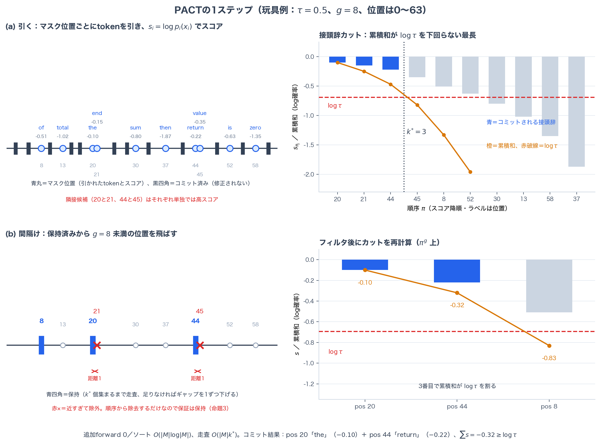
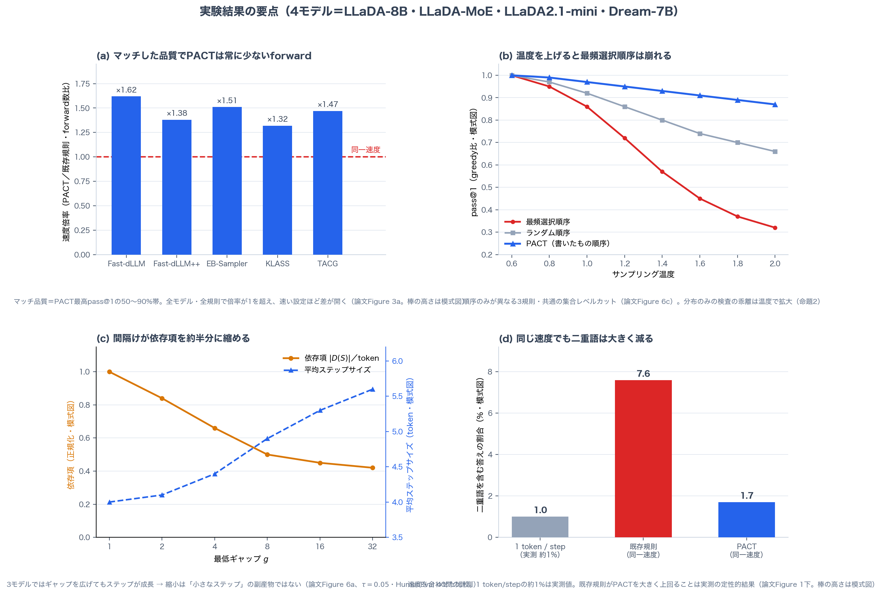

# 引く前に検査を済ませるな──PACTが拡散LMの並列デコーディングで書いたtokenそのものを認証する仕組み

## TL;DR

マスク拡散言語モデル（dLLM）の並列デコーディングを速くするcommit rule──Fast-dLLMやEB-Samplerなど──は、予測分布の統計量を検査して「このステップでどの位置を確定するか」を決める。しかしデコードがサンプリングで行われるとき、実際に書かれるのは引かれた（drawn）tokenであり、その検査は引きの**前**に済んでいる。引かれたtokenは最頻tokenよりずっと低い確率かもしれないが、分布だけを見るテストはこのギャップに気づけない。本論文は、答えの品質（pass@1）が「実際に書かれたtokenのlog確率の和」とよく相関することを4モデルで示した上で、**PACT（Post-draw Accumulated Certificate for Tokens）**を提案する。tokenを先に引き、そのlog確率で位置を順序づけ、累積和が$\log\tau$を下回らない最長の接頭辞をコミットする。さらにコミット位置を最低間隔$g$だけ離す。訓練不要・forward追加なしで、全温度で「書く集合そのもの」の信頼性保証を持ち、同じ保証を持つ規則のうち最大の集合をコミットできることを証明する。LLaDA・Dream系4モデル×5ベンチマークで、マッチした品質において5つの既存規則すべてより少ないforward数を達成。$\tau=0.3$で1 token/stepの精度の80〜98%を保ったまま最大約8倍高速化し、同じ速度では既存デコーダよりはるかに稀にしか同じ単語を二度書かない。

- 論文: [PACT: Certifying What Is Written in Parallel Decoding of Diffusion Language Models](https://arxiv.org/abs/2611.04152)（arXiv:2611.04152、2026年11月3日）
- 著者: Yanchao Li, Yusu Zhang, Jiaqing Xie, Yi Ban, Ben Gao, Zhongyu Huang, Tianfan Fu, Yuqiang Li（南京大学・上海人工智能実験室）
- コード: [github.com/LiZaiyuan0619/PACT](https://github.com/LiZaiyuan0619/PACT)

## 背景：commit ruleは「分布」を検査して「引き」を書く

マスク拡散言語モデルは、完全にマスクされた応答から出発し、毎ステップでいくつかの位置を埋めていく。各ステップは1回のforwardで、マスク位置$i$ごとに語彙上の分布$p_i$が得られる。デコーダは温度$T$で$q_i \propto p_i^{1/T}$からtokenを引き、**commit rule**が引いたtokenのどれを確定（コミット）し、どれをマスクのまま残すかを決める。コミットされたtokenはもう修正されない。1ステップで多く埋めるほどforwardは減るが、誤ったtokenを書くリスクは増える。

訓練不要のcommit ruleは、固定個数を埋める素朴な方式から、検査で個数を決める適応的な方式へと進化してきた。Fast-dLLMは位置ごとの最頻token確率でしきい値を引く。EB-Samplerはコミット候補の接頭辞についてエントロピーの総和を上界で抑える。KLASS、Fast-dLLM++、TACGも同様に、予測分布から計算した統計量を検査に使う。重要なのは、これらの検査が分布のみから計算されるため、**どのtokenが引かれても同じ集合をコミットする**ことだ。検査が対象にしているのは「最も確からしいtoken」の信頼性であって、実際に書かれるtokenの信頼性ではない。

この区別はgreedyデコード（$T \to 0$）なら消える。最頻tokenしか引かれないからだ。しかしdLLMはサンプリングでデコードされることが多く、RLやtest-time scalingが多様な答えに依存している（本論文の実験も温度0.6）。サンプリングの下では、引かれたtokenは最頻tokenよりずっと低い確率でありうる。そして分布だけを見るテストは、このギャップを一切見ない。

論文の冒頭に挙がる例が象徴的だ。最頻選択で順序づけた規則が、HumanEval/48へのLLaDA-8Bの応答（$\tau=0.1$）で "cleaned" を1ステップで2回受理した。2つのコピーはそれぞれ単独では十分確からしいが、完成した答えの下ではほぼ確率ゼロの組み合わせになる。単一位置の統計量から作ったテストはこれを検出できず、両方を同じステップで書いてしまう──これが出発点である。

論文はこの状況を2つの量で定式化する。コミット集合$S$について、

$$
\hat{R}(S) = \sum_{i \in S} \log p_i(\hat{x}_i), \qquad
R(S) = \sum_{i \in S} \log p_i(x_i)
$$

前者は最頻token $\hat{x}_i = \arg\max_v p_i(v)$ 上の**報告される信頼性**（reported reliability）、後者は引かれて実際に書かれるtoken $x_i$ 上の**実際の信頼性**（actual reliability）だ。既存規則の検査が上界を握っているのは$\hat{R}$であり、品質を実際に左右するのは$R$である。

## 診断：品質は「書いたもの」の信頼性に従う

著者らはまず、4モデル（LLaDA-8B、LLaDA-MoE、LLaDA2.1-mini、Dream-7B）で規則族を横断し、pass@1が何で予測できるかを調べた。比較された軸は3つ。実際の信頼性$R$（各答えのステップごとの5パーセンタイル、つまり最弱ステップの水準）、報告される信頼性$\hat{R}$、そしてforward数だ。結果は明快で、pass@1を最もよく予測するのは実際の信頼性であり、報告信頼性はこれより劣り、forward数はさらに大きく外れる。1つの規則族をホールドアウトし、残りの族で当てはめた単調曲線で予測する検証でもこの順は崩れない。さらに「stand-in規則」──位置あたりの個数やforward数、平均スコアを別の量に固定した代替規則──を持ち出すと、実際の信頼性が下がる分だけpass@1が落ちるという関係が予測どおりに成立する。順序を変えるだけの統制実験でも、最頻選択順序は「報告は$\tau$に達したが書いたものは下回る」ステップを頻繁に生み、引いたtokenで順序づけるとそのズレはほぼ消える。

では$R$は何によって決まるのか。論文は答えのlog確率を2つの和に分解する（命題1）。デコードが$S_1, \dots, S_K$の順にコミットされるとき、

$$
\log P(x) = \sum_{k=1}^{K} R(S_k) + \sum_{k=1}^{K} D(S_k)
$$

第一項は各ステップが書いたtokenの信頼性で、tokenを引いた後に確認できる量だ。第二項がステップ内の**依存項**で、$D(S) = \log P_S(x_S) - R(S)$、すなわち「tokenを1つずつ順に開示したときの同時確率」と「周辺分布の積」の差として定義され、1回のforwardからは測れない。集合と順序を固定して$T=1$で並列に引くと、依存項の期待値は$-\mathrm{KL}(Q \| P) \le 0$に等しい。並列で引くことが、モデルの分布から答えを遠ざける代償そのものだ。

この分解が設計の指針を与える。**第一項は閾値$\tau$で下から抑えられる。第二項はコミット位置を離すことで縮められる。**PACTはこの2行をそのまま実装したものになる。

さらに命題2が、分布のみの検査の構造的弱点を突く。常に$\hat{R}(S) \ge R(S)$で、等号は全位置が最頻tokenを引いたときに限る。分布だけから選ばれた集合$S$について、$\mathbb{E}_T[R(S)]$は温度について単調非増加──温度を上げるほど書かれるtokenは信頼できなくなる。$T=1$での期待ギャップは$\sum_{i \in S}[H(p_i) - H_\infty(p_i)]$（エントロピーとminエントロピーの差）になる。つまり分布のみの検査は、温度が上がるほど「検査した量」と「書いた量」が乖離する。この予測も実験で裏付けられる（後述）。

## 提案手法：PACT

PACT（Post-draw Accumulated Certificate for Tokens）は、commit ruleの3つの部品──スコア、順序、打ち切り──をすべて「引いたtoken」の側へ移す。

**1. 引いてからスコアする。** 各ステップでforwardの後、まず温度$T$ですべてのマスク位置のtokenを引く。スコアは**書いたものスコア**（written-word score）$s_i = \log p_i(x_i)$、引いたtoken自身のlog確率だ。

**2. 順序と集合レベルのカット。** 位置を$s_i$の降順に並べた順序を$\pi$とするとき、PACTは累積和が$\log\tau$を下回らない最長の接頭辞をコミットする。

$$
k^{*} = \max\left\{\, m \;\middle|\; \sum_{j \le m} s_{\pi_j} \ge \log\tau \,\right\}
$$

どの接頭辞も条件を満たさなければ$\pi_1$だけをコミットし、毎ステップ必ず進捗する。このカットが**集合単位**であることが効く。位置ごとに独立にしきい値を課すFast-dLLM系と違い、信頼できる位置を「まとまった予算」として扱えるからだ。

**3. コミット位置の間隔け（spacing）。** 隣接位置は互いの文脈を抜いた状態で決まる、最もリスクの高いペアだ。PACTは順序$\pi$を走査し、すでに保持した位置から最低距離$g$（デフォルト$g=8$）離れた位置だけを保持する。$k^{*}$個集まらないまま走査が尽きたらギャップを1ずつ下げてやり直す。フィルタ後の順序$\pi^{g}$に対してカットを再計算する──低いスコアの位置が和を$\log\tau$以下に落としうるからだ。間隔けは順序のフィルタにすぎず、forwardを追加しない。

計算量はソートが$O(|M|\log|M|)$、走査が$O(|M|k^{*})$で、1回のforwardに比べれば無視できる。訓練は一切不要で、変わるのはコミット集合を選ぶステップだけだ。

### 何が保証されるか

命題3：PACTがコミットする集合は（単一位置への例外を除き）**全温度で**$R(S) \ge \log\tau$を満たす。間隔けのような「順序から位置を除去するだけ」のフィルタを経ても保証は保たれる。しかも間隔けなしの場合、PACTはこの保証を持つ**最大の**集合をコミットする──同じ保証を持つ規則はこれ以上の位置をコミットできない。$\tau \to 1$で1位置/ステップに帰着し、$g=1$で間隔けは恒等変換になる。つまりPACTは「保証付き並列コミット」の族の端から端までを$\tau$一本で掃ける一般化になっている。

命題4：モデルの条件付き分布がマスク位置上の1つの同時分布から来て、それが系列に沿ってMarkovであるという仮定の下で、$m$個のコミット位置がペアワイズ$g$以上離れていれば、依存項は

$$
0 \le \mathbb{E}[D(S)] \le (m-1)\, J_I(g)
$$

で抑えられる（$J_I(g)$は距離$g$離れた2位置間の相互情報量の最大値。各周辺から引く場合のlautum情報についても同様の界が成り立つ）。$J_I$は$g$について非増加なので、間隔けは依存の上界を縮める。$(m-1)$の因子は**ステップが多くのtokenを書くほど間隔けが効く**ことを意味する。Markov性などの仮定は理想化であり、論文はこの予測するトレンドだけを実験で検証する、という誠実な姿勢を取る。

## 実験結果

### セットアップ

4モデル（LLaDA-8B-Instruct、LLaDA-MoE-7B-A1B、LLaDA2.1-mini 16B、Dream-7B）×5ベンチマーク（HumanEval、MBPP、GSM8K、MATH500、IFEval）。温度0.6、各答え256位置のシングルブロック、pass@1は8サンプル。比較対象はFast-dLLM、Fast-dLLM++、EB-Sampler、KLASS、TACGの5規則に、1 token/stepと固定$k$の2つの単純デコーダ。KVキャッシュは使わない──比較をcommit ruleそのものに絞るためだ。有意差は問題単位のペアードbootstrapで検定している。

### マッチした品質で少ないforward

方法ごとに速度と精度が同時に動くので、論文は品質を合わせてforward数を比べる。マッチ品質を「PACTの最高pass@1の50〜90%」の帯に置くと、**PACTは全モデルで5つの既存規則すべてより少ないforward**を達成する。差はデコードを速くするほど開く。1つの設定で素朴に比べても、PACTより正確な既存規則はほぼ常に遅い。固定$k$との比較では、同じforward数（1答え11〜26の帯）で高速設定のPACTは数倍正確だ。固定$k$が「いくつ書くか」を固定するのに対し、PACTは各ステップの実際の信頼性に書く数を委ねる──易しい場所では多く、難しい場所では少なく書く。

forwardの節約はそのまま時間に転化する。1 token/stepの精度に合わせたとき、LLaDA-8Bで最大約8倍の速度向上。HumanEval全体では$\tau=0.3$で1 token/stepのpass@1の80〜98%を保持する。Fast-dLLM流の32トークンブロックでも傾向は変わらず、その速度で同等の精度に達する。答えを1つだけ生成する設定では、KVキャッシュを持つARモデルのQwen3-8Bよりも速い。答えの多様性（相異なる最終答えの数、相異なる4-gramの割合）は1 token/stepと同水準に保たれている。

### 間隔け：ステップを削って全体を速くする

間隔けは各ステップのコミットを短くするのだから、直観には損に見える。ところが実測ではほぼ全問題でforwardを節約する。仕組みはこうだ。コミット位置が答え全体に散らばると、**次のステップ以降の予測が揃い、1ステップあたりに書ける数が増える**。トレードオフが全体でプラスに転じるのは速い設定（$\tau$が小さい設定）ほど顕著で、これは命題4の$(m-1)$因子の予測と一致する。$g=8$の両隣でも成績はほぼ変わらず、$g$の選択は致命的ではない。IFEvalでは間隔けが全閾値でpass@1を上げてもいる。

依存項の実測（tokenを1つずつ開示して同時確率を測る、計測専用のforwardを使う）では、間隔けは$|D(S)|$を約半分に縮める。3つのモデルではギャップを広げてもステップサイズがむしろ成長するので、縮小が「小さなステップ」の副産物ではないことも分かる。LLaDA2.1-miniだけはどのギャップでもステップが4 token近辺に留まるため間隔けの利得がなく、著者らは素直に間隔けなしで実行している。

### 温度を上げると差が開く

順序だけが異なる3つの規則──最頻選択順序、ランダム順序、PACTの書いたもの順序──で温度を振ると、命題2の予測どおりの分岐が起きる。最頻選択順序は温度の上昇とともに精度を失い、forwardも増える。引いたtokenで順序づけるPACTは精度の大部分を保持する。GSM8Kでも同じパターンだ。分布のみの検査の弱点は、温度が上がるほど顕在化する。

### 二重語の定量的な差

冒頭の「同じ単語を二度書く」現象は、速度を合わせた比較で定量化される。1 token/stepでは約1%の答えに現れる二重語が、既存の並列デコーダでは同じ速度のPACTよりはるかに頻繁に現れる。2つのコピーは単独では確からしく同時ではほぼ不可能、という組み合わせを、単一位置の統計量は決して検出できない。間隔けが隣接位置を同じステップから排除するので、PACTではこのペアがそもそも形成されにくい。

## 考察

この論文の主張は「速いcommit rule」ではなく「正しい検査対象」だ。並列デコーディングの高速化は、ふつう「各ステップがどれだけのリスクを取れるか」という枠組みで語られる。本論文は、**そのリスクを何の上で測るか**が同じくらい重要だと言う。分布上の最頻tokenで測ったリスクは、サンプリングの下では書かれるtokenのリスクを代表しない。引いてから測り直す──それだけで、同じ「リスク予算」が実際に書かれるものをカバーする。

理論と実装の接続も丁寧だ。分解（命題1）の第一項を$\tau$で抑え、第二項を間隔けで縮める、という2行の設計指針がそのまま手法になっていて、命題2〜4が「なぜこの設計でなくてはならないか」を裏打ちする。特に命題3の「同じ保証を持つ規則のうち最大」という最適性は、$\tau$という1つのパラメータで速度と品質の全域を掃ける根拠を与える。

限界も論文自身が明確に述べる。第一に、認証がカバーするのはlog確率の**総和**までで、同時確率（ステップ内依存）は1回のforwardからは測れない。間隔けは依存を間接的に下げるだけで、その上界はMarkov性という理想化の上に立つ。同時確率の直接の認証が「自然な次のステップ」として挙げられている。第二に、認証はモデル自身の確率に基づく。並列デコーディングが上乗せする誤りは限られるが、自信満々に間違うモデルは直せない。第三に、コストはforward数で数えており、1回のforwardの価値はキャッシュやバッチングを含む推論スタックに依存する。評価も2ファミリー・英語・自動採点に限られ、長い生成や人手評価は今後の課題だ。

実用の観点で特記すべきは、RLとtest-time scalingがサンプリングを主戦場にしていることだ。多数の答えを引いて選ぶ用途では、デコーダがモデルの分布からどれだけ逸脱するかが探索の質を左右する。PACTの分解はこの逸脱を$R$と$D$に分けて見せるので、「どの規則がどれだけ分布を壊すか」を語る共通言語としても使えそうだ。

## 関連研究

- **適応的commit rule**: 位置ごとの検査（最頻確率：Fast-dLLM、予測の安定性、軌跡シグナル：TACG）と接頭辞の検査（エントロピー上界：EB-Sampler、最頻tokenの同時確率：Fast-dLLM++、KLガイド：KLASS）。いずれも分布のみから計算され、引きを見ない点がPACTと対照的。
- **依存認識型デコーディング**: attentionから依存を推定するDAPD、訓練したヘッド（Ringel et al.）、小さなARモデル（Israel et al.）、先行文脈の不確実性（He et al.）。コミット位置の選び方で依存を避ける系統で、PACTの間隔けはその訓練フリー版に位置づけられる。間隔けの発想自体は画像生成のDilated scheduling（Luxembourg et al.）やHaltonスケジューラ（Besnier et al.）に由来する。
- **分析系**: ParallelBench（Kang et al.）、サンプラー中心の評価（Tang et al.）、情報理論的視点（Zhang et al.）が並列デコーディングの誤差を分析し、Zhong et al.とNi et al.は生成順序の自由度の価値を問い直した。本論文はこの系譜に対して「実際の信頼性」という測定軸を提出したものと読める。
- **本ブログの既報とも近い**: ARモデルの無損失高速化（Uno、2026-09-09公開）、自己蒸留による並列化（Pivot-SD、2026-10-05公開）、reveal順序の学習（Cord、2026-11-02公開）と同じく、dLLMの「順序と並列性の自由度」を資源として扱う系譜。PACTはこの系譜ではじめて「保証」の側を明示的に書いた。

## まとめ

PACTは、マスク拡散LMの並列デコーディングにおけるcommit ruleの検査対象を「予測分布の最頻token」から「引いて実際に書くtoken」へ移した。書いたものスコアで順序づけ、累積和$\log\tau$の接頭辞カットで認証し、間隔けで依存を縮める。訓練不要・forward追加なしで、全温度で書く集合そのものの信頼性を保証し、同じ保証を持つ規則のうち最大の集合をコミットできる。4モデル×5ベンチマークで、マッチした品質において5つの既存規則すべてを上回る効率、温度への頑健性、そして二重語の大幅な減少を示した。

「検査は、それが検査すると言うものを実際に検査しているか」。サンプリングベースの生成が主流になるほど、この問いはデコーダ設計の随所で繰り返されるだろう。次に認証すべきは各ステップの同時確率だと、著者ら自身が道標を指している。

## 参考

- Li, Y., Zhang, Y., Xie, J., Ban, Y., Gao, B., Huang, Z., Fu, T., & Li, Y. (2026). PACT: Certifying What Is Written in Parallel Decoding of Diffusion Language Models. [arXiv:2611.04152](https://arxiv.org/abs/2611.04152)
- Wu, C. et al. (2026). Fast-dLLM: Training-free Acceleration of Diffusion LLM by Enabling KV Cache and Parallel Decoding. ICLR 2026.
- Ben-Hamu, H. et al. (2025). Accelerated Sampling from Masked Diffusion Models via Entropy Bounded Unmasking. NeurIPS 2025.（EB-Sampler）
- Kim, S. H. et al. (2025). KLASS: KL-guided Fast Inference in Masked Diffusion Models. NeurIPS 2025.
- Kasa, S. R. et al. (2026). Fast-dLLM++: Fréchet Profile Decoding for Faster Diffusion LLM Inference. [arXiv:2606.02955](https://arxiv.org/abs/2606.02955)
- Nie, S. et al. (2025). Large Language Diffusion Models. NeurIPS 2025.（LLaDA）
- Ye, J. et al. (2025). Dream 7B: Diffusion Large Language Models. [arXiv:2508.15487](https://arxiv.org/abs/2508.15487)
- PACT公式実装: [github.com/LiZaiyuan0619/PACT](https://github.com/LiZaiyuan0619/PACT)
