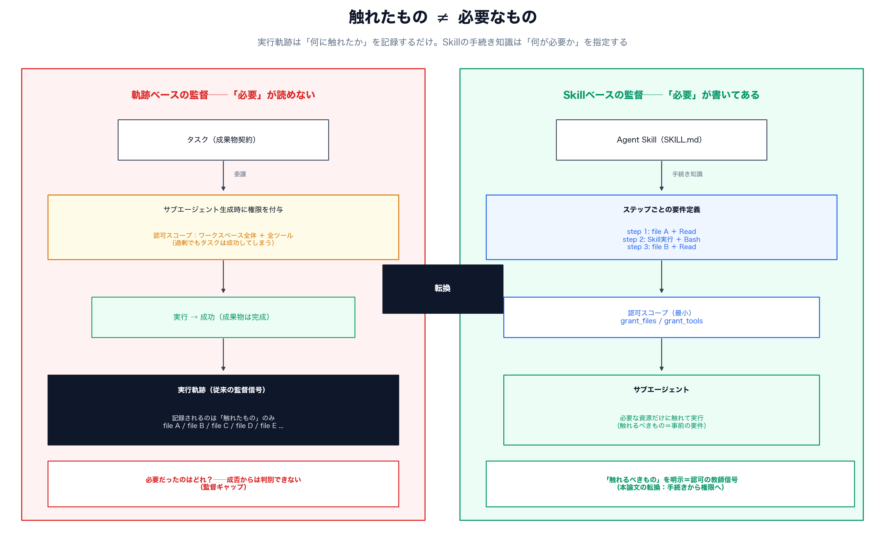
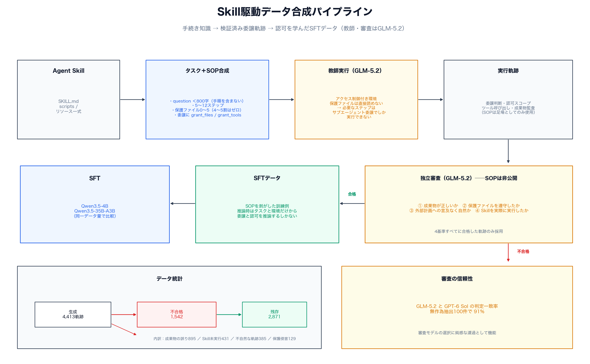
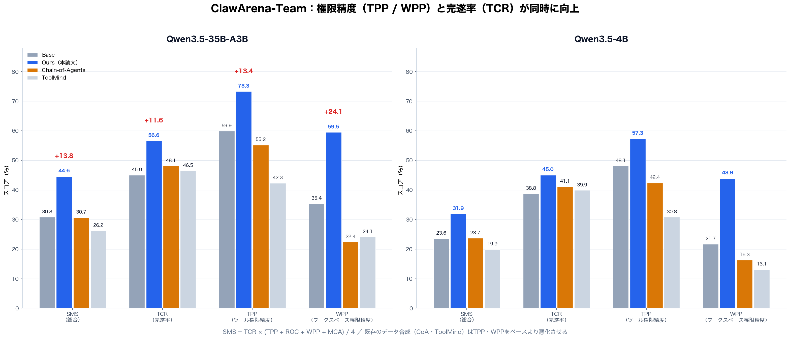
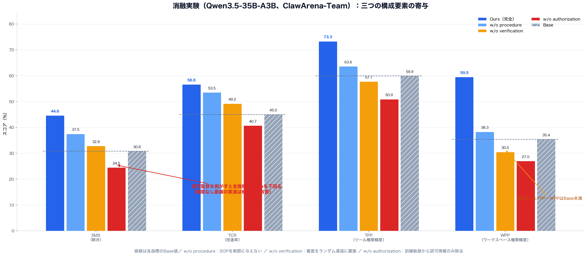

# 何をしたかではなく何が必要か──Agent Skillsの手続き知識がサブエージェントの権限設計を教える仕組み

## TL;DR

複数エージェントへの委譲が当たり前になったいま、メインエージェントに課される決定は「どのサブエージェントに何をさせるか」だけではない。**そのサブエージェントにどこまで触らせるか**──使ってよいツールとアクセスしてよいワークスペース資源の範囲、つまり認可（authorization）もまた、委譲のたびに迫られる判断になる。

本論文の出発点は、この認可判断に対する**監督信号が事実上存在しない**という指摘だ。タスクの成否も実行軌跡も、サブエージェントが「何に触れたか」は教えてくれるが、「何が必要だったか」は教えてくれない。成果物は入力ファイル1つで書けたのに、ワークスペース全体へのアクセスで成功していた──そんな軌跡は平気でできてしまう。

著者らの観察は、**Agent Skillsがこの穴を埋める**というものだ。Skillsはタスクの進行に沿って「どの段階でどの操作を、どのツールで、どのファイルに対して行うか」を記述する手続き知識のパッケージであり、「触れたもの」ではなく「**触れるべきもの**」を指定している。そこで本論文は、Skillからタスクと手順書（SOP）を合成し、アクセス制御付きの環境でサブエージェント委譲として実行し、独立したLLM審査を通過した軌跡だけをSFTデータに変換する。

結果の要点（Qwen3.5-35B-A3B、ClawArena-Team）は次の通りだ。

- ツール権限精度（TPP）59.9→73.3（+13.4pt）、ワークスペース権限精度（WPP）35.4→59.5（+24.1pt）
- タスク完遂率（TCR）も45.0→56.6（+11.6pt）。**権限を絞っても成功率が下がらない**どころか上がる
- 総合スコアSMSは30.8→44.6。比較したChain-of-Agents・ToolMindのデータではTPP/WPPはむしろ悪化する
- 認可監督だけを剥がした消融ではSMS 24.5と**ベースモデル（30.8）を下回る**。権限指定なしの委譲を実演として見せるのは、何も教えないより有害
- Terminal-Bench 2.1（34.8）・SkillsBench（10.3）ではターミナル特化のTMAXなどと互角以上で、実行能力の劣化なし

権限の過剰付与はログのどこにも「失敗」として現れない。成功がそれを隠す。本論文は「手続きから権限へ」という監督源の転換によって、この見えない失敗を訓練可能にした。

- 論文: [From Procedures to Permissions: Learning Precise Subagent Authorization from Agent Skills](https://arxiv.org/abs/2611.08905)（arXiv:2611.08905、2026年11月6日）
- 著者: Wenkai Yu・Ning Ding（Samsung Research Beijing / 北京大学）、Wentao Zhang（北京大学）、Yehui Tang（Samsung Research Beijing）
- 主評価環境: ClawArena-Team、Terminal-Bench 2.1、SkillsBench

## 背景：委譲は「許可」の決定を迫る

エージェントフレームワークは、ツールと実行環境を制御する機構をすでに持っている。サブエージェントに渡すツール一覧とアクセス可能パスの指定も、サンドボックスの権限設定も、実装はされている。問題は機構ではなく**判断**の方だ。「この委譲されたサブタスクには、どのツールとどのファイルを渡すべきか」を決める能力が、モデル側に備わっていない。

しかもこの判断は、タスクの成否からは検証できない。AuthBenchは、コーディングエージェントが必要な権限の取りこぼしと不要な権限の付与を**同時に**起こすことを報告している。ClawArena-Teamは、マルチエージェント設定でワークスペース権限の過剰付与が顕著な失敗要因だと指摘する。MiniScopeは最小権限を実行時に強制する機構を、SkillScopeはSkillに固有の権限違反の性質を研究した。いずれも認可の重要性を確立したが、**その監督をどこから調達するか**という学習側の問いには答えていない。

ここには構造的なギャップがある。エージェントの訓練データは、タスク成果・デモンストレーション・実行軌跡のいずれかで構成される。これらはタスクが成功したかは教えるが、個々の委譲ステップの認可境界は教えない。成功した軌跡には複数ファイルへのアクセスが記録されているかもしれないが、そのうち本当に必要だったのは1つかもしれない。**実行痕跡は「触れたもの」を語り、「必要なもの」を語らない。**

## 転機：Skillは手続き知識である

Agent Skillsは、自然言語の指示と実行リソースを束ねた再利用可能な能力パッケージだ（SkillsBench）。本論文の着眼はその記述様式にある。Skillsは単に「何を達成すべきか」を書くのではなく、実行の各段階で必要な操作・ツール・ファイルを並べて書く。つまり**手続き知識**である。

この性質は認可の監督にきれいにはまる。委譲するステップが決まれば、そのステップの記述から「必要なツールとワークスペース資源」が読み取れる。軌跡が事後的なアクセス記録であるのに対し、Skillの記述は**事前的な要件定義**だ。「触れたもの」ではなく「触れるべきもの」を与えてくれる。

## 方法：手続き知識を検証済み軌跡に変換する

パイプラインは4段階で構成される（図2）。

### 1. タスクとSOPの合成

タスク設計プロンプトがSkillを読み込み、（a）ワークスペースの入力ファイル群、（b）ユーザー向けタスク記述（question）、（c）ステップ実行計画（SOP）をspec.jsonとして生成する。設計制約がいくつも効いている。

- **Skill中心性**：ステップの半分以上がSkillの主要エントリポイントを使う。中身を眺めるだけでなく、実行して初めて成果物が揃うタスクにする
- **保護ファイル**：0〜5個を配置し、4〜5割のタスクはゼロにする。保護なしタスクでは全ステップをメインエージェントが直接実行する。**委譲しない判断も同時に学ばせる**ためだ
- **questionは800字以下の成果物契約**：出力パス・形式・観察可能な要件を2〜5個書くだけ。手順・コマンド・委譲指示・「SOP」という語は含めない
- **委譲の精度**：保護データを必要とするステップは必ず委譲する。各委譲には自己完結したsubagent_promptと、必要ファイル、そして**最小の** grant_files / grant_toolsが付く。grant_toolsはRead・Write・Edit・Bash・Grep・Globの部分集合

保護ファイルは名前から保護されていると分からない現実的なファイル名にし、questionでは単に「アクセス制限あり」と述べる。隠された検証器を探すことも禁止されている。

### 2. アクセス制御下での教師実行

教師エージェント（GLM-5.2）が、タスク・Skill・SOPを受け取って対話環境で実行する。保護ファイルはメインエージェントから直接は読めず、必要なステップはサブエージェントを作って認可スコープ（tools と accessible_paths）を明示的に付与するしかない。ここが肝だ。**認可判断が形式的な注釈ではなく、実行の成否を左右する制約**として働く。権限を絞りすぎれば委譲先が詰まり、広げすぎれば審査で落ちる。合成環境はそういう世界になっている。

付録の実例を見よう。warm-talk SkillでWeChatのコーチング台本を作るタスクでは、会話ログ conversation_log.json が保護ファイルに指定される。教師は tools: ["Read"] とパス1つだけを持つサブエージェントに読み取りを委譲し、残りの工程（Skillの9セクション実行、台本の作成、成果物監査）は自分で行う。軌跡には委譲判断・認可スコープ・ツール呼び出しが丸ごと記録される。

### 3. 独立したLLM審査

生成された軌跡は、独立セッションの審査（GLM-5.2）にかけられる。重要なのは**審査がSOPを受け取らない**ことだ。判定は4基準で行われる。

1. deliverable_correct：成果物が実質的なデータでタスクの目的を満たすか
2. no_protected_violation：アクセス制御を守ったか
3. trajectory_natural：外部計画・SOP・ステップ番号への言及がなく、自然なエージェントに見えるか
4. skill_used：Skillのコードを実際に実行したか（ドキュメントを読むだけでは不可）

後の2基準が渋い。足場への依存を軌跡の不自然さとして検出し、Skillを実行せず手書きの結果で済ませる迂回──付録Cには、キャッシュされた結果や自作の要約でSkillをスキップしようとする失敗例が並ぶ──を弾く。審査モデルの頑健性も確認されており、GLM-5.2とGPT-6 Solの判定は無作為抽出した100件で**91%一致**する。

データ統計はこうだ。生成4,413軌跡のうち1,542に何らかのエラーがあり、**2,871件が全基準を通過して残った**。失敗の内訳は成果物の誤り・不完全895、Skill未実行431、不自然な軌跡385、保護ファイル侵害129（1軌跈で複数該当あり）。残存データはソフトウェア工学・データ分析・セキュリティとコンプライアンスなどを偏りなくカバーする。

### 4. SOPを剥がしてSFT

SOPは合成時だけの足場だ。審査にも訓練例にもSOPは含めない。つまり訓練されたモデルは、**タスクと環境だけから委譲と認可を推論する**しかない。これは評価環境（ClawArena-Team等）がSOPをくれないことへの合わせ設計であり、SOPを残して依存を教え込む事故を防いでいる。

## 実験結果

### ClawArena-Team：権限精度と成功率が同時に上がる

ClawArena-Teamは、メインエージェントがサブエージェントを作成し、それぞれにモダリティクラス・ツール・ワークスペース範囲を割り当てて、複数ラウンドの専門シナリオを完遂するベンチマークだ。指標は次の通り。

- TCR（タスク完遂率）、TPP（ツール権限精度）、WPP（ワークスペース権限精度）、ROC（読み取り専用遵守）、MCA（モダリティ選択精度）
- 総合スコア：`SMS = TCR × (TPP + ROC + WPP + MCA) / 4`

| 手法（Qwen3.5-35B-A3B） | SMS | TCR | TPP | ROC | WPP | MCA |
|---|---|---|---|---|---|---|
| Base | 30.8 | 45.0 | 59.9 | 96.1 | 35.4 | 82.8 |
| **Ours** | **44.6** | **56.6** | **73.3** | **98.1** | **59.5** | 84.5 |
| Chain-of-Agents | 30.7 | 48.1 | 55.2 | 94.6 | 22.4 | 83.2 |
| ToolMind | 26.2 | 46.5 | 42.3 | 88.7 | 24.1 | 70.2 |

4Bでも傾向は同じだ（Base 23.6→Ours 31.9、WPP 21.7→43.9）。

読みどころは二つある。第一に、**権限を絞る学習が成功率を下げない**。TCRは+11.6ptとむしろ大きく伸びる。スコープが明確な方が委譲先のサブエージェント自身が迷わない、という解釈も成り立つ。第二に、既存のデータ合成（Chain-of-Agents・ToolMind）はTPP/WPPを改善しないどころかベースより悪化させている。協調行動やツール使用の監督はあっても、認可スコープの監督がないからだ。

### 汎用実行能力は落ちない

Terminal-Bench 2.1とSkillsBenchでの比較がこれだ。

| 手法（Qwen3.5-35B-A3B） | Terminal-Bench 2.1 | SkillsBench（3試行平均） |
|---|---|---|
| Base | 28.1 | 5.7 |
| **Ours** | 34.8 | **10.3** |
| Chain-of-Agents | 29.2 | **10.3** |
| ToolMind | 32.6 | 9.2 |
| SWE-smith | 33.7 | 6.9 |
| TMAX | **38.2** | 8.0 |

ターミナル特化のTMAXには及ばないが、SWE-smithやToolMindは上回り、SkillsBenchでは最高タイ。認可付きの委譲データがタスク実行能力を狭めないことを確認している。

### 消融：三つの要素の効き方

| 設定（Qwen3.5-35B-A3B） | SMS | TCR | TPP | WPP |
|---|---|---|---|---|
| Ours（完全） | 44.6 | 56.6 | 73.3 | 59.5 |
| w/o procedure | 37.5 | 53.5 | 63.6 | 38.3 |
| w/o verification | 32.8 | 49.2 | 57.7 | 30.5 |
| **w/o authorization supervision** | **24.5** | **40.7** | **50.9** | **27.0** |
| Base | 30.8 | 45.0 | 59.9 | 35.4 |

- **SOP除去（w/o procedure）**：教師がSkill文書とタスクだけから必要資源を自力で推論するようになる。それでもベースは上回る（Skill自体が手続き知識を保持しているから）が、伸びは半減近くになる。明示的なSOPが、知識をステップ粒度の信頼できる監督へ変換する役割を果たす
- **検証除去（w/o verification）**：審査をランダムフィルタに置き換えると、TPP/WPPは**ベースを下回る**。失敗軌跡（空の成果物・不要な権限・一貫しない委譲）が混ざると監督同士が衝突する。データの質は量で代用できない
- **認可監督除去（w/o authorization supervision）**：訓練軌跡のサブエージェント生成呼び出しから認可情報だけを剥がす（実行痕跡は保持）。結果は全指標でベースを大きく下回る。これは示唆的だ。認可なしの委譲は「学ぶべきことの欠如」ではなく、**権限を確認しない委譲こそ正しい作法だと示す実演**として機能する。悪い例を見せることは、何も見せないことより有害なのである

### ケーススタディ：ディレクトリ丸ごとから、必要な3ファイルへ

衛星画像の境界変更レビュータスク（画像分析・測量・法務の3委譲）で、Baseと訓練後モデルの認可が比較されている。Baseは画像分析サブエージェントに imagery/ ディレクトリ全体とRead・Grep・Globを与える。訓練後のモデルは**2つのシーンノファイルとメタデータCSVのみに、Readのみ**を与える。測量・法務も同様に、ディレクトリ単位から必要ファイル単位へ絞る。その結果、Baseが5ラウンド中4回完遂だったのに対し訓練後は全5回を完遂し、シナリオ内のTPP/WPPは60.0/63.3から**100.0/100.0**になる。「単に少なく与える」のではなく、必要集合に合わせることを学んだ証拠だ。

## 考察

**「触れたもの」と「必要なもの」の区別は、エージェント訓練一般に通じる視点だと思う。** 成果報酬で成功を罰する強化学習も、軌跡を写す教師あり学習も、基本的には「触れたもの」側の信号である。本論文は、要件を記述する別のテキスト（Skill）を教師側に持ち込むことで、この非対称を一部分解消した。一般化できるかは興味深い問いで、「この編集にはどのファイルへの書き込み権限が必要か」「この検索にはどの範囲の参照権限が必要か」といった行動の事前要件を記述したデータソースがあれば、同じ仕組みが働くはずだ。

**認可監督除去の結果は、合成データの混在の害の好例でもある。** ベース（SMS 30.8）に対し、認可なし委譲の実演を混ぜると24.5まで落ちる。SFTが行動様式を忠実に模倣する以上、欠除状態の行動様式は積極的に有害になる。合成データの品質管理とは「正例を選ぶ」だけでなく「負例を実演に含めない」ことでもある、という教訓として読める。

**限界**も素直に挙げられている。教師と審査が単一モデル（GLM-5.2）依存で、審査一致率91%は高いが完璧ではない。訓練はSFTのみで、認可判断をさらに伸ばすRL等の探索は残されている。合成タスクの保護ファイル配置（4〜5割が保護なし）と評価分布の整合も、結果の一部を説明するだろう。

**実行時強制との補完関係**も見えてくる。MiniScopeやSkillScopeが作るのは外側の壁で、壁があれば権限違反は実行できない。本論文が学ぶのは内側の判断で、判断が正しければ壁に当たる前に正しいスコープで委譲される。壁だけなら失敗のリトライか停滞が残り、判断だけなら穴が残る。両者の組み立てが次の実用段階を作りそうだ。

## 関連研究

- **サブエージェントとスキルの実行方式**（[arXiv:2609.09233](https://arxiv.org/abs/2609.09233)、当ブログ2026-09-18）：スキルを直接実行するかサブエージェントに渡すかで長期タスクの性能が分かれることを示した。本論文はさらに進み、Skillの記述をサブエージェントへの認可決定の教師に使う。**スキルは実行手段であると同時に、権限の仕様書**でもある
- **DHCG**（[arXiv:2610.07835](https://arxiv.org/abs/2610.07835)、当ブログ2026-10-14）：実行フィードバックで協調グラフを動的に育てる。チーム構造（誰に何を任せるか）の学習に対して、本論文は権限（任せた先に何を許すか）の学習を補う
- **The Memory Trap**（[arXiv:2611.07554](https://arxiv.org/abs/2611.07554)、当ブログ2026-11-08）：無害な記憶の過剰一般化が危険行動を生む。スコープの内在化という共通テーマを持つ──あちらはスコープが広がる害、本論文はスコープを正しく絞る学習
- **MiniScope**（[arXiv:2512.11147](https://arxiv.org/abs/2512.11147)）：ツール呼び出しエージェントへの最小権限の実行時強制。**SkillScope**（[arXiv:2605.05868](https://arxiv.org/abs/2605.05868)）：Skill固有の権限違反の分析。**AuthBench**（[arXiv:2605.14859](https://arxiv.org/abs/2605.14859)）：コーディングエージェントの権限理解の測定
- **ClawArena-Team**（[arXiv:2606.31174](https://arxiv.org/abs/2606.31174)）：サブエージェント編成のベンチマーク。本論文の主評価環境
- **Chain-of-Agents**（[arXiv:2508.13167](https://arxiv.org/abs/2508.13167)）、**ToolMind**、**TMAX**（[arXiv:2606.23321](https://arxiv.org/abs/2606.23321)）、**SWE-smith**：比較対象のエージェントデータ合成・訓練手法

## まとめ

- 委譲における認可（何を許すか）は、タスクの成否からは観測できない監督対象で、従来のエージェント訓練はここを教えてこなかった
- Agent Skillsの手続き知識は「触れるべきもの」を指定する事前要件であり、認可監督の自然な供給源になる
- アクセス制御付きの合成タスクで認可判断を成否に効かせ、独立審査で軌跡の質を担保し、SOPを剥がして訓練するパイプラインは、2,871件のデータでTPP +13.4pt・WPP +24.1pt・TCR +11.6ptを達成した
- 認可監督の除去はベースを下回る。権限なし委譲の実演は積極的に有害
- 最小権限の「壁」（実行時強制）と「判断」（学習）の組み合わせが、次の実用段階を作りそうだ

## 参考

- 論文: [From Procedures to Permissions: Learning Precise Subagent Authorization from Agent Skills](https://arxiv.org/abs/2611.08905)（arXiv:2611.08905）
- ClawArena-Team: [ClawArena-Team: Benchmarking Subagent Orchestration and Dynamic Workflows in Language-Model Agents](https://arxiv.org/abs/2606.31174)
- SkillsBench: [SkillsBench: Benchmarking How Well Agent Skills Work Across Diverse Tasks](https://arxiv.org/abs/2602.12670)
- MiniScope: [Authorizing Agents with Least-Privilege Permissions](https://arxiv.org/abs/2512.11147)
- SkillScope: [Toward Fine-Grained Least-Privilege Enforcement for Agent Skills](https://arxiv.org/abs/2605.05868)
- AuthBench: [Do Coding Agents Understand Least-Privilege Authorization?](https://arxiv.org/abs/2605.14859)
