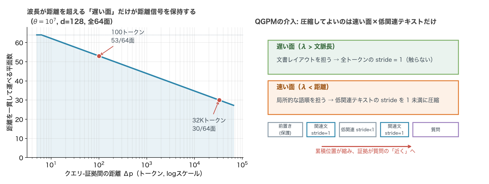
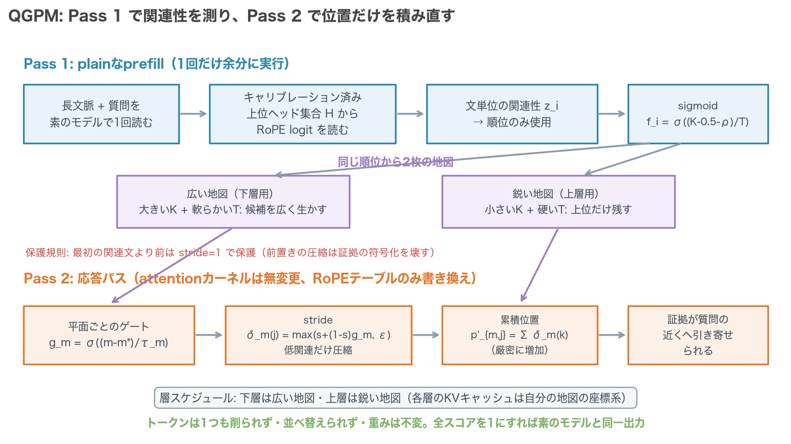
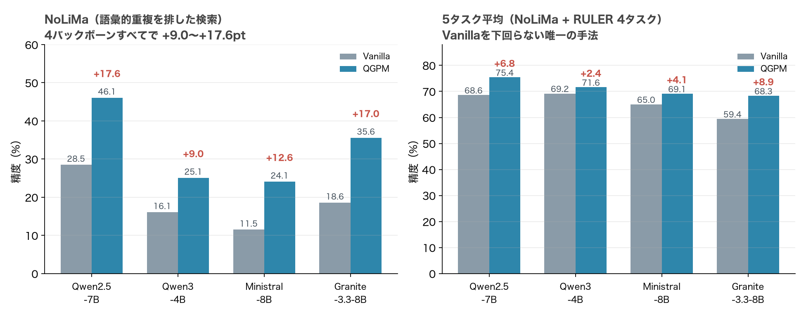
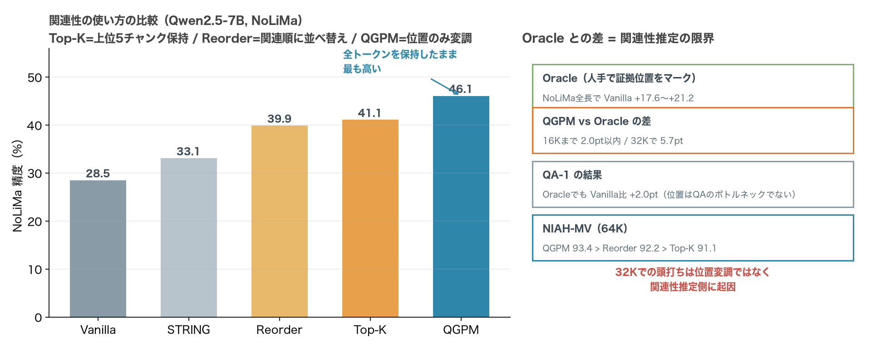

# トークンは1つも動かさず距離を縮める──QGPMがクエリ誘導RoPE変調でlost-in-the-middleと戦う仕組み

## TL;DR

長文脈LLMの文脈窓は数十万トークンに達したが、「窓の中身をどれだけ使い切れているか」は別問題だ。モデルは入力の頭と末尾には強く反応する一方、真ん中に置かれた証拠を見落とす。Liu et al. (2024) 以来、定番の失敗モードとして知られる **lost in the middle** である。

USCとAWSのZhang、Pingらが発表した**QGPM（Query-Guided Positional Modulation）**は、この問題への介入ポイントとしてRoPEの位置表現そのものを選び、しかもその変更を**クエリから読み取った関連性で条件付ける**。訓練なし・重み不変・入力不変の三条件を守ったまま、次の3段階を踏む。

1. モデル自身のattentionヘッドから「質問はどの文に関連するか」を読む（plainなprefillを1回だけ余分に実行）
2. 低関連の文だけ、**速く回転する周波数面上で**位置の進み幅（stride）を1未満に圧縮する
3. 累積位置が縮むことで、関連する証拠が質問の「近く」へ引き寄せられる

理論的な支柱は、RoPEの位置符号を周波数面に分解したときの**長距離減衰**だ。RoPEは $d/2$ 個の2次元回転面の和で相対位置を表すが、波長がトークン距離を下回る面は位相が一周以上回ってしまい、距離の信号として平均化されて消える。$\theta=10^7$・$d=128$ の設定では、距離100トークンで64面中53面が距離を一貫して運べるのに対し、32Kトークンでは30面まで減る。遠くの証拠は、近くのテキストより少ない面でしか照合されない。**ならば証拠だけ近づけばよい**──これがQGPMの出発点である。

結果の見どころは4つある。

- **NoLiMa**（質問と証拠の語彙的重複を最小化した検索ベンチマーク）で4バックボーンすべてに**+9.0〜+17.6pt**。Qwen2.5-7Bは28.5→46.1
- **NIAH-MK**（類似キーの山から1つの値を選ぶ）では、劣化するバックボーンほどよく効く。Granite-3.3-8Bは平均66.0→85.1、64Kでは**14.2→55.4**
- **入力編集に勝つ**：Qwen3-Rerankerで上位チャンクを保持するTop-K（NoLiMa 41.1）や並べ替えるReorder（39.9）を上回る46.1。トークンを1つも捨てていないのに、である
- **Oracle（人手で証拠位置をマーク）との差は1.2pt以内**：attentionから読んだ関連性は、注釈付きの証拠位置にほぼ匹敵する

実務上の代償は2つ。モデル内部（Q/KベクトルとRoPEテーブル）へのアクセスが必要で、API経由でしか提供されないモデルには適用できないこと。そして関連性測定のためにplainなprefillが1回増え、TTFTが延びること。デコードの1ステップあたりコストとKVキャッシュのサイズは標準推論と変わらない。コードは公開されている。

## 背景：窓は広いのに、真ん中は薄い

まず失敗の形状を確認しておく。lost in the middle は、同じ品質の証拠を入力のどこに置くかで精度がU字型に動く現象として観測された。頭と末尾は読まれ、中盤は読み飛ばされる。NoLiMa（Modarressi et al. 2025）はこの傾向に輪をかける。質問と証拠の字面的な重複を意図的に小さく作るため、表層マッチングで証拠を拾えず、本物の「読み」が要求される。RULERのNIAH-MK（多数の似たキーの中から1つの値を探す）も、位置の効果が強く出るタスクだ。

では既存の対策はどこに介入してきたか。論文は3系統に整理する。

**入力圧縮**（Selective Context、LongLLMLingua、LLMLingua-2）は重要度が低いトークンを削る。ファイルサイズは減るが、削った情報は二度と戻らない。等級付きの関連性──「どれも要らないが、こっちの方がまだマシ」という情報──は失われる。後で見る通り、LLMLingua-2はNIAH-MKで壊滅する。キーの一致というデリケートな演算が、削除で破壊されるからだ。

**attention再重み付け**（PASTA、AutoPASTA、InstABoost）は選んだトークンへのattentionを増幅する。しかしRoPEが遠距離の位置信号を減衰させた**後**のlogitをスケールするにすぎない。そもそも信号が弱いところに増幅をかけても、ノイズも一緒に持ち上がる。

**RoPEレベルの位置変更**（Ms-PoE、Self-Extend、STRING、Position Engineering）は位置符号に直接手を入れる。ただしこれらの再マッピングは**クエリを見る前に固定**される。証拠と邪魔者の区別なく、同じ写像が全トークンに適用される。

QGPMの立場は明快だ。**関連性の情報は使う。しかし削らないし、並べ替えない。変えるのは位置だけで、しかも特定の周波数面だけ、しかも低関連のテキストだけ**。この絞り込みを支えるのが、次の理論的観察である。

### RoPEの長距離減衰を数える

RoPEは各query/keyベクトルを $d/2$ 個の2次元平面に割り、平面 $m$ を角周波数 $\omega_m = \theta^{-2m/d}$ で回転させる。位置 $p_i$ のqueryと位置 $p_j$ のkeyのattention logitは、各平面から振動項を1つずつ受け取る。

$$\mathrm{logit}(i,j) = \sum_{m=0}^{d/2-1} \left[ a_m \cos(\omega_m \Delta p) + b_m \sin(\omega_m \Delta p) \right]$$

ここで $\Delta p = p_i - p_j$ であり、$a_m, b_m$ はベクトルの内容だけで決まる係数だ。重要なのは、位置情報が各平面の**位相 $\omega_m \Delta p$** を通してのみ現れること。平面 $m$ は $\lambda_m = 2\pi/\omega_m$ ごとに一周するから、$\lambda_m < \Delta p$ の平面は距離 $\Delta p$ の間に一周以上回ってしまい、cos/sinの項は近傍のkeyたちの間で打ち消し合う。距離を一貫して運べるのは $\lambda_m > \Delta p$ の平面、すなわち波長が距離を超える遅い面だけだ。その境界となる平面番号は

$$m(\Delta p) = \frac{d \ln(\Delta p / 2\pi)}{2 \ln \theta}$$

と閉形式で書ける。$m(\Delta p)$ は距離とともに単調に増える。つまり**遠くの証拠ほど、少ない平面でしか照合されない**。$\theta = 10^7$, $d = 128$ なら、64平面のうち距離100トークンを一貫して運べるのは53平面だが、32Kトークンでは約30平面に減る。これがRoPEの長距離減衰であり、lost in the middle の位置的な説明候補である。

この見方は、対策も教えてくれる。クエリと証拠の距離を $\Delta p$ から $\Delta p'$ に縮めれば、$\Delta p' < \lambda_m < \Delta p$ を満たす平面のコヒーレンスが復活する。同時に、$\lambda_m$ が文脈長を超える遅い平面はどんな距離でも一貫しており、文書の粗いレイアウトを担っている──**ここは触る必要がない**。一方、速い平面は局所的な語順も担う──**だから圧縮してよいのは、クエリに無関係なテキストだけ**。

## 提案手法：2パスで動くQGPM

QGPMの推論は2つのパスに分かれる。1回目のplainなprefillで関連性を測り、2回目の応答パスで位置を変調する。

### Pass 1：モデル自身に関連性を聞く

関連性の信号源は、モデル自身のattentionヘッドだ。事前に各バックボーンについて、証拠文の位置アノテーションを持つキャリブレーション用サンプル（評価セットと非交差）で全 (層, ヘッド) ペアを評価し、証拠文ランキングのMRRが高い上位ヘッド集合 $\mathcal{H}$ を選んでおく。選ばれたヘッドは中間〜上層に多い。

推論時には、質問トークンとプロンプト末尾の数トークンをquery行 $\mathcal{Q}$ とし、ヘッド $h$ の文脈トークン $j$ への関連性を「query行からのRoPE logitの最大値」として読む。

$$\ell_h(j) = \max_{r \in \mathcal{Q}} \frac{(R(p_r)\, q_{h,r})^\top (R(p_j)\, k_{h,j})}{\sqrt{d}}$$

文脈を文に分割し（`.` `!` `?` + 空白、略語は保護）、各文のスコアは文内最強トークンの $\ell_h$ とする。ヘッドごとに標準化して平均すれば、文 $S_i$ の関連性 $z_i$ が得られる。

$$z_i = \frac{1}{|\mathcal{H}|} \sum_{h \in \mathcal{H}} \frac{\ell_h(S_i) - \mu_h}{\sigma_h}$$

入力ごとに $z_i$ のスケールは暴れるので、QGPMは**順位だけ**を使う。順位 $\rho(i)$（最関連が0）をsigmoidでスコア化する。

$$f_i = \sigma\left(\frac{K - 0.5 - \rho(i)}{T}\right), \qquad s_i = s_{\mathrm{low}} + (1 - s_{\mathrm{low}})\, \tilde{f}_i$$

上位の文はスコア1、最下位は $s_{\mathrm{low}}$ に張り付く。中心 $K$ が「スコア1近くに残す文の数」、温度 $T$ が「落ち込みの急さ」を決める。

ここでQGPMは**同じ順位から2つの地図**を作る。**広い地図**（broad map）は大きい $K$ と軟らかい $T$ で、複数の候補文が関連扱いになる。**鋭い地図**（sharp map）は小さい $K$ と硬い $T$ で、上位のごく少数だけが残る。なぜ2枚も要るのかは Pass 2 の層スケジュールで効いてくる。

もう一つ、地図上の重要な保護規則がある。**最初の関連文より前の文脈はスコア1で保護される**（protected prefix）。因果attentionのもとでは、証拠の表現は証拠より前のテキストから作られる。前置きを圧縮すると証拠の符号化そのものが壊れるので、圧縮は「証拠と質問の間」──まさに距離を決める区間──に限定される。

### Pass 2：周波数を分けて、位置を積み直す

応答パスでは、地図のスコアを**平面ごとのstride**に変換する。アンカー長 $L_a$（文脈長に比例）を定め、境界平面 $m^* = m(L_a)$ を決める。平面 $m$ が速いか遅いかは、sigmoidゲートで滑らかにつなぐ。

$$g_m = \sigma\left(\frac{m - m^*}{\tau_m}\right), \qquad \delta_m(j) = \max\left(s(j) + (1 - s(j))\, g_m,\ \epsilon\right)$$

読み方はこうだ。遅い平面（$m > m^*$）では $g_m \approx 1$ なので、スコアに関係なく全トークンのstrideは1。**文書のレイアウトは完全に保存される**。速い平面（$m < m^*$）では $g_m \approx 0$ なので、strideはスコア $s(j)$ に落ちる。関連文（$s \approx 1$）はどの平面でもstride ≈ 1でその場に留まり、低関連のテキストだけが $\max(s(j), \epsilon)$ ずつ進む。$\epsilon$ はstrideの下限で、低関連トークンが完全に同位置に潰れるのを防ぎ、事前学習で見た位置の範囲から大きく外れないようにする。小さい $\epsilon$ のもとでは約 $1/\epsilon$ 個の低関連トークンが速い面上で1つの位置を共有する。局所的な語順はほぼ消えるが──それは**邪魔者をぼかす**効果だと著者は仮説を立てる──遅い面が全トークンの正しい位置を保持している。

再マップ後の位置はstrideの累積和 $p'_{m,j} = \sum_{k \leq j} \delta_m(k)$ で与えられる。strideはすべて正なので位置は厳密に増加し続ける。ここが面白いところで、**stride ≈ 1 でも位置は不変ではない**。速い面上で圧縮された区間の後続トークンはすべてその分だけ前へ詰められる。質問は入力末尾にあるから、圧縮はそのまま「証拠と質問の距離の縮小」として現れる。質問内の距離は厳密に保存され、関連文内の距離も近似的に保存される。

最後に**層スケジュール**。下層（$\ell < \ell_s = \lfloor n_{\mathrm{layer}}/2 \rfloor$）には広い地図、上層には鋭い地図を割り当てる。各層のKVキャッシュは自分の地図の座標系で保持される。動機は深さ方向の分業仮説だ。下層は局所文脈からトークン表現を作るので、ここでぼかされたテキストは後から復元できない。だから下層では複数の候補文を生かした広い地図で保険をかける。一方、関連ヘッドは中間〜上層に多い。上層では鋭い地図で競合を絞り込み、証拠だけを質問の近くに残す。

デコードは通常どおり、各平面で最終プロンプト位置 $p'_{m,N-1}$ から単位ステップで進む。attentionカーネルは一切変更されず、変わるのはRoPEテーブルの値だけだ。追加コストはPass 1のprefill（選択ヘッドの最深層の直後で打ち切り）と、地図ごとに $O(N \cdot d/2)$ の位置テーブル構築に限られる。全スコアを1にすれば素のモデルと同一の出力になることも検証済みで、パッチの健全性が確かめられている。

## 実験結果

### RQ1：4バックボーン × 5タスクで、唯一負けない方法

評価は4バックボーン──Qwen2.5-7B-Instruct-1M（28層、$\theta=10^7$）、Qwen3-4B-Instruct-2507（36層、$5\times10^6$）、Ministral-8B-Instruct-2410（36層、$10^8$）、Granite-3.3-8B-Instruct（40層、$10^7$）──に対し、NoLiMa（4K〜32K）とRULER（QA-1・QA-2・NIAH-MK・NIAH-MV、4K〜64K）。すべて元の文脈窓内で動かし、長さ外挿はしない。ベースラインはVanilla、LLMLingua-2（圧縮）、Ms-PoE・Self-Extend・STRING（クエリ非依存のRoPE変更）。

| バックボーン | Vanilla | QGPM | NoLiMa Vanilla | NoLiMa QGPM |
|---|---|---|---|---|
| Qwen2.5-7B | 68.6 | **75.4** | 28.5 | **46.1** |
| Qwen3-4B | 69.2 | **71.6** | 16.1 | **25.1** |
| Ministral-8B | 65.0 | **69.1** | 11.5 | **24.1** |
| Granite-3.3-8B | 59.4 | **68.3** | 18.6 | **35.6** |

（左側は5タスク平均、右側はNoLiMa。単位は%）

5タスク平均でQGPMは4バックボーンすべてで最高、Vanilla比+2.4〜+8.9pt。そして**5タスク平均がVanillaを下回らない唯一の手法**である。設定（バックボーン×タスク×長さ）96通りでの勝ち/引き分け/負けは、Vanilla相手に71/8/17、STRING相手に76/4/16、LLMLingua-2相手には96/0/0と全部勝ち。負けのほとんどはQAに集中し、その差も最大3.2ptに収まる。

伸びは検索タスクに偏っている。NoLiMaでは全長・全バックボーンで最高。NIAH-MKのGraniteは、Vanillaが4Kの95.4から64Kの14.2へ落ちていく間、QGPMは98.2→77.0→55.4と粘り、劣化が始まる長さで差が最大41.2ptまで開く。NIAH-MVのQwen2.5でも全長で+7.8〜+14.2pt。逆にQwen3はNIAHが元々99前後で、QGPMは1pt以内を保つだけ──**伸びしろのあるところだけ伸びる**、誠実な挙動だ。

ベースラインの不調も数字が物語る。LLMLingua-2はNIAH-MKで平均0.2〜3.6という壊滅（削除がキー一致を壊す）。Ms-PoEはGraniteのNIAH-MVで71.1→14.1。Self-ExtendはQwen2.5のNIAH-MK 64Kで91.4→58.0。**クエリを見ない固定の再マッピングや削除は、証拠と邪魔者を区別しない代償を払う**。STRINGは最良のベースラインだが、それでもQwen2.5では5タスク平均がVanillaを下回る。

### RQ2：関連性の使い方──削る・並べ替える・位置を変える

「関連性が役立つのなら、入力を編集してもいいのでは？」という当然の疑問に、論文は入力編集2種で答える。文脈をチャンクに割り、Qwen3-Reranker-4Bで質問との関連をスコア化する。**Top-K**は上位5チャンクのみ保持、**Reorder**は全チャンクを関連順に並べ替えて最関連を質問の直前に置く。対してQGPMは全トークンをその場に残したまま位置だけ変える（Qwen2.5-7Bで比較）。

NoLiMaでは、Top-K 41.1・Reorder 39.9と、入力編集もVanilla（28.5）やSTRING（33.1）を大きく上回る。関連性の信号自体が有効なのだ。しかしQGPMは46.1で、**全長で両者を0.4〜10.2pt上回る**。NIAH-MVでもQGPM 93.4に対しReorder 92.2・Top-K 91.1。64KではTop-Kとの差が5.2ptに開く──保持する5チャンクがキーの全値を覆いきれないケースが出るからだ。Top-Kはランカーが見逃した証拠を失い、Reorderは文書の本来の順序を壊す。**QGPMはこの2つのリスクを構造的に持たない。誰も捨てないし、誰も動かない**。

QA-1では3手法が横並び（Top-K 80.6、QGPM 80.4）。QA-1は語彙的重複が大きく、ランカーが証拠をまず間違えないので、削除のコストがほぼゼロになる。タスクの性質が介入の優劣を決める好例だ。

### RQ3：attentionの関連性はどこまで正確か

QGPMの関連性信号の質を測るため、**Oracle**を用意する。attentionの代わりに、ベンチマークのラベルから人手で証拠位置をマークし、地図・保護前置・周波数ゲート・stride下限はすべてQGPMと同一に保つ。QGPMとOracleの差は、関連性信号だけに起因する。

Qwen2.5-7Bの3タスクで、QGPMはOracleと**1.2pt以内**。8KのNoLiMaや64KのNIAH-MVではOracleを上回ることすらある（Oracleは厳密な上限ではなく参照）。選んだヘッドのattentionは、注釈付き証拠位置にほぼ匹敵する関連性地図を無料で提供している。

ただし限界も正直に報告される。NoLiMaでOracleは全長でVanillaに+17.6〜+21.2をつける──**正しく特定した証拠を近づければ32Kでも効く**。一方QGPMのOracleからの遅れは16Kまで2.0pt以内だが、32Kで5.7ptに開く。つまり32KでのQGPMの頭打ちは、位置変調の限界ではなく**関連性推定の限界**だ。長い入力でヘッドのランキングが精度を落とす。次の改善点ははっきり特定されている。

QA-1ではOracleですらVanilla比+2.0ptに留まる。位置はQAのボトルネックではない、という_negative result_も含めて、この論文の測定は注意深い。

## 考察

### 「削らない・並べ替えない・訓練しない」の意味

QGPMの設計制約──トークンを削らない、順序を変えない、重みを動かさない──は、単なる潔癖ではない。入力を保存するからマッチングに敏感なタスク（NIAH-MK）が壊れず、順序を保存するから「前置きが証拠の符号化を壊す」事故が起きず、訓練しないからどのバックボーンにも即座に適用できる。入力編集との比較はこの設計の直接的な検証になっていて、関連性を**どこに**使うかの差が検索タスクで0.4〜10.2ptの差になる。位置という、注意力の計算には一切現れない座標系だけを書き換える──この非侵襲性が本手法の identity だと思う。

### 周波数と深さの二重の分割

速い面/遅い面の分割（式の $g_m$）と広い地図/鋭い地図の分割（層スケジュール）は、どちらも「全部か無か」を避ける仕掛けだ。遅い面で文書のレイアウトを保存し、下層で複数候補を生かし、上層で絞り込む。RoPEの解析（Sec. 3）があれば速い面の圧縮は正当化されるし、深さの分業仮説（下層でぼかしたら復元不能）があれば広い地図も正当化される。理論と実装が噛み合った設計で、この手の推論時工夫としては珍しく各部品の理由が言える。

### 効かない場所も特定されている

QAではQGPMはVanillaとほぼ横ばい。Oracleですら+2.0pt。位置がボトルネックでないタスクに位置で介入しても意味がない──当たり前に聞こえるが、lost in the middle 対策の多くはこの当たり前を検証せずに使われてきた。タスク診断（LURCH的な難しさ分解）→介入可能な軸の特定→その軸だけの介入、という流れは今後の推論時最適化の定型になり得る。

### 残る制約

素直に並べると：（i）モデル内部へのアクセスが必要で、API提供モデルには使えない（オープンウェイトのRoPEモデルという十分広いクラスには届く）。（ii）Pass 1のprefillがTTFTを伸ばす。ただし最初のパスのcontextキーは質問に依存しないので、同一文書への複数質問でprefixキャッシュを共有できる。（iii）ヘッド選択にキャリブレーション（証拠アノテーション付きサンプル）が要る。バックボーンごとに一度きりとはいえ、完全にゼロショットではない。（iv）NoLiMa 32Kでの頭打ちは関連性推定側にあり、ここが次の研究対象と明示されている。

## 関連研究

**lost-in-the-middle対策**の系譜では、削除系（Selective Context、LongLLMLingua、LLMLingua-2）とattention増幅系（PASTA、AutoPASTA、InstABoost）とタグ挿入系（TAG）が先行した。位置バイアスの較正という変わり種（Found in the middle、Hsieh et al. 2024）もある。QGPMはこれらの下流に位置する「RoPEレベル・クエリ依存」という空席を埋めた形になる。

**RoPE拡張系**（Position Interpolation、YaRN、LongRoPE）は窓を広げるための再スケーリングで、窓内の利用改善とは目的が違う。窓内利用ではMs-PoE（ヘッド別の位置スケーリング）、Self-Extend（遠距離をグルーピングして訓練範囲へ戻す）、STRING（よく訓練された位置の再利用）、Position Engineering（タスク調整のプレースホルダ位置挿入）が先例だが、いずれもクエリ非依存。QRHeadやretrieval headsの研究は「一部のヘッドが既にquery関連スパンへ注意している」ことを示し、SnapKVやGemFilterはその信号でKVキャッシュや入力を選んできた。QGPMは同じ信号を**選択ではなく位置変調**に使った初めての手法と言える。

本ブログの既読記事との接続では、まず**LURCH**（長文脈推論の難しさをevidence scope・dispersion・depthに分解）との対応が示唆的だ。LURCHは「長さそのものより、証拠の置かれ方が効く」ことを示した。QGPMのOracle実験（正しく特定した証拠を近づければ全長で+17.6〜+21.2）は、その中の位置軸を介入で確かめた形だ。**Retrieved but Not Read**（検索拡張LLMが眼前の証拠を使わない）が測ったのは「読む側の癖」、QGPMが扱うのは「読まれる側の位置」──同じ「証拠があるのに使われない」問題の、別の面である。そして**PARSER**（並列読みと逐次推論の分離）はアーキテクチャ側からの、QGPMは位置符号側からの、長文脈の工業化という同じ山の別ルートだ。

## まとめ

QGPMを読んだ。要点を3つに絞る。

- **理論**：RoPEの位置符号を周波数面に分解すると、遠距離で一貫した距離を運べる平面の数が減る（$\theta=10^7$・$d=128$で100トークン時53/64面→32K時30/64面）。lost in the middle の位置的説明として数えられる
- **方法**：モデル自身のattentionヘッドから文単位のクエリ関連性を読み（順位→sigmoid）、低関連テキストのstrideだけ速い面上で1未満に圧縮し、累積位置で証拠を質問の近くへ引き寄せる。下層は広い地図、上層は鋭い地図。トークンは1つも削られず、並べ替えられない
- **結果**：4バックボーンの5タスク平均すべてで最高、かつVanillaを下回らない唯一の手法。NoLiMaで+9.0〜+17.6pt、Granite NIAH-MK 64Kで14.2→55.4。入力編集（Top-K/Reorder）を検索で上回り、Oracleとの差は1.2pt以内。32Kでの頭打ちは関連性推定側と特定済み

位置エンコーディングは長らく「文脈窓を広げるためのレンチ」だった。QGPMはそれを「何を優先して読むかを決めるツマミ」として使う。しかもツマミの刻みは周波数と層の深さで細かく分割され、クエリが変われば同じ文脈が別の位置配置を受ける。証拠は動かさずに距離だけ縮める──逆説的なこの一行が、この論文の全てだ。

## 参考

- Zhang, P., Ping, H., Bhattacharyya, S., Pal, A., Kanakaris, N., Cheang, K., Li, S., Yang, W., Bogdan, P. *Query-Guided RoPE Modulation for Lost-in-the-Middle Mitigation in Long-Context LLMs*. arXiv:2611.09554
- コード: https://github.com/iZHpy/QGPM
- Liu, N. F. et al. *Lost in the Middle: How Language Models Use Long Contexts*. TACL 2024
- Modarressi, A. et al. *NoLiMa: Long-Context Evaluation Beyond Literal Matching*. 2025
- Hsieh, C. et al. *RULER: What's the Real Context Size of Your Long-Context Language Models?* 2024
- Su, J. et al. *RoFormer: Enhanced Transformer with Rotary Position Embedding*. Neurocomputing 2024
- Zhang, Z. et al. *Found in the Middle: How Language Models Use Long Contexts Better via Plug-and-Play Positional Encoding*. NeurIPS 2024（Ms-PoE）
- Jin, H. et al. *LLM Maybe LongLM: Self-Extend LLM Context Window Without Tuning*. 2024
- An, C. et al. *Why Does the Effective Context Length of LLMs Fall Short?* ICLR 2025（STRING）
- Pan, Z. et al. *LLMLingua-2: Data Distillation for Efficient and Faithful Task-Agnostic Prompt Compression*. Findings of ACL 2024
- Wu, W. et al. *Retrieval Head Mechanistically Explains Long-Context Factuality*. ICLR 2025
- Zhang, W. et al. *Query-Focused Retrieval Heads Improve Long-Context Reasoning and Re-ranking*. EMNLP 2025（QRHead）
