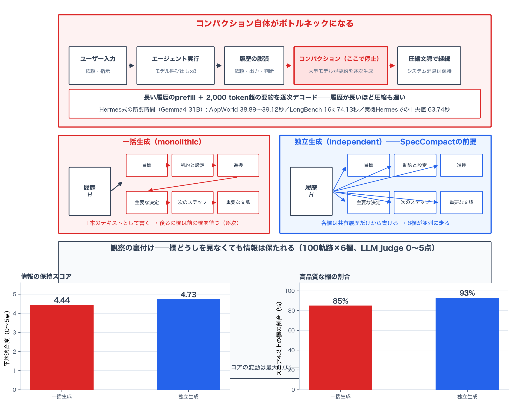
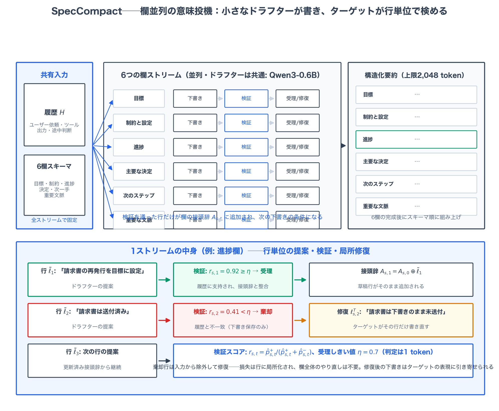
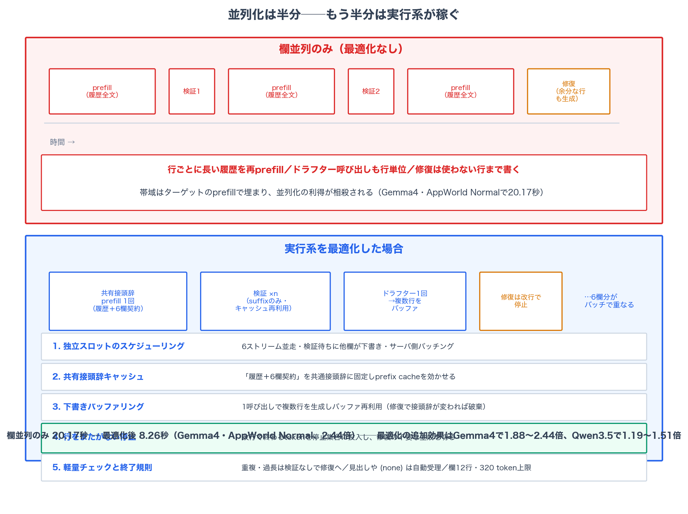
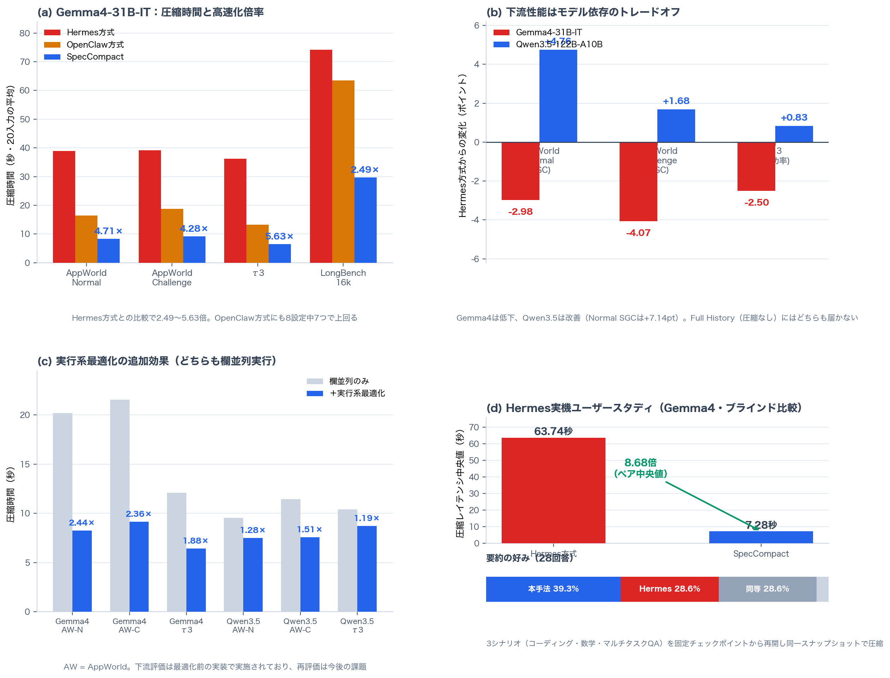

# 要約の欄は互いを見ずに書ける──SpecCompactがスロット並列の意味投機検証でエージェントの文脈圧縮を最大5.6倍速くする仕組み

## TL;DR

長時間稼働するLLMエージェントは、膨らみ続ける対話履歴を「コンパクション」──要約に置き換えて間引く──ことでやり繰りする。だがその要約自体が、長い履歴を大きなモデルでprefillし、2,000 token超のまとめを逐次デコードする重い推論である。履歴が長くなったからこそ圧縮したいのに、圧縮ほど時間がかかるというジレンマが、エージェントとユーザーを待たせる。本論文は、OpenClawやHermesの要約テンプレートが「目標」「制約」「進捗」「決定」「次の一手」「重要な文脈」といった欄（スロット）に分かれていることに着目し、**欄どうしは互いの出力を見なくても、共有履歴から独立に書ける**ことを実証する（独立生成の平均適合度4.73対一括生成4.44、生成順を反転しても±0.03）。この観察を土台にSpecCompactを構築する。0.6Bの小さなドラフターを欄ごとに条件づけて訓練し、6つの欄を並列に下書きする。ターゲットモデルは各行を「履歴に支持されるか、受理済みの内容と整合するか」で1 tokenで検証し、棄却された行はその場で書き直させる。さらに共有接頭辞キャッシュ、下書きバッファリング、行単位の停止といった実行系の最適化を重ねる。AppWorldとτ3の2ターゲットモデルでHermes式要約に対し**2.04〜5.63倍**の圧縮高速化、Hermes本体への組み込みではコンパクション中央値が**63.74秒から7.28秒へ（8.68倍）**。一方で下流タスク性能はモデル依存のトレードオフに留まることを率直に報告する。

- 論文: [SpecCompact: Accelerating LLM Agent Context Compaction with Slot-Parallel Semantic Speculative Verification](https://arxiv.org/abs/2611.06876)（arXiv:2611.06876、2026年11月4日）
- 著者: Yulu An, Yifei Feng, Xiangyang Yin（ニューヨーク大学）
- コード: [github.com/shawnyin128/Speculative-Compaction](https://github.com/shawnyin128/Speculative-Compaction)

## 背景：圧縮こそボトルネック

コンテキストウィンドウが長くなるほど、エージェントは履行すべき仕事の全履歴──ユーザーの依頼、ツールの出力、途中の判断──を文脈に溜め込めるようになった。OpenClawやHermesといったエージェント基盤の標準的な対処は文脈圧縮（compaction）で、古い履歴を構造化された要約に置き換え、後続の行動に必要な情報だけを残す。要約は「目標」「制約と設定」「進捗」「主要な決定」「次のステップ」「重要な文脈」などの欄に分かれて書かれる。

問題は、この圧縮がそれ自体で大きな推論である点だ。ターゲットモデルは長い履歴全体をprefillし、要約をtokenごとに逐次生成する。実測ではHermes方式のコンパクションに数十秒かかる（後述のユーザースタディで中央値63.74秒）。圧縮の必要度が上がるほど──すなわち履歴が長くなるほど──圧縮自体が遅くなる。情報の保持とレイテンシの天秤が、ここに現れる。

投機的デコーディングをそのまま持ち込むのは自然な思いつきだが、相性が悪い。token単位の投機はターゲットモデルの出力分布を保存する代わりに加速する。しかし要約には「正解が一つ」ではない。言い回しが違っても、後続の行動に同じ情報を渡せれば等しく有効だ。分布の保存に縛られると、この自由度を引き換えに損をしている。そこで近年は意味的な投機（semantic speculation）が提案されている──SpecReasonやDREAM-Rは、小さなモデルが書いた推論ステップをターゲットモデルが受理/棄却で判定し、意味が保たれていれば受け入れる。高速だが、1本の要約を逐次に書く以上、順序の縛りは残る。

論文が立てる問いはこうだ。**要約の構造そのものが、並列生成と検証を導けるのではないか。**

## 観察：欄は独立に書ける

OpenClawとHermesのテンプレートは、要約を6つの欄に分ける。Goal、Constraints and Preferences、Progress、Key Decisions、Next Steps、Critical Context。各欄はタスク状態の一面を記述し、共有履歴から直接書けるはずのものだ。しかし1つのテキストとして生成する限り、後ろの欄は前の欄が書き終わるのを待つ。この逐次依存は本当に必要なのか。

著者らは100軌跡（LiveClawBench、1軌跡6欄）で2つの生成方式を比較した。一括生成（monolithic）は6欄を単一の出力として書く。独立生成（independent）は各欄を、他の欄の出力を見ずに同じ履歴から書く。評価はLLM judgeによる適合度スコア（5つの二値基準の和、0〜5点）で行った。

結果は逆転していた。**独立生成の平均スコアは4.73で、一括生成の4.44を上回る。** スコア4以上の欄の割合も93%対85%と独立生成が勝つ。さらに一括生成の欄順を反転しても、独立生成の呼び出し順を変えても、平均スコアの変動は最大0.03に収まる。欄に必要な情報は履歴の中にあり、他の欄の出力にはない──逐次依存は、1本のテキストとして生成するという実装の副産物だったわけだ。

この観察が設計を導く。欄を並列生成の単位とし、検証と修復を欄の中で閉じさせればよい。6欄が独立なら、6本のストリームが同時に走れる。

## 提案手法：SpecCompact

### スロット条件付きドラフティング

ドラフターには独立した小さなモデル──実験ではQwen3-0.6B──を使う。意味的投機では受理判定がターゲットモデルの意味判断に委ねられるため、vanillaな投機的デコーディングと違って**語彙の共有が不要**になる。QwenのドラフターでGemmaのターゲットを加速できる。

訓練はターゲットモデル自身が生成した欄内容に対するSFTだ。履歴 $H$ と欄指示 $c_s$ から欄内容 $y_s$ を書くクロスエントロピーを最小化する。教師はテキストのみで、ターゲットの分布を保存する必要がない。AppWorld・τ3・LiveClawBenchから約5万例（履歴 $T$ 本につき $6T$ 例）を作り、LoRA（rank 16）、学習率 $10^{-4}$、最大系列長16,384で1エポック回す。ターゲットモデルごとに別々のドラフターを訓練する。

推論時は欄ごとに独立したストリームを走らせる。ドラフターは欄 $s$ の受理済み接頭辞 $A_{s,t-1}$ を条件に次の行を提案する：

$$
\tilde{\ell}_{s,t} \sim q_\theta\left(\cdot \mid H,\, c_s,\, A_{s,t-1}\right)
$$

履歴と欄指示は固定で、接頭辞だけが更新されていく。各行は検証を通ってはじめて接頭辞に追加される。

### 意味検証と局所修復

検証はDREAM-Rと同じく二値判定だ。ターゲットモデルは提案された行が (1) 履歴 $H$ に支持されているか、(2) 受理済み接頭辞 $A_{s,t-1}$ と整合するかを判定し、positiveかnegativeかを1 tokenで返す。判定tokenの上位 $k$ 個の確率から正規化受理スコアを計算する。

$$
r_{s,t} = \frac{\hat{p}^{+}_{s,t}}{\hat{p}^{+}_{s,t} + \hat{p}^{-}_{s,t}}
$$

$r_{s,t} \geq \eta$（$\eta = 0.7$）なら受理、そうでなければ棄却だ。ラベルのtoken表現は複数ある（先頭大文字、先行スペースなど）ので各ラベルで最も高い確率を採り、上位 $k$ に現れないラベルには残余確率質を最小返却確率と比較した代替値を当てる──地味だが効く実装の詰めである。

棄却された行のために、ターゲットモデルが**その行だけ**の置き換えを生成する（修復）。入力から棄却された行は除外し、同じ履歴・欄指示・受理済み接頭辞で書き直させる。接頭辞は受理された草稿行かターゲットの置き換え行のどちらかで伸びていく：

$$
A_{s,t} = A_{s,t-1} \oplus \tilde{\ell}_{s,t} \ \text{（受理）} \quad / \quad A_{s,t-1} \oplus \ell^{\mathrm{T}}_{s,t} \ \text{（棄却）}
$$

重要なのは、修復後のドラフティングが**更新済み接頭辞から続く**ことだ。ターゲットが書き直した内容はそのまま次の下書きの条件に入るので、草稿は徐々にターゲットの表現に引き寄せられる。1行書き損ねても欄全体をやり直す必要はなく、損失は局所に留まる。

### 並列だけでは速くならない：実行系の最適化

欄を並列にしても、各行の検証・修復が長い履歴のprefillを繰り返すなら、推論の帯域はターゲット側のprefillで埋まってしまう。SpecCompactの速度のかなりの部分は、地味な実行系の設計が担う。

- **独立スロットのスケジューリング**：6ストリームを並走させ、ある欄がターゲットの検証を待っている間に他の欄が下書きを進める。ドラフターとターゲットの動作が重なり、サーバ側のバッチングも効く。
- **共有接頭辞キャッシュ**：検証・修復の呼び出しはすべて長い履歴を含む。そこで「履歴＋6欄すべての契約」を共通接頭辞として固定し、欄指示・受理済み接頭辞・提案行だけを可変部に置く。先行tokenがスロット・ステップをまたいで不変になるので、prefix cacheの再利用が効く。
- **下書きバッファリング**：行ごとにドラフターを呼ぶとリクエストのオーバーヘッドが効く。1回の呼び出しで複数行を生成して先頭行を検証に出し、残りをバッファに置く。行がそのまま受理されれば、次の行はドラフターを呼ばずに検証に出せる。修復で接頭辞が変わったときだけバッファを捨てて書き直す──バッファの再利用条件は「生成時の接頭辞が現在の接頭辞と完全一致」である。
- **行をまたがない停止**：修復でターゲットが複数行を続けて書いても使われるのは1行だけ。改行で終わるtokenを停止集合に入れ、不要な行の生成を切り捨てる。
- **軽量チェックと終了規則**：重複行や異常に長い行は検証を飛ばして直接修復へ。`#` で始まる見出しや `(none)` のような空欄マーカーは意味検証なしで受理。欄あたり12行・320 token、要約全体で2,048 tokenの上限も設け、反復生成が無限に続かないようにする。

## 実験結果

### セットアップ

ターゲットはGemma4-31B-IT（BF16、1 GPU）とQwen3.5-122B-A10B（FP8、2 GPU）。ドラフターQwen3-0.6Bに1 GPU追加し、vLLM on RTX PRO 6000 Blackwellで供給する。エージェントのモデル呼び出し8回ごとにコンパクションを挟む。評価はAppWorld（Test-Normal/Challengeの全件）、τ3（80タスク×3試行）、ロングコンテキストとしてLongBench（GovReport/QMSum、ROUGE-L）とRULER（8k/16k、公式マッチングスコア）。遅延測定は各ワークロードからマッチした20入力で行う。

### 圧縮レイテンシ：2.04〜5.63倍

Hermes方式との比較で、Gemma4ではAppWorld Normal 38.89秒→8.26秒（4.71倍）、Challenge 39.12秒→9.14秒（4.28倍）、τ3 36.21秒→6.43秒（**5.63倍**）、LongBench 16k 74.13秒→29.72秒（2.49倍）。Qwen3.5では2.04〜2.41倍（エージェント系）、1.36倍（LongBench 16k）と伸びは控えめだ。OpenClaw方式との比較でも8設定中7つで上回る。

Qwen3.5で伸びが小さい理由を論文は3つ挙げる。第一にベースラインの要約が元々速い。第二にモデル格差が大きく、0.6Bドラフターの受理率がGemma4のときより**19.6ポイント低い**。第三にQwen3.5のハイブリッドアテンションではprefix cacheの再利用が限られる──線形アテンション層はチェックポイントからの再帰状態の復元が必要で、テキスト接頭辞が一致してもキャッシュが使えるとは限らない。投機系の速度がサービングスタックの細部に依存する、という重要な実務的観察だ。

### 下流性能：モデル依存のトレードオフ

圧縮が速くなっても、要約の質が落ちては元も子もない。AppWorldのTGC（タスク目標達成率）でHermesと比べると、Gemma4ではNormal −2.98pt、Challenge −4.07pt、τ3 −2.50ptと低下する。ところがQwen3.5ではNormal **+4.76pt**（28.57→33.33）、Challenge +1.68pt、τ3 +0.83ptとむしろ改善し、NormalのSGCに至っては+7.14pt（14.29→21.43）だ。OpenClaw・Hermes両方式をAppWorldで上回る。同じ加速装置でも、下流への効き方はターゲットモデルで変わる。

論文はこの非対称性を深く掘り下げてはいないが、示唆は明確だ。欄条件付きの独立生成と行単位の検証・修復は、単なるHermes要約の高速化ではなく**出力分布を変える変換**である。モノリシックな要約より欄ごとの独立生成のほうが情報の整理が向いているケース（これは動機実験の4.73対4.44と整合する）があり、行単位の修復がターゲットの品質を局所的に注入する。損失のある加速が、ときに品質を上げる。ただしFull History（圧縮なし）にはどの方式も届かない。圧縮が情報を落とす天井は変わらず、SpecCompactが変えるのはその**価格**だ。

ロングコンテキストでは、Qwen3.5でのSpecCompactはTarget-self（ターゲットが欄を直接生成）とLongBenchで0.6点以内、RULER 8k/16kではむしろ上回る。Gemma4では4設定すべてで0.83〜4.50点下回る。ここでもモデル依存が貫徹している。

### 並列化の先：実行系最適化の寄与

両バージョンとも欄並列実行を済ませた上で、実行系の最適化の前後を比べると、Gemma4で1.88〜2.44倍、Qwen3.5で1.19〜1.51倍の追加高速化がある。Gemma4のAppWorld Normalは欄並列だけなら20.17秒だったのが、最適化で8.26秒まで縮む。**並列化は半分にすぎず、残りの半分はprefillの再利用と呼び出し回数の削減**が稼ぐ。速度を語るときにシステムを語らない議論がいかに空虚かを示す好例である。なお下流タスク評価は最適化前の実装で行われており、最適化版での再評価は今後の課題とされている。

### ユーザースタディ：Hermes実機で8.68倍

実運用での体感を測るため、SpecCompactをHermesのコードベースに組み込み、Gemma4を4 GPUで展開した。コーディング・数学・マルチタスクQAの3シナリオを固定チェックポイントから再開し、同一スナップショットに対して両方式で圧縮をトリガー、どちらが速いかをブラインドで選んでもらう。結果、**圧縮レイテンシの中央値は63.74秒から7.28秒へ、ペア中央値で8.68倍**。要約の好みでは28回答中11（39.3%）が本手法、8（28.6%）がHermes、8（28.6%）が同等、1（3.6%）が判断不能と、品質の体感でも遅れを取っていない。

## 考察

この論文の寄与は「速い圧縮アルゴリズム」だけに留まらない。**出力の構造そのものを並列性の資源として読み替えた**点が本質だ。要約テンプレートは可読性のために欄を分けているのであって、並列化のために分けているわけではない。その偶然の構造が、実は依存関係のほとんどを履歴側に持っている──動機実験の順序反転テスト（±0.03）は、この「構造が許す並列性」を安価に検証する方法としても鮮やかだ。マルチセッションRLのMosaicがセッションを信用割当ての単位にしたように、SpecCompactは欄を投機の単位にした。「何を検証の単位にするか」という問いは、PACT（token単位の認証）やSpecAgent（状態変更アクション単位の査読）と同じ文脈に置ける。

同時に、損失のある加速であることの責任を論文は負っている。Gemma4での下流低下（最大−4.07pt）は小さくない。受理率のモデル依存性（19.6ポイント差）が示すように、0.6Bドラフターと122Bターゲットの間の溝は埋めきれない。著者ら自身が、DREAM-R流のRLによるドラフター・ターゲット整列を改善の道として挙げている。もう一つの実務的コストはGPUだ。ドラフター用に1枚追加している。圧縮がボトルネックでなければ、この追加は単なる冗長性になる。

面白いのは将来展望の観察で、欄によって情報の**居場所**が違うという。ProgressとKey Decisionsは文脈全体に散らばった証拠から書かれ、Goal・Constraints・Next Stepsは主に文頭と文末に依拠する。欄条件付きのスライディングウィンドウアテンションでドラフティングをさらに速くできるかもしれない、という提案は、要約の情報局所性という新しい軸を提示している。

## 関連研究

- **token単位の投機的デコーディング**: Leviathan et al.（2023）とChen et al.（2023）が確立した、小さなドラフター＋ターゲット検証による無損失加速。語彙共有と分布保存が前提で、要約の冗長性を活かせない。
- **意味的投機**: SpecReason（Pan et al., 2025）が推論ステップ単位の受理判定を導入し、DREAM-R（Hu et al., 2026）がRLでドラフターを整列しドラフティングと検証を並列化した。SpecCompactはこれをコンパクションに転用し、欄という構造単位で並列性を引き出す。
- **エージェントの文脈管理**: ACON（圧縮ガイドラインの最適化）、ReSum（周期的な軌跡要約）、MEM1・AgentFold・Context-Folding（文脈管理自体を訓練に組み込む）、Slipstream（圧縮をエージェント実行と非同期に重ね、後続ステップで検証）、Cim et al.（入力ブロック単位の並列圧縮）。SpecCompactは生成と検証の高速化に絞っており、非同期化や学習ベースの管理と直交する。
- **本ブログの既報との関係**: Osprey（2026-10-13、ドラフターの事前学習）が「加速する側」の汎化を、SpecAgent（2026-10-18、軌跡単位の投機実行）が「エージェントの帯域」の投機を扱った。SpecCompactはその系譜で「エージェントの文脈整備」を投機の対象にしたものと言える。検証対象の粒度──token（PACT）・行（本論文）・状態変更アクション（SpecAgent）──の選択が各々の核心だった。

## まとめ

SpecCompactは、エージェントの文脈圧縮を欄単位の並列な意味的投機に置き換えた。鍵となった観察は、構造化要約の欄が互いの出力を必要とせず、共有履歴から独立に書けること（適合度4.73対4.44、順序反転±0.03）。0.6Bドラフターが6欄を並列に下書きし、ターゲットが各行を1 tokenで検証・修復する。共有接頭辞キャッシュ、下書きバッファリング、行単位の停止といった実行系の最適化が、並列化の上にさらに1.19〜2.44倍を上乗せする。結果はHermes式要約に対し2.04〜5.63倍の高速化と、実機Hermesでの8.68倍（中央値63.74秒→7.28秒）。下流性能はモデル依存のトレードオフで、Gemma4では数ポイントの低下、Qwen3.5では改善すらある。

「フォーマットは読む人のためにある」──それはそのとおりだが、フォーマットは機械の並列性のためにもある。出力が構造を持つところでは、その構造が許す依存関係を一度疑ってみる価値がある。欄の独立性を確認するのに必要なのは順序を反転して測り直すことだけだ。次にこの問いが効くのは、コード生成のセクション、レポートの章立て、あるいはエージェント間のメッセージかもしれない。

## 参考

- An, Y., Feng, Y., & Yin, X. (2026). SpecCompact: Accelerating LLM Agent Context Compaction with Slot-Parallel Semantic Speculative Verification. [arXiv:2611.06876](https://arxiv.org/abs/2611.06876)
- Leviathan, Y., Kalman, M., & Matias, Y. (2023). Fast Inference from Transformers via Speculative Decoding. ICML 2023.
- Chen, C. et al. (2023). Accelerating Large Language Model Decoding with Speculative Sampling. [arXiv:2302.01318](https://arxiv.org/abs/2302.01318)
- Pan, R. et al. (2025). SpecReason: Fast and Accurate Inference-Time Compute via Speculative Reasoning. [arXiv:2504.07891](https://arxiv.org/abs/2504.07891)
- Hu, Y. et al. (2026). DREAM-R: Multimodal Speculative Reasoning with RL-Based Refined Drafting, Precise Verification, and Fully Parallel Execution. [arXiv:2605.28678](https://arxiv.org/abs/2605.28678)
- Trivedi, H. et al. (2024). AppWorld: A Controllable World of Apps and People for Benchmarking Interactive Coding Agents. ACL 2024.
- Nous Research (2026). Hermes Agent. [github.com/NousResearch/hermes-agent](https://github.com/NousResearch/hermes-agent)
- SpecCompact公式実装: [github.com/shawnyin128/Speculative-Compaction](https://github.com/shawnyin128/Speculative-Compaction)
